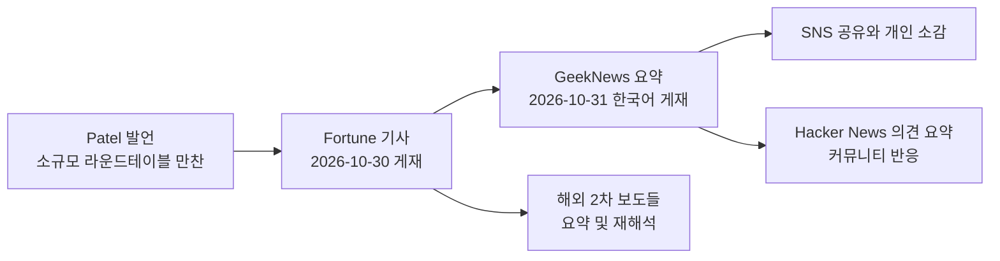
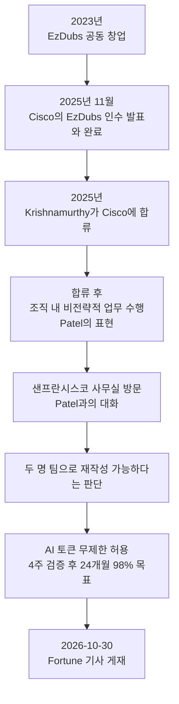
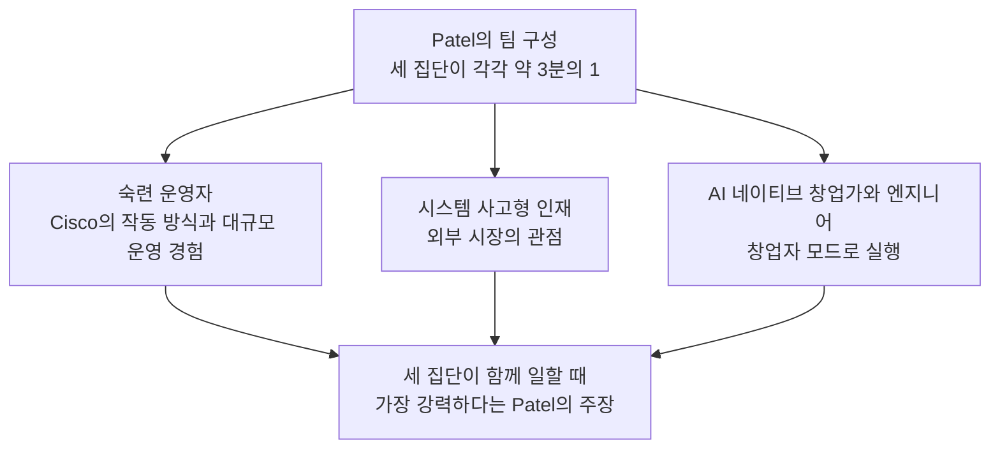
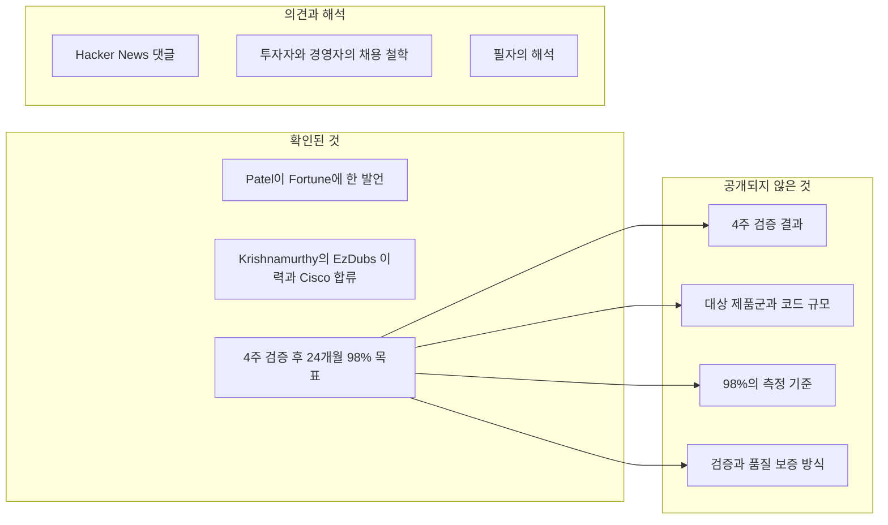

- 작성 기준일: 2026-11-02 (Asia/Seoul)
- 대상 자료: [Fortune 원문](https://fortune.com/2026/10/30/cisco-president-jeetu-patel-gen-z-27-year-old-unlimited-ai-tokens-rewrite-legacy-code-entry-level-jobs/)(2026-10-30 게재), [GeekNews 요약](https://news.hada.io/topic?id=36324)(2026-10-31 게재), 공유된 SNS 게시글, 그리고 관련 후속 보도
- 작성 원칙: 확인된 사실, 당사자 주장, 2차 보도, 커뮤니티 의견, 필자의 해석을 서로 구분해서 적었습니다. 근거가 없는 내용은 "공개되지 않았다"고 명시했습니다.

> Cisco, 27세 엔지니어에게 AI 토큰 무제한 제공하여 레거시 코드 98% 리팩터링 추진
> 
> 엔지니어 Krishnamurthy는 2인 팀으로 코드 재작성이 가능하다고 판단했습니다. 4주 동안 가능성을 검증하고, 24개월 내 레거시 코드의 98%를 리팩터링하는 것이 목표입니다.
> 
> 프로젝트를 맡긴 최고제품책임자 Jeetu Patel은 경력 초기 인재가 기존 관행에 도전하고, 경험이 없는 사람만 할 수 있는 질문을 던질 수 있다고 봅니다. 숙련 운영자, 외부 관점을 가진 인재, AI 네이티브 엔지니어를 함께 배치해 서로 다른 경험과 사고방식을 결합하려 합니다.
> 
> https://www.facebook.com/share/p/1QFHwrziMo/

---

## 1. 먼저 한 문단으로 요약하면

Cisco의 사장 겸 최고제품책임자(CPO)인 Jeetu Patel이, 조직도상 자신보다 다섯 단계 아래에 있던 27세 엔지니어 Padmanabhan "Paddy" Krishnamurthy에게 회사의 대규모 레거시 코드 리팩터링을 맡기고, AI 토큰을 사실상 제한 없이 쓰도록 허용했다는 이야기입니다. Krishnamurthy는 단 두 명으로 이 일을 해낼 수 있다고 말했고, 먼저 4주 안에 가능성을 증명한 뒤 최종적으로 24개월 안에 레거시 코드의 98%를 리팩터링하겠다는 목표를 세웠습니다. 이 일화는 Patel이 가진 더 넓은 인재관, 즉 경력이 짧은 인재가 숙련 직원에게 오히려 새로운 사고방식을 가르칠 수 있다는 생각을 보여 주는 사례로 소개됩니다. 다만 이것은 "목표와 계획"에 대한 보도이며, 4주 검증의 결과나 실제 코드 개선 성과는 아직 공개되지 않았다는 점을 가장 먼저 기억해 두셔야 합니다.

---

## 2. 이 자료들은 어떤 관계인가

공유해 주신 자료는 사실상 하나의 이야기가 여러 단계로 전달된 결과물입니다. 출발점은 Fortune의 Orianna Rosa Royle 기자가 2026년 10월 30일 오전 3시(미국 동부 시간)에 게재한 기사입니다. 이 기사는 Patel이 Fortune 기자들과의 소규모 라운드테이블 만찬에서 한 발언을 바탕으로 작성되었습니다. 그다음 한국의 기술 뉴스 큐레이션 사이트 GeekNews가 이 기사를 AI 기반 요약 코너(GN⁺)에서 한국어로 요약해 2026년 10월 31일 오후에 올렸고, 그 소개가 SNS에서 다시 공유되었습니다. 공유 게시글을 올린 분은 "AI 개발도구를 써 보며 이러면 어떨까 상상만 했는데 이제는 대기업이 먼저 움직이는 시대"라고 적었고, 대기업이라는 타이틀보다는 절박함 때문에 그랬을 것 같다는 개인적 소감을 덧붙였습니다.

여기서 구분이 필요합니다. GeekNews 요약은 Fortune 원문을 줄이고 재배열한 것이고, GeekNews 페이지 아래쪽의 토론 내용은 Hacker News 댓글을 요약해 옮긴 것입니다. 따라서 "무엇이 사실인가"는 Fortune 원문에서 확인해야 하고, 댓글들은 어디까지나 불특정 개인들의 의견과 경험담입니다.

---

## 3. 사건의 전개를 시간 순서로 보기

Fortune에 따르면 Krishnamurthy는 2023년에 실시간 번역 스타트업 EzDubs를 공동 창업했고, Cisco가 이 회사를 인수하면서 2025년에 Cisco에 합류했습니다. 인수 과정은 Cisco 측 자료로도 확인됩니다. TechCrunch는 2025년 11월 17일자 기사로 인수 소식을 전했고, Cisco는 2025년 11월 25일에 인수를 완료했다고 공식 페이지에 밝혔습니다. EzDubs는 통화, 음성 메시지, 문자 등에서 실시간 음성 대 음성 번역을 제공하던 회사였고, 인수 후 소비자용 앱은 12월 15일에 종료된다고 보도되었습니다. 기술은 Cisco의 협업 제품군, 특히 Webex 쪽에 통합될 계획이라고 알려졌습니다.

Fortune이 전하는 바로는, 창업자이자 CEO 경력이 있는 이 인물이 합류 후에는 Patel의 표현으로 "조직 안 어딘가에 묻혀 전략적이지 않은 일을 하고 있었다"고 합니다. 전환점은 Patel이 샌프란시스코 사무실을 방문했을 때 둘이 나눈 대화였습니다. 그 자리에서 Krishnamurthy는 Cisco의 레거시 코드를 두 명짜리 팀으로 다시 쓸 수 있다고 말했고, Patel은 자신의 팀에서 AI에 가장 앞선 사람들조차 그런 방식으로는 생각하지 못했다고 평가합니다. 이후 Patel은 토큰을 마음껏 쓰라고 허용했습니다. Fortune이 옮긴 Patel의 말은 "마음껏 해 보라(go nuts)"는 취지입니다.

---

## 4. 숫자를 하나씩 해부하기

이 기사에서 가장 눈에 띄는 숫자는 세 개입니다. 2인 팀, 4주, 그리고 24개월 안의 98%입니다. 각각이 무엇을 뜻하고 무엇이 아직 모호한지 나누어 보겠습니다.

**2인 팀.** 이것은 Krishnamurthy 본인의 판단입니다. Fortune은 그가 "두 명 팀으로 레거시 코드를 다시 쓸 수 있다고 판단했다"고 전합니다. 즉 사실로 입증된 것이 아니라 당사자의 주장이자 계획입니다. 한편 인도 매체 News Karnataka는 Patel이 X(구 트위터)에 올린 글을 인용해, 이 소규모 팀(두세 명 규모)이 촉매 역할을 하고 이후 Cisco의 핵심 엔지니어링 팀들이 최종 결과물의 소유권을 가져가는 구조를 의도한다고 전했습니다. 이 내용은 2차 보도이고 저는 원 게시글을 직접 확인하지 못했으므로, "그렇게 보도되었다" 수준으로만 받아들이시길 권합니다.

**4주.** Fortune 문장의 주어는 문맥상 Krishnamurthy 쪽으로 읽히며("스스로 4주를 정했다"), GeekNews 요약도 같은 방식으로 옮겼습니다. 반면 일부 2차 매체는 Patel이 4주를 주었다고 표현했습니다. 누가 기한을 정했는지는 매체마다 달라서, 이 글에서는 "4주 안에 가능성을 증명하기로 했다"까지만 확정적으로 적습니다.

**24개월 안의 98%.** 최종 목표입니다. 여기서 중요한 한계가 있습니다. Fortune 보도에는 어떤 제품군의 코드가 "레거시"에 해당하는지, 코드 규모가 몇 줄인지, 98%를 어떤 기준(줄 수, 모듈 수, 제품 수)으로 셀 것인지가 나와 있지 않습니다. 또 새로 쓰는 대상 언어가 무엇인지도 Fortune 본문에는 없습니다. 다만 News Karnataka는 Patel이 메모리 안전 언어로의 이전에 관심을 둔다고 전했는데, 이것도 2차 보도이므로 확정된 사양으로 보시면 안 됩니다.

용어도 짚어 둘 필요가 있습니다. Fortune 제목은 "코드를 업그레이드한다(upgrading)"이고 본문은 "리팩터링"이라고 쓰면서, 한 곳에서는 "다시 쓴다(rewrite)"는 표현도 씁니다. 엄밀히 리팩터링은 외부 동작을 바꾸지 않고 내부 구조를 개선하는 것이고, 재작성은 새로 쓰는 것입니다. 보도들이 두 용어를 섞어 쓰고 있어서, 실제로 어느 수준의 작업을 뜻하는지는 아직 알 수 없습니다.

| 항목 | 보도된 내용 | 확인 수준 |
|---|---|---|
| 대상 인물 | 27세 Padmanabhan "Paddy" Krishnamurthy | Fortune 원문, 다수 2차 보도 일치 |
| 지원 수준 | AI 토큰 무제한 | Patel의 발언으로 Fortune이 전함. 실제 한도나 비용은 비공개 |
| 팀 규모 | 두 명(Krishnamurthy의 판단) | 당사자 주장 |
| 검증 기간 | 4주 | 기한을 정한 주체는 매체별로 표현이 다름 |
| 최종 목표 | 24개월 내 레거시 코드 98% 리팩터링 | 목표일 뿐 성과는 비공개 |
| 대상 범위 | 어떤 제품, 몇 줄, 어떤 기준인지 | 공개되지 않음 |
| 4주 검증 결과 | 없음 | 공개되지 않음 |

---

## 5. Patel의 인재론: "경험 없는 질문"과 "생산적인 긴장"

기사의 후반부는 코드 이야기라기보다 사람 이야기입니다. Patel의 논리는 대략 이렇게 정리됩니다.

첫째, 대규모 프로젝트를 수십 년 경력자에게만 맡기는 관행이 문제라고 봅니다. 신입이나 경력 초기 인재를 뽑지 않으면 새로운 아이디어가 조직에 들어올 통로가 사라지고, 현상 유지에 도전하기 어려워진다는 것입니다. 그는 숙련된 직원도 새로운 아이디어를 낼 수 있다는 점은 인정하면서, 다만 경험이 전혀 없는 사람만 던질 수 있는 종류의 질문이 있다고 말합니다.

둘째, 숙련 직원과 Z세대가 같은 방에서 일할 때 생기는 마찰을 의도적으로 장려합니다. 다만 그는 사람이나 성격 사이의 충돌이 아니라 아이디어를 둘러싼 긴장을 말한다고 선을 긋습니다. 이 긴장이 가능하려면 서로 신뢰할 수 있어야 하고, 그 신뢰 위에서 스스로 "비합리적일 만큼 높은" 목표를 세우도록 요구한다고 설명합니다.

셋째, 인턴을 단순 업무 담당이 아닌 일종의 역멘토로 대합니다. 기사에는 Stanford의 17~18세 장학생 대상 강연에서 만난 학생 Baya의 이야기가 나옵니다. 다른 학생들이 질문하는 동안 한쪽에서 듣기만 하다가 모두가 끝난 뒤에야 다가온 학생이었고, Patel은 AI에 대해 배운 것을 매달 이메일로 보내 달라고 요청해 약속을 지키는 사람인지 시험했습니다. 그녀는 한 번도 빠뜨리지 않았고, 이후 Cisco 인턴으로 들어와 숙련 직원들이 풀지 못했던 "무언가"를 재설계했다고 합니다. 그 대상이 무엇인지는 기사에 나오지 않습니다. Patel은 그녀를 데이터 입력이나 잡무를 시키려고 데려온 것이 아니라 기존 직원들이 완전히 다르게 생각하도록 가르치게 하려고 데려왔다고 말하며, 이제는 정식 채용을 원한다고 합니다.

넷째, 자신의 팀을 대략 세 집단이 3분의 1씩 차지하도록 구성했다고 합니다. 첫 번째는 Cisco가 어떻게 돌아가는지 아는 숙련 운영자, 두 번째는 시장 바깥에서 와서 외부의 시선을 가져오는 시스템 사고형 인재, 세 번째는 창업자 모드로 일하는 AI 네이티브 창업가와 엔지니어입니다. 그는 어느 한 집단만으로는 세 집단이 함께 일할 때만큼 강력하지 않다고 말합니다.

여기서 한 가지 눈여겨볼 점이 있습니다. Patel이 "젊은 인재만 쓰자"고 말한 것은 아니라는 사실입니다. 그의 구성안에서도 숙련 운영자는 3분의 1을 차지하며, 핵심은 경험과 사고방식의 결합입니다. 그래서 제목만 보고 "대기업이 시니어를 버리고 청년에게 맡겼다"고 읽으면 기사의 의도와 다릅니다.

---

## 6. 같은 흐름에 있는 다른 목소리들

Fortune은 Patel 외에도 경험이 적은 인재를 의도적으로 찾는 인물을 세 명 더 소개합니다.

Thrive Capital 창업자 Josh Kushner는 업계 경력 4년 미만의 인재를 선호한다고 합니다. 26세에 회사를 세웠을 때 숙련된 연장자를 영입하라는 압박을 받았지만, 능력 있는 경력자가 26세 창업자 밑에서 일하고 싶어 하지 않을 것이라고 판단해 자신이 아는 가장 똑똑한 또래를 모았다고 설명합니다. Fortune은 이 회사가 OpenAI 등에 초기 투자했다고 전하고, OpenAI가 기사 시점에 1조 2,500억 달러 가치로 최대 300억 달러를 조달하는 중이라고 적었습니다.

생성형 AI 플랫폼 Tastewise의 창업자 겸 CEO Alon Chen은 경력이 없는 Z세대를 적극적으로 채용한다고 합니다. 이유로 그들이 세상을 생각하는 방식에 경계와 한계가 없고, AI 시대에 나고 자란 사실상의 AI 네이티브라는 점을 듭니다. Black Eyed Peas의 Will.i.am은 투자자로서 MIT와 Stanford의 젊은 혁신가들에게서 다음 기술 돌파구가 나올 것이라고 보고, 지금은 그들을 찾는 데 집중한다고 말합니다.

이 사례들을 읽을 때 균형 있게 봐야 할 점이 있습니다. 이들은 모두 자신의 채용 철학이나 투자 철학을 밝힌 것이지, 청년 중심 채용이 성과를 낸다는 데이터를 제시한 것이 아닙니다. 또 이 인물들은 투자자이거나 기업 경영자라서 이런 이야기를 공개적으로 하는 데 이해관계가 있을 수 있습니다. 이 부분은 필자의 해석이며, 사실로 확인된 것은 "그들이 그렇게 말했다"는 데까지입니다.

---

## 7. 기사가 깔아 둔 배경: "신입 일자리가 사라진다"는 40%

Fortune 기사는 첫 문단에서 신입 일자리가 줄고 있고, 고용주 약 40%가 AI가 더 싸게 일을 한다는 이유로 대졸 신입 채용을 줄일 계획이라고 말합니다. 이 숫자에는 영국 매체 People Management 기사 링크가 걸려 있습니다. 저는 해당 페이지를 직접 열어 보지 못했기 때문에 표본, 조사 시기, 질문 문항을 확인하지 못했습니다. 따라서 "약 40%"라는 수치 자체는 Fortune이 인용한 것으로만 전달합니다.

대신 같은 주제를 다룬 다른 조사들을 확인해 보면, 수치가 조사마다 크게 다릅니다.

| 조사 | 시기와 표본 | 주요 수치 |
|---|---|---|
| ResumeTemplates.com | 2026년 7월 보도. 미국 직원 101명 이상 기업의 채용 담당자 1,000명 | 48%가 신입을 뽑아 키우기보다 AI 도구에 투자하겠다고 응답. 2026년 졸업생을 지난해보다 적게 뽑겠다는 응답 18%, 아예 안 뽑겠다 5%(합계 23%), 같은 수준 48%, 더 뽑겠다 17%, 미정 12% |
| Strada Education Foundation | 2026년 3월 조사. 미국 기업 임원과 인사 담당자 약 1,500명(5월 보도) | 응답자의 40% 이상이 AI 덕분에 신입이 단순 업무가 아니라 더 복잡하고 분석적인 핵심 업무로 바로 들어갈 수 있다고 응답 |

이 두 조사는 서로 방향이 다릅니다. 하나는 AI가 신입 채용을 대체한다는 신호를, 다른 하나는 AI가 오히려 신입의 역할을 상향시킨다는 신호를 보여 줍니다. 또 ResumeTemplates 조사는 자기 보고 방식이라 실제 고용 기록이 아니라는 한계가 있다고 해당 보도가 직접 밝힙니다. 결론적으로 "신입 채용이 확실히 줄고 있다"는 단정은 이 자료만으로는 어렵고, "AI를 둘러싼 채용 인식이 갈리고 있다"가 더 정확한 표현입니다.

---

## 8. Cisco라는 회사의 맥락

이 프로젝트가 어떤 회사에서 벌어지는지 알면 이해가 쉬워집니다. 2026년 5월 14일 TechCrunch와 여러 매체는 Cisco가 전체 인력의 약 5%에 해당하는 4,000명 미만의 감원을 발표했다고 보도했습니다. 같은 날 발표된 2026 회계연도 3분기 실적은 매출 158억 달러로 사상 최대였고, 전년 동기 대비 12% 증가였습니다. 회사는 구조조정 비용으로 세전 최대 10억 달러를 예상한다고 밝혔고, CEO Chuck Robbins는 AI 시대에 맞춰 투자를 실리콘, 광통신, 네트워킹, 사이버 보안 같은 영역으로 옮기는 것이라고 설명했습니다. TechCrunch는 이 기사에서, Cisco가 사이버 보안 투자를 늘리겠다고 한 배경에 라우터와 방화벽의 보안 취약점 문제가 있다는 점도 짚었습니다. 한편 2차 보도 중에는 이번 코드 프로젝트와 감원을 연결 짓는 곳이 있지만, 예컨대 Pasquale Pillitteri의 기사는 Cisco가 둘을 연결해 언급한 적이 없다고 밝힙니다. 즉 둘의 인과관계는 공개적으로 확인된 바가 없습니다.

Patel의 AI 코딩 기조는 이전에도 있었습니다. 2025년 6월 The Register 보도에 따르면 Patel은 Cisco Live 행사 전 기자 Q&A에서 약 27,000명 규모의 엔지니어링 조직이 직접 작성하는 코드의 양을 절반으로 줄이도록 하고 싶다며, 에이전트형 AI 동반자를 만들겠다고 말했습니다. 당시 그는 Cisco가 엔지니어링 자원이 제약되어 있어 모든 아이디어를 제품화하지 못한다고도 인정했습니다. 이번 일화는 그 흐름의 연장선으로 읽을 수 있습니다.

---

## 9. 커뮤니티의 반응: 기대와 우려가 함께 나온 이유

GeekNews는 Hacker News에 달린 의견을 요약해 소개합니다. 아래는 그중 대표적인 흐름이며, 모두 익명 개인의 경험이나 의견이므로 사실로 검증된 것이 아닙니다.

긍정적인 쪽에서는 개인 경험담이 많았습니다. 오래된 ColdFusion 사이트를 Claude Code로 Java Spring으로 옮겼는데 약 5만 줄 규모를 혼자 일주일 정도의 틈틈이 작업으로 마쳤다는 사례, 20년 된 임베디드 시스템을 약 3개월 만에 재작성하고 문서화했다는 사례, 오래된 FoxPro 프로그램을 역공학해 일주일 만에 원본과 거의 같은 결과를 얻었다는 사례 등이 올라왔습니다. 언어 간 이식은 AI가 잘하는 작업이라는 의견도 있었습니다.

우려하는 쪽의 논점은 대체로 "작성은 쉬워졌지만 검증은 여전히 어렵다"로 모입니다. 구체적으로는 다음과 같습니다. 레거시 코드에서는 버그가 시간이 지나며 사실상 기능이 되어 있는 경우가 있어 신구 버전의 동작이 같은지 확인하기 어렵다는 지적, 자동화 테스트가 있다고 해도 그 테스트 코드를 누가 읽고 검증했느냐는 질문, 코드를 이해하지 못한 채 재작성하면 실행 환경 차이(예: 단일 스레드에서 다중 스레드)로 보안 문제가 생길 수 있다는 지적, 그리고 재작성한 코드는 결국 원저자가 없는 코드가 되어 유지보수가 또 다른 문제가 된다는 지적입니다. Cisco의 과거 보안 취약점 이력을 언급하며 이번 시도가 그 흐름을 바꿀지 회의적으로 보는 의견도 있었습니다. 한편 한 댓글은 리팩터링 과정에서 AI가 무엇을 왜 바꿨는지 기록하게 하자고 제안했고, 아키텍처 결정 기록(ADR) 같은 형식을 활용하자는 답글이 이어졌습니다.

이 논의는 기사 자체가 던지지 않은 질문을 대신 던진다는 점에서 의미가 있습니다. 기사는 "누가, 얼마나 자유롭게 시도하는가"에 초점을 맞췄지만, 커뮤니티는 "결과를 어떻게 믿을 수 있는가"를 물었습니다.

---

## 10. 무엇이 확인되었고 무엇이 아닌가

정리하면 확인된 것은 "누가 무엇을 하겠다고 했는가"까지이고, 성과와 방법론은 아직 비어 있습니다. 이 구분을 놓치면 "Cisco가 98%를 AI로 바꿨다"처럼 사실보다 앞서가는 문장이 만들어집니다. 실제로 Fortune 제목의 "지금 98%를 업그레이드하고 있다(now he's upgrading 98% of its code)"는 현재진행형 표현이라 이미 상당 부분이 진행된 것처럼 읽히기 쉽지만, 본문은 목표와 4주 검증 계획을 말하고 있을 뿐입니다. GeekNews 요약이 "아직 검증에 나선 계획으로, 목표 달성 여부나 실제 개선 결과는 공개되지 않음"이라고 명시한 것이 정확한 읽기입니다.

---

## 11. 필자의 해석: 이 일화를 어떻게 읽을 것인가

아래는 사실 보도가 아니라 해석입니다. 근거는 앞에서 확인한 내용과 일반적인 소프트웨어 공학의 관점입니다.

**첫째, "토큰 무제한"의 메시지는 비용 정책보다 허가의 신호에 가깝습니다.** 보도에서 확인되는 것은 Patel이 한도에 신경 쓰지 말고 시도하라고 했다는 점입니다. 실제 운영에서 한도가 정말 없는지, 비용이 어디에 귀속되는지는 알려지지 않았습니다. 그래서 이 문구는 "예산 승인"보다는 "실험을 방해하지 않겠다"는 조직적 신호로 읽는 편이 안전합니다.

**둘째, 레거시 현대화에서 병목은 코드를 쓰는 속도가 아니라 동작의 동일함을 증명하는 일일 가능성이 큽니다.** 이는 커뮤니티 의견이 공통으로 가리키는 지점이고, 일반적인 리팩터링 원칙과도 맞습니다. 리팩터링은 정의상 외부 동작을 유지해야 하므로, 기존 동작을 기록하는 특성화 테스트, 신구 버전의 병행 실행 비교, 단계적 전환과 같은 장치가 성패를 가릅니다. Cisco가 이런 장치를 어떻게 설계하는지는 공개되지 않았으므로, 이 부분이 4주 검증에서 가장 중요한 관전 포인트일 것입니다.

**셋째, 소유권의 문제가 있습니다.** News Karnataka가 전한 Patel의 설명대로 소규모 팀이 촉매가 되고 핵심 엔지니어링 팀이 결과물을 넘겨받는 구조라면, 기술적 성과만큼이나 조직 내 인수인계가 성패를 좌우할 것입니다. 이 구조가 실제로 어떻게 운영되는지는 확인되지 않았습니다.

**넷째, 이 이야기는 AI 코딩 도구의 역량 입증 사례가 아니라 조직이 그것을 시도하도록 허락한 사례입니다.** 한국어 공유 게시글이 "대기업이 먼저 움직이는 시대"라고 느낀 것도 같은 맥락일 것입니다. 다만 한 기업이 시도를 공개했다는 사실과 그 시도가 성공했다는 사실은 별개입니다. 실무자가 가져갈 만한 교훈이 있다면 결과 숫자가 아니라 구조, 즉 작은 팀에 명확한 목표와 기한을 주고, 도구 사용의 마찰을 없애고, 4주라는 짧은 검증 구간을 먼저 두는 방식입니다.

---

## 12. 앞으로 지켜볼 지표

보도가 처음 나온 시점에 확정된 것이 적기 때문에, 이후 정보가 나오면 다음 항목을 확인하시길 권합니다. 먼저 4주 검증 결과가 공개되는지, 공개된다면 어떤 대상과 어떤 지표로 측정했는지입니다. 둘째는 "레거시 코드"의 범위와 98%의 정의입니다. 셋째는 신구 코드의 동작 동일성을 어떻게 검증하는지, 그리고 보안 취약점 감소 같은 효과를 어떤 방식으로 측정하는지입니다. 넷째는 핵심 엔지니어링 팀으로의 이전이 실제로 이루어지는지입니다. 마지막으로 Cisco가 이 프로젝트를 공식 채널에서 직접 설명하는지, 아니면 계속 임원 발언과 2차 보도에 의존하는지도 신뢰도를 판단하는 데 도움이 됩니다.

---

## 13. 용어 정리

**레거시 코드**는 오래되어 유지보수가 어렵지만 여전히 운영 중인 코드를 뜻합니다. **리팩터링**은 외부에서 보이는 동작을 바꾸지 않고 내부 구조를 개선하는 작업이고, **재작성**은 같은 기능을 새로 구현하는 작업입니다. **토큰**은 AI 모델이 처리하는 텍스트의 단위로, 사용량과 비용이 토큰 수에 따라 정해지는 경우가 많습니다. **역멘토링**은 경력이 짧은 구성원이 숙련 구성원에게 새로운 기술과 관점을 가르치는 방식입니다. **메모리 안전 언어**는 버퍼 오버플로나 해제 후 사용 같은 메모리 관련 오류를 구조적으로 줄이도록 설계된 프로그래밍 언어를 가리킵니다.

---

## 14. 참고 자료

접근일은 모두 2026-11-02입니다. 신뢰도는 1차(원문·공식), 2차 보도, 커뮤니티 의견으로 구분했습니다.

| 구분 | 자료 | 용도 |
|---|---|---|
| 1차(원문) | Fortune, "Cisco chief found a 27-year-old ex-founder 'buried away in the organization doing something unstrategic'—now he's upgrading 98% of its code", Orianna Rosa Royle, 2026-10-30. https://fortune.com/2026/10/30/cisco-president-jeetu-patel-gen-z-27-year-old-unlimited-ai-tokens-rewrite-legacy-code-entry-level-jobs/ | 사건의 핵심, 발언, 인물 |
| 요약 | GeekNews, "Cisco, 27세 엔지니어에게 AI 토큰 무제한 제공하여 레거시 코드 98% 리팩터링 추진", 2026-10-31. https://news.hada.io/topic?id=36324 | 한국어 요약과 Hacker News 의견 요약 |
| 1차(공식) | Cisco, EzDubs 인수 완료 페이지(2025-11-25). https://www.cisco.com/site/us/en/about/corporate-development/acquisitions/ezdubs/index.html | 인수 완료 시점과 EzDubs 설명 |
| 2차 | TechCrunch, "Cisco acquires translation startup EzDubs", 2025-11-17. https://techcrunch.com/2025/11/17/cisco-acquires-translation-startup-ezdubs/ | 인수 발표 보도 |
| 2차 | TechCrunch, "Cisco cuts nearly 4,000 jobs to spend more on AI, reports 'record quarterly revenue'", 2026-05-14. https://techcrunch.com/2026/05/14/cisco-cuts-nearly-4000-jobs-to-spend-more-on-ai-reports-record-quarterly-revenue/ | 감원과 실적 배경 |
| 2차 | KTVU, "Cisco to cut thousands of jobs as CEO signals 'hard decisions' in AI race", 2026-05-14. https://www.ktvu.com/news/cisco-layoffs-ai-push | 실적 수치와 구조조정 비용 |
| 2차 | The Register, "Cisco president says dredging coding syntax from wetware memory wastes engineers' expensive synapses", 2025-06-10. https://www.theregister.com/2025/06/10/cisco_wants_ai_coding_assistants/ | Patel의 이전 AI 코딩 기조 |
| 2차 | News Karnataka, "Cisco's Jeetu Patel backs unlimited AI for Gen Z", 2026-11-01. https://newskarnataka.com/technology/ciscos-jeetu-patel-backs-unlimited-ai-for-gen-z/01112026/ | Patel의 X 게시글을 인용한 촉매 팀 구상, 메모리 안전 언어 언급(원 게시글 미확인) |
| 2차 | Datafloq, "Cisco Gives a Former Startup Founder an AI Budget With No Ceiling". https://datafloq.com/cisco-gives-a-former-startup-founder-an-ai-budget-with-no-ceiling/ | 공개되지 않은 범위와 refactor와 rewrite 용어 문제 지적 |
| 2차 | Pasquale Pillitteri, "Cisco reveals unlimited AI tokens for a 27-year-old to rewrite 98% of its code". https://pasqualepillitteri.it/en/news/28934/cisco-unlimited-ai-tokens-27-year-old-legacy-code | 감원과 프로젝트를 Cisco가 연결하지 않았다는 점 |
| 조사 | ResumeTemplates.com 2026년 졸업생 채용 보고서(HR Dive 등 보도). https://www.hrdive.com/news/new-grads-have-to-compete-with-ai-for-entry-level-roles/825810/ | 신입 채용과 AI에 대한 미국 채용 담당자 설문 |
| 조사 | Strada Education Foundation 설문 보도(Fn News, 2026-05-21). https://en.fnnews.com/news/202605200440134295 | 신입의 역할 상향에 대한 반대 방향의 신호 |
| 커뮤니티 | Hacker News 토론(GeekNews가 요약). https://news.ycombinator.com/item?id=50304122 | 커뮤니티 의견(검증되지 않은 개인 경험담 포함) |

> 한계: Fortune 기사가 인용한 People Management의 40% 조사 원문, Patel의 X 게시글 원문, 공유 SNS 게시글 원문은 직접 열어 확인하지 못했습니다. 해당 부분은 인용 또는 2차 보도로만 표시했습니다. 위 Hacker News 링크는 GeekNews 페이지에 표기된 주소를 그대로 옮긴 것입니다.

---

작성 일자: 2026-11-02
