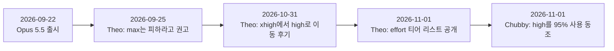
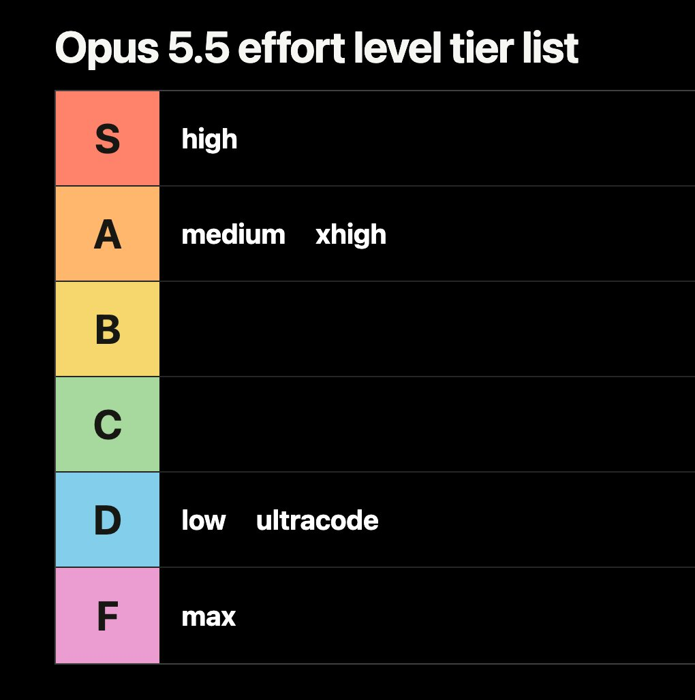
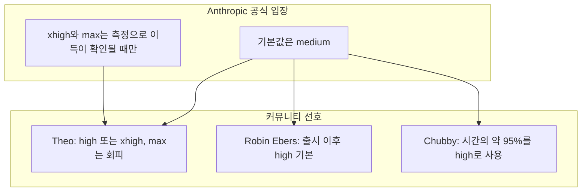
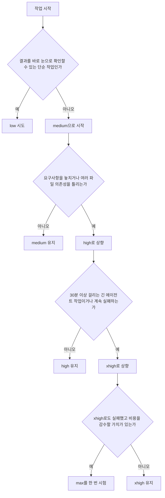

- 작성 일자: 2026-11-02
- 대상 게시물: Theo([@theo](https://x.com/theo/status/2116687937727586812))의 Opus 5.5 effort 레벨 티어 리스트와 이를 인용한 Chubby([@kimmonismus](https://x.com/kimmonismus/status/2116829097200599296))의 게시물, 그리고 그 배경이 되는 Opus 5.5의 effort 설정 전반

---

## 0. 한눈에 보기

이 게시물들은 한 문장으로 요약하면 **"Claude Opus 5.5를 쓸 때 추론 강도(effort)를 어디에 맞추는 것이 가장 이득인가"** 에 대한 개발자 커뮤니티의 토론입니다. 유명 개발 콘텐츠 제작자인 Theo는 2026년 10월 31일에 "예전에는 extra high(xhigh)를 쓰다가 한두 주 전에 high로 내렸는데, 거의 항상 더 낫다"는 취지의 글을 올렸고, 이튿날 이를 티어 리스트로 정리했습니다. 그 결과는 **high가 S, medium과 xhigh가 A, low와 ultracode가 D, max가 F** 였습니다. 다음 날 Chubby가 이를 인용하며 "출시 이후 시간의 약 95%를 high로 썼고, 지능 대비 효율의 가장 좋은 지점이라고 생각한다"고 동조했습니다.


여기서 꼭 알아 두어야 할 점이 세 가지 있습니다.

1. 이 티어 리스트는 **공식 평가가 아니라 개인의 의견**이며, 다만 비용·속도·정확도 수치로 어느 정도 뒷받침되는 의견입니다.
2. Anthropic의 공식 기본값은 high가 아니라 **medium** 입니다. 커뮤니티가 high를 선호하는 것은 공식 권장과 약간 결이 다릅니다.
3. 티어 리스트의 **ultracode는 effort 레벨이 아니라 Claude Code의 별도 설정**입니다. 이 사실을 모르면 리스트를 오해하기 쉽습니다.

---

## 1. 게시물들은 어떤 내용인가

### 1-1. 시간 순서로 보는 흐름



### 1-2. 첫 번째 게시물: Theo의 "xhigh에서 high로 옮겼다" (2026-10-31)

>
> Julius convinced me to move from extra high to high on Opus 5.5 a week or two ago. He was right. This is better almost all of the time.
>
> https://x.com/theo/status/2116420089411145913
>

Theo는 Opus 5.5에서 effort를 extra high(xhigh)에서 high로 낮추라는 Julius라는 사람의 설득을 받아 한두 주 전부터 실제로 바꿔 써 보았고, 결과적으로 그의 말이 맞았으며 거의 모든 경우에 high가 더 낫다고 적었습니다. 이 글은 약 55만 회의 조회, 답글 374개, 재게시 108개, 좋아요 약 5,500개, 북마크 677개를 기록하며 크게 퍼졌습니다. (조회수 등은 게시물 화면에 표시된 수치입니다.)

대표적인 반응은 Robin Ebers의 답글입니다. 그는 출시 이후 줄곧 high를 기본으로 써 왔고, max는 아주 드물게만 쓰며, 그 외의 레벨은 전혀 쓰지 않는다고 답했습니다. 이에 Theo는 "max is just bad tbh"라고 짧게 덧붙였습니다. 즉 max는 그냥 별로라는 뜻입니다.

### 1-3. 두 번째 게시물: 티어 리스트 (2026-11-01)

Theo는 같은 주제를 "Opus 5.5 effort level tier list"라는 제목의 표로 만들었습니다. 내용은 다음과 같습니다.




| 티어 | 항목 |
|------|------|
| S | high |
| A | medium, xhigh |
| B | (비어 있음) |
| C | (비어 있음) |
| D | low, ultracode |
| F | max |

B와 C 티어가 비어 있다는 점이 눈에 띕니다. "쓸 만한 것은 확실히 쓸 만하고, 아닌 것은 확실히 아니다"라는 의견이 표 구조에도 드러납니다.

### 1-4. 세 번째 게시물: Chubby(@kimmonismus)의 인용 (2026-11-01 18:46)

Chubby는 이 티어 리스트를 인용하며, 출시 이후 약 95%의 시간을 high 추론으로 사용해 왔고 high가 지능과 효율의 균형이 가장 좋은 지점이라고 평했습니다. 약 2만 4천 회의 조회를 기록했습니다.

### 1-5. 확인 범위에 대한 안내

요청하신 링크(`x.com/kimmonismus/status/2116829097200599296`)는 X 쪽이 자동 접근을 막아 본문을 직접 열 수 없었습니다. 따라서 위 1-2~1-4의 내용은 첨부해 주신 게시물 화면에 표시된 글과 수치, 그리고 검색으로 확인되는 Theo의 이전 게시물을 근거로 정리했습니다. 게시물 문구는 저작권을 고려해 의역했습니다.

> 
> since launche ive used Opus 5.5 in high reaoning for probably 95% of the time. I think its the perfect sweet spot in the intelligence-efficency ratio.
> 
> https://x.com/kimmonismus/status/2116829097200599296
> 

---

## 2. 배경 지식: Effort란 무엇인가

### 2-1. 개념

Effort는 모델이 답하기 전, 그리고 도구를 쓰는 단계 사이사이에 **얼마나 오래, 깊이 생각할지**를 정하는 다이얼입니다. 낮추면 빠르고 저렴하며, 높이면 어려운 문제에서 더 깊이 추론합니다.

중요한 사실은 **Opus 5.5에서는 사고(thinking)를 아예 끌 수 없다**는 점입니다. 사고를 끄려는 요청은 400 오류를 돌려주며, 대신 effort로 사고량을 조절합니다.

### 2-2. 다섯 단계

Opus 5.5가 받아들이는 effort는 low, medium, high, xhigh, max의 다섯 단계입니다. API에서는 `output_config.effort` 값으로 지정하고, Claude Code에서는 `/effort` 명령이나 `--effort` 옵션으로 지정합니다.

| 레벨 | 성격 | 공식 문서와 해설이 말하는 적합한 용도 |
|------|------|------|
| low | 사고를 최소화, 단순 작업에서는 건너뛰기도 함 | 결과를 바로 확인할 수 있는 짧고 기계적인 작업 |
| medium | 균형 잡힌 접근, 적당한 토큰 절약 | 대부분의 일상 코딩, 문서 작성, 분석 (Opus 5.5의 기본값) |
| high | 매 턴 더 깊은 사고 | 여러 파일에 걸친 변경, 신중한 분석, 세 번 시도해도 실패한 문제 |
| xhigh | 장시간 작업에 적합 | 긴 에이전트 작업, 어려운 디버깅 (Anthropic이 Terminal-Bench 4.0 점수에 사용) |
| max | 사고량에 제약 없음 | 되돌리기 어려운 결정 등 정확성이 비용보다 중요한 소수의 경우 |

### 2-3. 알아 두면 좋은 사실들

- **기본값이 한 칸 내려갔습니다.** Opus 5와 이전 Opus는 high가 기본이었지만, Opus 5.5는 medium이 기본입니다. 그래서 effort를 지정하지 않고 Opus 5에서 Opus 5.5로 옮기면 자동으로 한 단계 낮은 설정으로 돌아가게 됩니다.
- **Anthropic의 주장:** 자사 테스트에서 Opus 5.5의 medium은 코딩과 지식 노동 평가에서 Opus 5의 high와 같거나 더 낫다고 합니다. 그래서 기본값을 medium으로 잡았습니다.
- **같은 이름이라도 같은 양이 아닙니다.** Anthropic 문서에 따르면 effort 눈금은 모델마다 따로 보정됩니다. 같은 레벨에서 Opus 5.5는 Opus 5보다 턴당 더 많이 생각하며, 특히 xhigh와 max에서 그 차이가 큽니다. 따라서 Opus 5에서 쓰던 "high"를 그대로 가져오면 느낌이 달라질 수 있습니다.
- **단가는 같고 토큰 수가 다릅니다.** 레벨이 달라도 토큰당 단가는 같습니다. 비용은 모델이 만들어 내는 토큰 수, 즉 사고량에서 갈립니다. Opus 5.5의 API 가격은 입력 100만 토큰당 4달러, 출력 100만 토큰당 20달러입니다(Opus 5는 5달러, 25달러).
- **Opus 5.5는 2026년 9월 22일에 출시되었습니다.** Claude 5.5 계열의 첫 모델이며 API 모델 ID는 `claude-opus-5-5` 입니다. Claude Code에서 쓰려면 v2.1.280 이상이 필요합니다.

---

## 3. 티어 리스트를 한 칸씩 읽기

### 3-1. S 티어: high

high가 1위를 차지한 이유는 "성능은 충분히 올라가는데 비용과 시간은 아직 폭증하지 않는 지점"이기 때문입니다. 근거가 되는 자료는 다음과 같습니다.

- Artificial Analysis(독립 평가 기관)의 지능 지수에서 Opus 5.5는 low 42, medium 51, high 54, xhigh 56, max 58점을 기록했습니다. medium에서 high로 갈 때는 약 3점이 오르는 대신 비용이 약 36% 늘어납니다.
- 한 테스트에서는 같은 게임 제작 프롬프트에 medium이 52초, 0.56달러, high가 1분 50초, 0.75달러였습니다. 이 테스트를 진행한 사이트는 high가 "medium보다 34% 비싸지만 눈에 띄게 더 나은 결과"라고 평가했습니다.
- Theo는 high와 xhigh는 거의 구분하기 어렵고, xhigh가 약간 느리며 high는 가끔 사소한 부분을 놓친다고 말했습니다. 그래서 둘 중 하나를 고르고 더 이상 신경 쓰지 않는다는 입장입니다.
- 사용량 관점도 있습니다. Theo는 Fable 5.1 xhigh에서 Opus 5.5 high로 옮기면 구독 한도 대비 사용 가능량이 약 6.6배 늘어난다고 계산했습니다. 이 수치는 그의 개인 추정치입니다.

### 3-2. A 티어: medium, xhigh

**medium**은 Anthropic이 직접 기본값으로 권하는 레벨입니다. 여러 비교에서 "대부분의 작업에는 medium으로 충분하다"는 결과가 반복됩니다. 한 독립 테스트에서는 코드 변경과 PR 리뷰에서 medium이 max와 같은 병합 성공률을 더 적은 비용으로 달성했다고 합니다. 그럼에도 Theo의 티어에서 S가 아닌 A인 이유는, 그가 말한 대로 "어려운 문제에서는 high가 더 낫다"는 체감 때문으로 보이지만, 그가 medium을 A로 둔 구체적 이유를 직접 설명한 자료는 확인하지 못했습니다.

**xhigh**는 성능이 높지만 비용이 크게 늘어나는 구간입니다. high에서 xhigh로 가면 비용은 약 90% 늘고 점수는 약 2점 오릅니다. 그래서 작은 작업에는 과하고, 30분 이상 걸리는 긴 에이전트 작업이나 놓치면 안 되는 검증에 적합하다는 평가가 많습니다. 참고로 Anthropic은 자사 Terminal-Bench 4.0 점수(66.4%)를 xhigh로 측정해 발표했습니다.

### 3-3. D 티어: low, ultracode

**low**는 가장 저렴하고 빠르지만 한계가 분명합니다. 한 평가에서 Terminal-Bench 점수가 38.5%로 medium보다 약 19점 낮았고, 지식 노동 평가(AA-Briefcase Elo)에서도 low는 1285점으로 대부분의 최상위 모델보다 낮게 나왔습니다. Theo 역시 가격 대비 추천하지 않는다는 입장입니다. 다만 low가 쓸모없는 것은 아닙니다. 결과를 바로 확인할 수 있는 단순 작업에서는 비용을 약 60% 줄여 줍니다. 일부 사례에서는 코드 리뷰에서 low가 알려진 버그의 72%를 잡아 Opus 5의 high를 앞섰다는 보고도 있습니다.

**ultracode**는 이 리스트에서 가장 오해하기 쉬운 항목입니다. 공식 Claude Code 문서의 설명은 다음과 같습니다.

- ultracode는 **모델의 effort 레벨이 아니라 Claude Code의 설정**입니다.
- 켜면 Claude가 중요한 작업마다 **동적 워크플로(여러 서브에이전트를 병렬로 돌리는 오케스트레이션)** 를 계획해서 실행합니다.
- `claude --effort ultracode`로 시작하면 effort는 xhigh로 설정되고 ultracode가 함께 켜집니다.
- Claude Code 2.1.284부터는 `/effort` 슬라이더의 토글이나 `/effort ultracode off`로 켜고 끌 수 있으며, xhigh가 아닌 다른 레벨에서도 켜 둘 수 있습니다.

즉 ultracode는 "가벼운 작업용 레벨"이 아니라 오히려 **대규모 작업에 많은 토큰을 쓰는 방식**입니다. 한 해설 글은 전체 세션 기준 토큰 사용량이 10~50배 이상일 수 있다고 설명합니다. 그렇다면 Theo가 이를 D에 둔 이유는 무엇일까요. 그가 직접 밝힌 이유는 확인되지 않았습니다. 다만 일상 작업에서 상시 켜 두기에는 비용과 시간 부담이 크다는 점이 하나의 가능성이지만, 이는 어디까지나 해석이며 확정된 사실이 아닙니다.

### 3-4. F 티어: max

max가 최하위인 이유가 가장 구체적으로 논의됩니다.

**Theo의 직접 측정(Skatebench, 본인도 "다소 우스꽝스러운 벤치마크"라고 인정)**

| 지표 | xhigh | max |
|------|-------|-----|
| 응답당 평균 토큰 | 약 338 | 약 5,000 |
| 평균 응답 시간 | 약 6초 | 약 50초 |
| 가장 느린 응답 | 약 31초 | 약 600초 |
| 정확도 | 78% | 79% |

정답이 하나 늘어나는 데 약 13배의 비용이 든다는 것이 그의 요약입니다.

**Theo의 이론:** xhigh 이하의 레벨은 "최대 이만큼까지 생각해도 된다"는 상한처럼 작동해서 쉬운 일에는 일찍 멈추지만, max는 하한을 정하는 것처럼 작동해서 쉬운 일에도 계속 생각한다고 그는 주장합니다. 이것은 그의 관찰이자 가설입니다. 공식 문서는 max를 "사고에 제약이 없는" 레벨로 설명합니다.

**독립 수치:** Artificial Analysis는 max에서 작업당 약 11만 9천 개의 출력 토큰을 측정했습니다. 비교 대상인 Opus 5(max)는 약 7만 3천, GPT-6 Astra(max)는 약 2만 7천이었습니다. 한 자료에서는 low와 max의 토큰 사용량이 약 11배 차이 난다고 합니다.

**Anthropic 공식 수치:** Terminal-Bench 4.0에서 max는 64.8%로 xhigh의 66.4%보다 낮았다고 한 해설 글이 공식 발표 그래프를 읽어 전했습니다. 다만 이 수치는 그래프에서 읽은 값이라 이차 자료의 해석입니다.

**시간 비용:** 같은 게임 프롬프트 테스트에서 max는 22분 22초에 5.25달러가 들었습니다(medium은 52초, 0.56달러). 같은 사이트가 2026-10-23에 Claude Code 2.1.295로 재측정한 결과는 low 0.17달러, medium 0.26달러, high 0.35달러, xhigh 0.82달러, max 5.33달러였습니다.

---

## 4. 반론: max가 정말 "나쁜가"

공정하게 보려면 반대 증거도 짚어야 합니다.

1. **점수만 보면 max가 가장 높습니다.** Artificial Analysis 지능 지수에서 max(58)가 xhigh(56)와 high(54)보다 위이며, 이 지수에서 Opus 5.5의 max, xhigh, high는 타사 모델보다도 앞섭니다. AA-Briefcase Elo(지식 노동)에서도 max 1822, xhigh 1780, high 1705, medium 1642로 레벨이 오를수록 점수가 꾸준히 올랐습니다.
2. **즉 max는 "나쁘다"기보다 "가성비가 낮다"에 가깝습니다.** xhigh에서 max로 갈 때 점수는 약 2점 오르는 대신 비용은 약 73% 늘어납니다.
3. **작업 종류에 따라 달라집니다.** Theo의 평가는 코딩과 에이전트 작업 중심입니다. 지식 노동에서는 레벨이 높을수록 점수가 의미 있게 오르는 자료가 있으므로, 이 티어 리스트를 모든 용도에 일반화하기는 어렵습니다.
4. **공식 문서도 max의 용도를 남겨 둡니다.** 되돌리기 어려운 결정처럼 정확성이 비용보다 중요한 경우, 그리고 xhigh로 실패했는데 추가로 올릴 여지가 측정으로 확인된 경우에 쓰라는 취지입니다. 또 Claude Code에서 max는 환경 변수로 지정하지 않는 한 현재 세션에만 적용됩니다.
5. **앞으로 바뀔 수 있습니다.** 한 요약에 따르면 Addy Osmani가 Claude Code 내 max 추론 개선을 진행 중이라고 하므로, 지금의 "max 회피" 조언이 영구적이라고 단정할 수는 없습니다.

결론적으로 "max는 F"라는 평가는 **비용·속도·체감 효율을 포함한 실무 기준의 평가**로 읽는 것이 정확합니다.

---

## 5. 공식 권장과 커뮤니티 선호의 간극



두 입장은 충돌하지 않고 **출발점이 다를 뿐**입니다. Anthropic은 비용 효율을 고려해 medium에서 시작해 실패하면 올리라고 권하고, 커뮤니티의 파워 유저는 구독 한도 안에서 품질 여유를 확보하려고 high를 기본으로 삼습니다. 한 독립 해설은 "high는 시작점이 아니라 medium이 실제로 놓친 것이 확인된 뒤에 올리는 단계"라고 보는데, 이는 Theo 쪽과 정반대 철학입니다. 어느 쪽이 맞는지는 **본인 작업에서 측정해 봐야 알 수 있습니다.**

---

## 6. 실제로 설정하는 방법

### 6-1. Claude Code

```bash
# 세션 내에서 변경 (모델별로 저장됨)
/effort high

# 저장된 레벨을 지우고 모델 기본값으로 복귀
/effort auto

# 실행 시 한 번만 지정
claude --model claude-opus-5-5 --effort high

# 환경 변수로 지정 (다른 설정보다 우선)
export CLAUDE_CODE_EFFORT_LEVEL=high
```

알아 둘 점은 다음과 같습니다.

- 세션 헤더의 모델 이름 옆에 현재 effort가 표시됩니다.
- `/effort`로 지정한 레벨은 이제 **모델별로** 사용자 설정에 저장됩니다. Opus 5.5 이후 모델은 새로 레벨을 정하기 전까지 자기 기본값(medium)으로 시작하며, 예전에 저장한 단일 레벨이 새 모델로 이어지지 않습니다.
- `ultrathink` 키워드는 한 턴만 깊게 생각하게 합니다. 과거에는 프롬프트 지시만 추가하고 effort는 바꾸지 않았지만, Claude Code 2.1.311(10월 26일 npm 게시)부터는 Opus 5.5, Sonnet 5.5, Haiku 5.5, Fable 5.1에서 그 턴을 xhigh로 올릴 수 있다고 보도되었습니다. 단 Anthropic API를 통해 쓸 때만 해당하며 Bedrock 등에서는 직접 `/effort`로 지정해야 합니다.

### 6-2. API

```python
response = client.messages.create(
    model="claude-opus-5-5",
    max_tokens=64000,
    output_config={"effort": "high"},  # low | medium | high | xhigh | max
    messages=[{"role": "user", "content": "..."}],
)
```

- Opus 5.5에서는 `thinking: {"type": "disabled"}`나 `budget_tokens` 지정이 400 오류를 반환합니다. thinking 필드를 빼고 effort로만 조절하세요.
- xhigh에서는 추론과 도구 호출 여유를 위해 `max_tokens`를 넉넉히(예: 64,000 안팎부터) 잡으라는 안내가 있습니다.

---

## 7. 그래서 무엇을 고를까



정리하면 다음과 같습니다.

- **처음 쓰는 분:** Anthropic 권고대로 medium에서 시작해 부족하면 high로 올리세요.
- **어려운 코딩을 자주 하고 한도에 여유가 있는 분:** Theo처럼 high를 기본으로 두는 것이 합리적입니다.
- **오래 걸리는 자율 작업:** xhigh를 고려하되, 같은 작업에서 high와 비교해 보세요.
- **max:** 평소에는 두고, 마지막 수단으로 한 번 시험하는 용도로 쓰세요.
- **ultracode:** effort 레벨이 아니므로 별개로 판단하세요. 코드베이스 전체에 걸친 대규모 작업에서만 의미가 있습니다.

---

## 8. 검증 노트: 사전 요약문과 달랐던 점, 확인하지 못한 점

질문에 함께 붙여 주신 요약문에는 사실과 다르거나 근거를 찾지 못한 부분이 있어 바로잡습니다.

| 요약문의 표현 | 확인 결과 |
|------|------|
| "초기 Opus 5 계열" | 티어 리스트 제목은 **Opus 5.5**이며, 2026년 9월 22일에 출시된 모델입니다. Opus 5와는 다른 모델입니다. |
| low와 ultracode가 "가벼운 문답이나 초고속 단순 코드 생성용" | low는 맞지만, **ultracode는 오히려 대규모 병렬 워크플로를 실행하는 Claude Code 설정**입니다. |
| max가 "지나치게 복잡하게 꼬인 코드를 내놓거나 창의성을 죽이는 경향" | 이런 코드 품질 문제를 뒷받침하는 자료는 찾지 못했습니다. 확인되는 문제는 **토큰 과다 사용, 느린 응답, 비용 대비 낮은 이득**입니다. |
| medium을 "기본 균형" 정도로만 언급 | medium은 **Anthropic 공식 기본값**이며 공식 비교의 기준점입니다. |
| 일부 인용 링크 | 해당 링크들을 제가 직접 열어 검증하지는 못했습니다. 이 문서는 별도로 검색해 확인한 자료만 근거로 삼았습니다. |

이 문서에서 **확인하지 못한 점**은 다음과 같습니다.

- 요청하신 링크의 원문(X의 접근 차단)
- Julius가 누구인지, 그가 어떤 근거로 Theo를 설득했는지
- Theo가 medium을 A, ultracode를 D에 둔 구체적 이유
- Anthropic 공식 발표 페이지와 플랫폼 문서의 원문 직접 열람(검색 결과와 이를 인용한 해설 글을 통해 확인)

또한 이 문서의 비용·점수 수치는 대부분 Artificial Analysis 측정과 개별 블로그의 자체 테스트에서 온 것이어서, **작업·프롬프트·시점에 따라 달라질 수 있습니다.** 같은 테스트가 불과 한 달 사이에도 비용이 크게 달라졌다는 사례(0.56달러에서 0.26달러 수준)가 이를 보여 줍니다.

---

## 9. 출처

- Theo(@theo), max 추론 회피 권고 (2026-09-25): https://x.com/theo/status/2103274408567881948
- Theo(@theo), max는 하한을 정한다는 견해: https://x.com/theo/status/2103284606690873529
- Theo(@theo), Fable 5.1 대비 한도 계산 (2026-09-27): https://x.com/theo/status/2104339496942948401
- Dami-Defi, Theo의 Opus 5.5 가이드 요약: https://x.com/DamiDefi/status/2103776467356115357
- BigGo Finance, Theo Browne 방송 요약: https://finance.biggo.com/news/6234f57bf1038489
- BigGo Finance, Theo Browne 출시 당일 리뷰 요약: https://finance.biggo.com/news/d88fb484e898ec12
- Claude Code Docs, Model configuration: https://code.claude.com/docs/en/model-config
- Claude Code Docs, Dynamic workflows와 ultracode: https://code.claude.com/docs/en/workflows
- Developers Digest, Claude effort 레벨 해설: https://www.developersdigest.tech/blog/fable-5-effort-levels-explained
- Developers Digest, ultrathink의 xhigh 상향: https://www.developersdigest.tech/blog/claude-code-ultrathink-xhigh-effort-2026
- TechGeum, Opus 5.5 effort 레벨: https://www.techgeum.com/blog/ai/claude-opus-5-5-effort-levels
- Tokensave, effort 레벨별 실측: https://tokensave.app/blog/claude-opus-5-5-effort
- Pascal Reischl, effort 레벨과 Artificial Analysis 수치: https://pascalreischl.com/en/blog/claude-effort-levels/
- AIFreeAPI, effort 스윕과 작업당 비용: https://www.aifreeapi.com/en/posts/claude-opus-5-5-effort
- FinOps LLM, effort 레벨별 비용: https://finopsllm.com/research/opus-5-5-effort-level-cost
- ToSea, Opus 5.5 종합 가이드(AA-Briefcase Elo 포함): https://tosea.ai/blog/claude-opus-5-5-complete-guide
- Kingy AI, Opus 5.5 사양과 벤치마크: https://kingy.ai/blog/claude-opus-5-5-specs-benchmarks-pricing-comparison/
- Vellum, Opus 5.5 벤치마크 해설: https://www.vellum.ai/blog/claude-opus-5-5-benchmarks-explained
- note.com(グリティ), Anthropic 권장 effort 해설: https://note.com/takuma_hayakawa/n/n605b6857eeeb
- Medium(aitrends24), effort 레벨별 비용과 모델별 눈금 차이: https://medium.com/@aitrends24/opus-5-5-quietly-ignores-your-effort-setting-i-checked-what-all-5-levels-actually-cost-4adf83d8e9c8
- Claude Code Club, Claude Code effort 레벨: https://www.claudecodeclub.ai/blog/claude-code-effort-levels
- TechNews(台灣), Opus 5.5 출시와 가격: https://technews.tw/2026/09/23/anthropic-upgrades-claude-with-new-opus-5-5-model/
- ClaudeLog, Opus 5.5 개요: https://claudelog.com/faqs/what-is-claude-opus-5-5/

---

작성 일자: 2026-11-02
