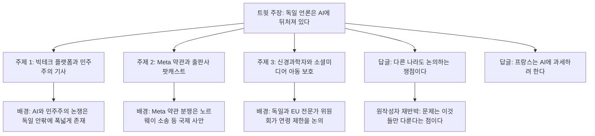
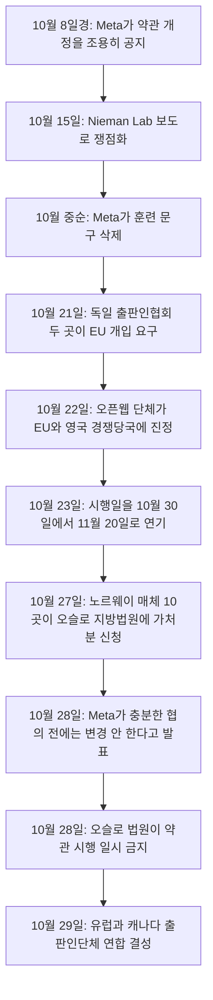

작성 기준일: 2026-11-02 (모든 사실관계는 이 날짜까지 검색으로 확인한 내용이며, 확인하지 못한 부분은 본문에 그대로 밝혔다.)

---

## 1. 한눈에 보는 요약

2026년 11월 2일(월) [한 X(구 트위터) 사용자가 글을 올렸다](https://x.com/kimmonismus/status/2117022119422996650). 요지는 "독일의 대표 일간지 프랑크푸르터 알게마이네 차이퉁(이하 FAZ) 월요일자의 주요 주제 세 가지만 봐도, 독일 언론이 AI에 대해 얼마나 뒤처져 있는지 알 수 있다"는 것이다. 그가 든 세 가지는 다음과 같다.

1. AI "프런티어 랩"이 반민주적이며 공론장을 지배하고 있으니 이를 더는 허용해서는 안 된다는 주장
2. Meta가 서비스 약관을 바꾸면서 언론인의 콘텐츠를 "훔치려 한다"는 이야기
3. 한 신경과학자가 소셜 네트워크가 아이들에게 해롭다고 말하고, 그래서 실리콘밸리와의 "디커플링"을 요구한다는 이야기

그는 이것을 "완전히 터무니없다. 유럽은 졌다"라고 결론 내렸다. 이 글에는 두 가지 반응이 달렸다. 첫째, 다른 사용자는 "세 주제 모두 미국과 전 세계에서도 논의되는 실제 쟁점이므로 뒤떨어진 사고가 아니다"라고 반박했다. 원작성자는 "논의하는 것 자체가 문제라는 게 아니라, 이 지면에서 다뤄지는 것이 오직 이것들뿐이라는 점이 문제"라고 다시 설명했다. 둘째, 또 다른 사용자가 "프랑스가 AI에 세금을 매기려는 것보다는 덜 미쳤다"고 덧붙였고, 원작성자가 "맞다"고 동의했다.

이 문서는 세 기사가 각각 무슨 내용인지, 그 배경에서 실제로 무슨 일이 벌어지고 있는지, 프랑스의 "AI 과세"가 실제로 무엇인지, 그리고 트윗의 주장 중 확인되는 부분과 확인되지 않는 부분이 무엇인지를 순서대로 풀어 설명한다.

> **먼저 밝히는 확인의 한계.** 세 기사의 본문 전체는 구해서 읽지 못했다. FAZ 본문은 유료이거나 접근이 막혀 있어 검색으로 열리지 않았다. 따라서 기사 자체에 대해서는 지면에 노출된 표제·부제·분류 정보만을 근거로 삼았고, 기사가 "무엇을 주장하는지"를 본문 수준으로 단정하지 않는다. 대신 각 기사가 다루는 사안(Meta 약관, 어린이와 소셜미디어, AI와 민주주의)은 별도의 최신 보도로 사실관계를 확인했다.

---

## 2. 전체 구도

아래 그림은 트윗 하나가 어떤 요소들로 이루어져 있고, 각 요소의 실제 배경이 무엇인지를 한 장으로 정리한 것이다.

---

## 3. 트윗이 가리키는 FAZ 지면에 대하여

세 기사는 모두 FAZ 11월 2일자(전자 지면 표기는 "Zeitung vom Montag 02.11.2026")의 **디지털 경제(Digitalwirtschaft)** 섹션에 속한 것으로 표시되어 있다. 이 점이 중요하다. 트윗은 "월요일자 FAZ의 주요 주제 세 가지"라고 표현했지만, 확인되는 것은 "디지털 경제 섹션에 이 세 건이 실려 있다"는 사실까지다. 이 세 건이 신문 전체의 가장 중요한 세 주제인지, 혹은 같은 날 다른 섹션에 AI를 긍정적으로 다룬 글이 없었는지는 이번 조사로 확인할 수 없었다.

### 3-1. 주제 1 — "민주주의라는 도자기 가게의 AI 코끼리"

표제는 독일어 관용구 "도자기 가게의 코끼리(Elefant im Porzellanladen)"를 변형한 것이다. 이 관용구는 우리말의 "도자기 가게에 들어간 코끼리", 즉 조심성 없이 덩치 큰 존재가 섬세한 것을 망가뜨린다는 뜻이다. 분류는 "인공지능"이고, 부제는 다음 내용을 담고 있다. 대형 기술 플랫폼이 공론장(Öffentlichkeit)을 지배하고 있으며, 그러면서 반민주적인 의제(antidemokratische Agenda)를 추구하고 있고, 이대로 계속될 수는 없다는 것이다.

여기서 눈여겨볼 대목은 **트윗의 요약과 부제 사이의 표현 차이**다. 트윗은 "AI 프런티어 랩(frontier labs)이 반민주적"이라고 옮겼지만, 부제가 직접 가리키는 대상은 "대형 기술 플랫폼(große Techplattformen)"이다. 둘은 겹치지만 같은 말이 아니다. 구글·메타 같은 기업은 플랫폼이면서 동시에 AI 모델을 만드는 기업이지만, 부제만으로는 기사가 AI 연구소(OpenAI, Anthropic 등)를 겨냥하는지, 소셜 플랫폼과 검색·광고 중심의 기존 플랫폼 권력 일반을 겨냥하는지 구분되지 않는다. 기사 본문을 읽지 못했으므로 어느 쪽이라고 단정하지 않는다. 필자(기사 작성자)가 누구인지도 이번 조사에서 확인하지 못했다.

이런 논지는 독일 담론에서 낯선 것이 아니다. 같은 시기 독일어권에는 AI를 사회·기술적 권력 구조로 보고 민주적 통제를 요구하는 글이 여러 매체에 나와 있다. 예컨대 베를린의 일간지 taz에는 "AI는 반민주적 정치를 가속하는 도구가 될 수 있다"는 취지의 글이 실렸고(2026년 4월), 같은 매체의 다른 글은 언어 모델을 운영하는 쪽이 공론장을 통제한다고 주장한다. netzpolitik.org에도 AI와 반민주적 이데올로기의 결합을 비판하는 글이 있다. 또 2026년 10월 22일에는 슈투트가르트시가 헌법수호청장 등이 참여하는 토론 "AI — 민주주의에 대한 위험?"을 열었다. 이는 FAZ 기사가 고립된 입장이라는 뜻이 아니라, 독일 공론장에서 이미 진행 중인 논쟁의 한 갈래라는 뜻이다. 다만 이것들은 FAZ 기사의 근거가 아니라 **같은 논쟁의 존재를 보여주는 정황**일 뿐이다.

### 3-2. 주제 2 — "Meta와 출판사: 저널리즘 콘텐츠는 누구의 것인가?"

이 항목은 기사가 아니라 FAZ 디지털 경제 **팟캐스트**의 한 회차이며, 표기된 길이는 1분이다. 소개문은 "Facebook을 운영하는 기업이 계획 중인 약관(AGB) 변경으로 무엇을 노리는지, 그리고 신문업계가 왜 저항하는지"를 다룬다고 되어 있다. 이 짧은 소개문에는 "도둑질" 같은 단정적 표현이 없다. "훔치려 한다(allegedly stealing)"는 것은 트윗 작성자의 요약이다.

사안 자체는 검색으로 매우 구체적으로 확인된다. 아래 4장에서 상세히 다룬다.

### 3-3. 주제 3 — 신경과학자의 인터뷰성 기사

분류는 "신경과학자"로 시작하고, 표제의 일부로 "우리는 ... 태어날 때부터 이기적으로 만들어진 존재가 아니다"를 뜻하는 것으로 보이는 문구가 보이나, 노출된 부분이 잘려 있어 표제 전체와 본문은 확인하지 못했다. 트윗은 이 신경과학자가 "소셜 네트워크는 아이들에게 해롭다, 따라서 실리콘밸리와 디커플링해야 한다"고 말했다고 요약한다. 이 "디커플링 요구"가 기사 어디에 어떤 맥락으로 나오는지는 본문을 읽지 못해 검증하지 못했다.

다만 이 주제의 배경에 해당하는 사실은 확인된다. 독일의 한 신경과학자(정신과·심리치료 전문의 겸 저술가)가 2026년 7월 한 개신교 계열 매체 인터뷰에서, 아이들이 처음 10년 동안 현실 세계의 사물을 만지고 느끼고 직접 해보는 경험이 필요한데 디지털 서비스는 아이들을 현실 세계에서 떼어놓아 뇌와 신체 발달을 방해한다고 말했다. 같은 계열의 저술이 가상세계와 AI가 인간성을 위협한다고 경고하는 책으로도 출간되어 있다. 단, 이 인터뷰의 주인공이 FAZ 11월 2일자 기사의 주인공과 동일인인지는 노출된 표제 조각과 주장 내용의 유사성에 근거한 **추정**이며, 확정할 수 없었다. 따라서 이 문서는 FAZ 기사의 구체적 주장을 그 인물의 주장으로 귀속시키지 않는다.

---

## 4. Meta 약관 분쟁 — 실제로 무슨 일이 있었나

### 4-1. 무엇이 바뀌려 했는가

Meta는 Facebook·Instagram·WhatsApp·Threads에서 **비즈니스 계정**을 쓰는 사업자를 대상으로 하는 상업 약관(Commercial Terms 등)을 개정한다고 알렸다. 미국 저널리즘 전문 매체 Nieman Lab이 2026년 10월 15일 독자 제보를 계기로 보도했는데, 핵심은 다음과 같다.

- 개정 약관은 비즈니스 계정과 "연결된(associated with)" **외부 웹사이트**에 대해 Meta가 스크레이퍼·봇·크롤러 등 자동화 도구로 접근해 콘텐츠를 수집·색인·캐시·분석할 수 있다고 적었다.
- 수집한 콘텐츠를 Meta 제품을 "제공·개발·개선·연구·훈련(train)·유지"하는 데 쓸 수 있다고 했고, Meta의 다른 약관은 "AI at Meta"를 그 제품 중 하나로 정의한다.
- 비즈니스 계정은 시행일 전에 옵트아웃할 방법이 없었고, 동의하지 않으면 사실상 계정을 포기해야 했다.
- 언론사는 거의 예외 없이 Meta 비즈니스 계정을 하나 이상 갖고 있다. Nieman Lab 스스로도 마찬가지라고 밝혔다.
- 약관은 Meta가 "테스트 자격증명(test credentials)"을 만들어 스크레이핑에 쓸 수 있다고도 적었다. 이것이 유료 구독 벽(paywall)을 우회하는 데 쓰일 수 있는지에 대해 Meta는 Nieman Lab의 질문에 답하지 않았다. 법률 전문가들이 이 조항이 구독 벽을 넘는 뒷문이 될 수 있다고 경고했다는 보도가 있다.

법률 전문가 세 명이 Nieman Lab의 의뢰로 약관을 검토했는데, 이들은 약관이 **쓰여 있는 그대로라면** Meta가 뉴스 사이트를 스크레이핑해 자사 AI를 훈련하는 근거로 주장할 수 있다고 평가했다. 이것은 "Meta가 그렇게 하고 있다"가 아니라 "약관 문언이 그런 주장을 가능하게 한다"는 평가라는 점을 구분해야 한다.

### 4-2. Meta의 반응

Meta는 비판이 일자 약관에서 "AI 훈련(train)"이라는 명시적 표현을 삭제했다. 그러나 출판계는 수정 문안, 즉 "광고 및 비즈니스 제품을 개발·개선·연구·유지하는 데" 쓸 수 있다는 표현이 여전히 Meta의 생성형 AI 서비스를 포괄한다고 본다. 법률 전문가들도 수정 후에도 스크레이핑 허용 범위가 넓다고 평가했다.

Meta 대변인은 새 약관이 광고와 비즈니스 제품에만 관한 것이고, Meta가 웹 크롤러를 쓰는 방식이 바뀌지 않으며, 콘텐츠 권리자는 여전히 robots.txt로 선호를 표시할 수 있다고 밝혔다. 뉴스 사이트 스크레이핑이 목적이 아니라는 취지였다. 다만 robots.txt를 존중한다는 문구는 약관 어디에도 들어 있지 않다는 지적이 있다. 약관이 계약으로서 구속력을 갖는 반면 대변인 발언은 그렇지 않다는 것이 비판자들의 논점이다.

한편 출판계 쪽에서도 Meta가 이미 일부 출판사와 유료 계약을 맺고 있다는 점을 지적한다. 스위스출판협회는 "일부와는 돈을 내고 계약하면서, 약관으로 나머지 전부에게서는 같은 가치를 무료로 가져가려 한다"고 비판했다.

### 4-3. 시간순 전개

각 단계의 확인된 내용은 다음과 같다.

- **독일 출판인협회(BDZV, MVFP)의 요구(10월 21일, dpa).** 두 협회는 EU 집행위원회가 약관 변경을 검토하고 우선 중단시키라고 요구했다. 이들이 보는 문제는 Meta가 출판사가 플랫폼에 직접 올린 콘텐츠만이 아니라, 게시물에 링크된 웹사이트의 기사·아카이브·이미지·영상까지 자동으로 탐색·저장·평가할 수 있게 된다는 점이다. 이들은 유럽 디지털시장법(DMA) 위반 가능성을 거론했고, 일반 개인 이용자의 일상에는 큰 변화가 없으며 영향은 비즈니스 계정에 집중된다는 점도 기사에 명시돼 있다.
- **국제 진정(10월 22일 로이터 보도).** 광고주와 출판사가 모인 단체 "Movement for an Open Web"이 EU 집행위와 영국 경쟁시장청(CMA)에 약관 중단을 요구하는 진정을 냈다. EU 집행위는 통상 절차로 검토하겠다고 밝혔고, 가처분성 중단을 요구하는 쪽은 회복 불가능한 실제 손해를 입증해야 한다는 점도 함께 언급됐다.
- **시행 연기(10월 23일).** Meta는 시행일을 10월 30일에서 11월 20일로 미뤘다. 이유는 "파트너와 이해관계자에게 무엇이 바뀌고 무엇이 바뀌지 않는지, 크롤러를 어떻게 쓰는지 설명할 시간을 더 갖기 위해서"였다. 이 연기는 약관 문언을 고친 것이 아니라 시행 시점을 늦춘 것이라는 점을 보도들이 짚었다.
- **노르웨이 소송(10월 27일).** NRK, NTB, Schibsted, Amedia, Polaris, Aller, TV 2 등 노르웨이 미디어 10곳(노르웨이미디어기업협회 MBL 주도)이 오슬로 지방법원에 가처분을 신청했다. 이들은 새 약관이 유료 구독 벽 뒤의 기사·사진·영상까지 Meta가 가져가 AI 서비스 개발에 쓸 수 있게 하고, 거부하려면 계정을 지우는 수밖에 없는 "전부 아니면 전무"의 선택을 강요한다고 주장했다. 이는 Meta의 약관을 상대로 한 최초의 알려진 소송으로 보도됐다.
- **Meta의 협의 약속(10월 28일).** Meta 커뮤니케이션 담당 부사장은 업계 단체와 충분한 협의 없이 정책을 바꿀 계획이 없다고 밝혔고, 협의가 11월 20일을 넘길 수 있으며 그 경우 시행을 더 미루겠다고 했다. 그때까지는 기존 약관이 유지된다. 일부 언론이 이를 "무기한 연기"로 표현했지만, 다른 분석은 "새 날짜를 제시하지 않았으므로 철회로 단정할 수 없다"는 점을 지적했다.
- **오슬로 법원 결정.** Nieman Lab 보도에 따르면 Meta 발표 직후 노르웨이 법원이 법적 판단이 날 때까지 약관의 시행을 막았다. 다만 이 금지가 소송을 낸 10개 사에만 적용되는지, 노르웨이의 모든 사업자에 적용되는지, 국경 밖까지 미치는지는 확인되지 않았다.
- **업계의 반응.** 노르웨이 지역지 한 곳은 2027년 1월 1일부터 Facebook 공식 페이지를 삭제하고 Meta를 떠나겠다고 밝혔고, 스웨덴 출판인단체들은 경쟁당국에 신고했다. 10월 29일에는 독일 BDZV·MVFP와 유럽·캐나다 출판인단체(ENPA, EMMA, News Media Canada, Magazines Canada)가 EU-캐나다 정상회담에 맞춰 AI 시대의 언론 콘텐츠 보호를 촉구하는 대서양 연합을 결성했다.

### 4-4. 그래서 "훔친다"는 말은 맞는가

법적으로 단정하기에는 이르다. 확인되는 사실은 이렇다. (1) Meta의 약관 문안은 외부 웹사이트 자동 수집을 허용하도록 쓰여 있고, 초안에는 "훈련"이 명시돼 있었다. (2) 수정 후에도 법률 전문가와 출판계는 생성형 AI 활용을 막지 못한다고 본다. (3) Meta는 뉴스 스크레이핑이 목적이 아니며 robots.txt를 존중한다고 주장한다. (4) 약관은 현재 시행되지 않았고, 시행이 연기·정지된 상태다. 즉 "Meta가 이미 언론인의 콘텐츠를 가져갔다"는 근거는 이번 조사에서 확인되지 않았고, "가져갈 수 있는 권한을 약관에 넣으려 했다는 것과 그에 대한 국제적 반발"이 사실이다. 트윗의 "allegedly(주장에 따르면)"라는 단서는 이 점에서 정확하다. 다만 이 사안은 "AI 연구소가 도둑"이라는 일반 명제로 확장할 수 없다. 당사자는 Meta 한 기업이고, 쟁점은 일반 이용자 데이터가 아니라 비즈니스 계정과 연결된 웹사이트다.

---

## 5. 주제 3의 배경 — 어린이와 소셜미디어 규제는 어디까지 왔나

신경과학자의 발언을 읽을 때 알아야 할 것은, 아동·청소년의 소셜미디어 이용을 제한하자는 논의가 독일과 EU에서 이미 정책 단계에 와 있다는 점이다. 확인된 사실만 정리하면 다음과 같다.

- **독일.** 연방정부는 연립협약에 따라 전문가 위원회를 꾸렸고, 위원회 "디지털 세계의 아동·청소년 보호"는 2026년 6월 24일 56개 권고안을 제출했다. 그중 하나가 소셜미디어 계정을 독립적으로 쓰기 위한 법정 최저 연령 13세 옵션이다. 위원회는 연령 상한을 법으로 정하는 안과 단일 연령 제한을 두지 않는 안, 두 가지 대안을 제시했다. 담당 장관은 13세 기준을 "옳은 길"이라고 평가했다.
- **EU.** 집행위원장이 위촉한 전문가 패널이 2026년 7월 13일, 13세 미만 아동의 소셜미디어 접근을 모든 회원국에서 제한하라고 권고했다. 다만 패널은 이를 전면 "금지"라고 부르지 않았고, 회원국이 더 높은 연령 제한을 두는 것을 허용했다.
- **다른 나라.** 호주는 2025년 12월부터 16세 미만 소셜미디어 금지법을 시행 중이다. 프랑스는 15세 미만 제한을 추진했으나 상원이 하원 안을 약화시킨 것으로 보도됐다. 덴마크, 노르웨이, 오스트리아, 슬로베니아 등도 입법을 준비하고 있다.
- **여론과 업계.** 독일 IT협회 Bitkom이 같은 시기 발표한 대표성 있는 조사에 따르면, 독일 시민은 일괄 금지에는 찬성하지 않지만 보호된 방식의 단계적 진입에는 찬성한다.

이 맥락에서 보면 "소셜미디어가 아이들에게 해롭다"는 문제 제기는 독일에서 비주류의 이색 주장이 아니라 정부 위원회와 EU 패널이 공식적으로 다루는 의제다. 반면 "그래서 실리콘밸리와 디커플링해야 한다"는 결론은 위원회들의 권고(연령 제한, 집행 강화)와는 결이 다른 더 큰 주장이다. 트윗은 이 두 가지를 "그러므로(consequently)"로 이은 점을 비판하는데, 그 비판이 타당한지는 기사 본문에서 논증이 어떻게 이어지는지를 읽어야 판단할 수 있다.

---

## 6. 프랑스의 "AI 과세"는 실제로 무엇인가

답글에서 "프랑스는 AI에 세금을 매기려 한다"고 했고 원작성자가 동의했다. 확인되는 내용은 다음과 같다.

- **2026년 7월 2일 보도된 의회 보고서.** 프랑스 국회의원 한 명이 발표한 보고서가 26개 권고를 담았고, 그중 하나가 프랑스 내 일정 매출 이상을 올리는 AI 제공사에 **재정적 기여금(contribution financière)** 을 부과하자는 것이다. 보도는 이를 "AI 세금"으로 제목을 달았지만, 보고서의 표현은 기여금이다. 대상으로는 OpenAI, Anthropic, Google, Meta, Mistral 같은 기업이 거론됐다.
- **세부는 미정.** 구체적 방식은 정해지지 않았다. 걷힌 돈은 저작자에게 돌아가고, AI 때문에 가장 큰 변화를 겪는 창작 직업군 지원 등 공익 목적에 쓰인다는 구상이다.
- **저작권을 대체하지 않는다.** 보고서는 기여금이 저작권을 대신하지 않으며, 납부가 보호된 저작물을 자유롭게 쓸 허가나 면책이 되지 않는다고 못 박았다. 권리자는 여전히 허락·거부와 보상 요구를 할 수 있다.
- **협상 유인.** 권리자와 계약을 맺은 AI 기업은 기여금을 부분 면제받는 구조가 제안됐다. 또 AI 학습 거부(opt-out) 의사를 모은 유럽 차원의 등록부 신설, 상원이 이미 통과한 "문화 콘텐츠 이용 추정" 법안의 심의 계속도 권고됐다.
- **법이 된 것은 아니다.** 이것은 의회 보고서의 권고이고, 입법이나 시행이 아니다. 보고서를 낸 의원 본인이 기업들의 강한 로비를 예상한다고 말했다. 프랑스 문화산업의 규모는 약 1,000억 유로 수준이라고 보도됐다.
- **관련된 과거 사례.** 2025년 11월 28일, 프랑스 상원에서 AI 비서 서비스 구독에 세금을 매기는 수정안이 올라왔으나 **부결**됐다. 또 프랑스 정부가 과거 의회 질의에 대해 AI 과세를 반대하는 입장을 낸 적이 있다는 자료도 있으나 날짜는 확인하지 못했다.

정리하면 "프랑스가 AI에 세금을 매기려 한다"는 표현은 "프랑스 의회 보고서가 AI 사업자에게 창작자 지원용 기여금을 부과하자고 권고했다"를 줄인 것으로, 방향은 맞지만 실제 입법된 세금은 아니고 이후 진행 상황은 이번 조사에서 확인하지 못했다.

---

## 7. 트윗과 답글 논쟁을 어떻게 읽을 것인가

트윗의 논지는 "유럽(독일) 언론은 AI에서 기회가 아니라 위협과 규제만 이야기한다"는 것이고, 답글의 반론은 "그 세 주제는 전 세계에서 논의되는 정당한 쟁점이다"라는 것이다. 두 입장이 사실 서로 다른 층위를 말하고 있다는 점이 논쟁의 핵심이다.

- 답글 쪽은 **주제의 정당성**을 말한다. AI 모델의 편향, 사람들이 뉴스 사이트를 직접 읽는 대신 AI에 묻는 행태 변화, 청소년의 AI 관련 피해 사례 같은 근거를 들었다. 이 근거들은 답글 작성자의 주장이며, 이번 조사에서 하나하나 검증한 것은 아니다. 다만 4장과 5장에서 보았듯 Meta 약관 분쟁과 아동 보호 규제는 실재하는 쟁점이다.
- 원작성자의 재반박은 **편중의 문제**를 말한다. 논의 자체가 틀렸다는 것이 아니라, 지면에 오른 것이 위험·소유권·규제 쪽뿐이라는 것이다. 그리고 FAZ를 매일 읽으며 그것이 시대정신을 대표한다고 주장한다.

이 두 입장 중 어느 쪽이 옳은지는 취향의 문제가 아니라 **검증 가능한 질문**으로 나눠볼 수 있다. 첫째, 세 건이 FAZ 월요일자의 "주요 주제 전부"였는가. 확인된 것은 디지털 경제 섹션에 세 건이 있다는 것까지다. 둘째, FAZ가 AI의 활용·산업 측면을 다루지 않았는가. 같은 날짜의 정황을 몇 가지 확인했다.

- 같은 날(11월 2일) 독일 연방대통령은 ARD 인터뷰에서 유럽이 AI에 "아니오"라고 말할 기회가 없다고 했고, AI를 거부하는 것은 유럽 경제 여건을 악화시키므로 어리석은 일이라고 말했다. 규제를 논하려면 먼저 기술을 다룰 줄 알아야 한다는 취지였다(dpa). 이것은 FAZ 보도가 아니라 독일 최고위 인사의 발언이지만, 독일 공론장이 "AI 위협론"으로만 수렴돼 있지 않다는 정황 증거다.
- EU는 2025년 4월 9일 "AI 대륙 행동계획"을 발표해 세계적 AI 선도를 목표로 한다고 밝혔다.
- 독일에서 AI 이용 자체를 규범으로 다루는 사례도 있다. FAZ는 2026년 6월 한 주총리의 기고문이 AI로 생성된 것으로 의심되자 온라인에서 삭제했고, 원칙적으로 AI가 원천 생성한 텍스트는 싣지 않는다는 방침을 밝혔다고 보도됐다.

이들은 "FAZ가 무엇을 싣지 않았는가"를 증명하지 못한다. 하지만 "독일 공론장 전체가 위협론 일색"이라는 일반화에 대한 반증 후보로는 의미가 있다. 반대로 트윗 작성자의 인상, 곧 해당 지면의 상당 부분이 AI의 위험과 권력, 소유권 문제에 쏠려 있다는 인상은 이번에 확인한 세 건의 표제와 부합한다. 요컨대 **"세 주제가 틀렸다"는 주장은 근거가 약하고, "독일 언론 전체가 뒤처졌다/유럽은 졌다"는 결론은 이번 자료만으로는 입증되지 않는다.** 이것은 어느 한쪽 편을 드는 판정이 아니라, 확인 가능한 범위를 표시하는 것이다.

---

## 8. 정리 — 확인된 것과 확인되지 않은 것

**확인된 것**

- FAZ 11월 2일자 디지털 경제 섹션에 (1) 대형 기술 플랫폼과 민주주의를 다룬 AI 분류 기사, (2) Meta 약관과 출판사를 다룬 팟캐스트, (3) 신경과학자 관련 기사가 실려 있다.
- Meta의 비즈니스 계정 약관 개정은 외부 웹사이트 자동 수집을 허용하도록 쓰였고, 이에 대해 독일·스위스·노르웨이·스웨덴·영국·캐나다 등의 출판계와 규제기관이 반응했다. 시행은 11월 20일로 연기됐고, 노르웨이 법원이 일시 금지했으며, Meta는 협의가 길어지면 더 미루겠다고 했다.
- 독일 전문가 위원회(2026년 6월)와 EU 패널(2026년 7월)이 아동의 소셜미디어 접근 제한을 권고했다.
- 프랑스에서는 AI 사업자에 대한 기여금을 제안한 의회 보고서가 있으며(2026년 7월 보도), 입법된 세금은 아니다.

**확인되지 않은 것**

- 세 기사·팟캐스트의 본문 내용, 기사 작성자, 신경과학자의 정확한 발언과 "디커플링" 요구의 맥락.
- 세 건이 FAZ 지면의 "주요 주제 전부"인지 여부.
- "AI 프런티어 랩"이 기사 1의 직접 대상인지(부제는 "대형 기술 플랫폼"이라고만 표기).
- 오슬로 법원 금지의 적용 범위, 프랑스 기여금 제안의 이후 경과, Meta 약관의 최종 운명.
- 답글이 든 청소년 AI 관련 피해 사례 등의 사실 여부.

---

## 9. 출처

- 트윗 원문: https://x.com/kimmonismus/status/2117022119422996650
- Nieman Lab, Meta 신규 상업 약관과 스크레이핑 (2026-10): https://www.niemanlab.org/2026/10/metas-new-commercial-terms-will-allow-the-scraping-of-news-sites-legal-experts-say/
- Nieman Lab, 수정 약관에도 광범위한 스크레이핑 허용 (2026-10): https://www.niemanlab.org/2026/10/legal-experts-warn-metas-new-terms-still-grant-broad-scraping-permissions-despite-language-changes/
- Nieman Lab, Meta의 출판사 협의 약속: https://www.niemanlab.org/2026/10/meta-pledges-to-consult-publishers-before-finalizing-its-new-terms/
- Nieman Lab, 시행일 11월 20일 연기: https://www.niemanlab.org/?p=254546
- dpa/CIO.de, 독일 출판인협회의 EU 개입 요구 (2026-10-21): https://www.cio.de/article/4238279/verlegerverbande-fordern-eu-eingreifen-gegen-meta.html
- dpa/CIO.de, 출판인단체 대서양 연합 (2026-10-29): https://www.cio.de/article/4241988/verlegerverbande-schliesen-bundnis-gegen-ki-risiken.html
- Netzwoche, Meta 약관 반발과 Meta 입장 (2026-10-23): https://www.netzwoche.ch/news/2026-10-23/metas-neue-geschaeftsbedingungen-stossen-auf-widerstand
- Euronews, 노르웨이 매체의 Meta 제소 (2026-10-27): https://euronews.com/2026/10/27/norwegian-media-sue-meta-over-plans-to-use-their-journalism-for-ai
- Press Gazette, 노르웨이 소송과 업계 반응 (2026-10-27): https://pressgazette.co.uk/news/norwegian-media-companies-take-meta-to-court-over-ai-scraping-terms/
- PPC Land, 오슬로 법원 일시 금지: https://ppc.land/norwegian-court-temporarily-blocks-metas-new-terms-after-10-media-groups-sue/
- PPC Land, 시행 연기 경위: https://ppc.land/meta-delays-website-crawling-terms-to-nov-20-after-publisher-complaints/
- Reuters 보도(WSAU 전재), Meta 시행 연기 (2026-10-23): https://wsau.com/2026/10/23/meta-to-delay-new-commercial-terms-criticised-by-publishers-advertisers/
- dpa/CIO.de, 독일 연방대통령의 AI 발언 (2026-11-02): https://www.cio.de/article/4243231/ki-wettlauf-steinmeier-bezeichnet-verweigerung-europas-als-dumm.html
- Mac4Ever, 프랑스 의회 보고서의 AI 기여금 제안 (2026-07-02): https://www.mac4ever.com/ia/196959-la-france-envisage-une-nouvelle-taxe-sur-l-ia
- 프랑스 상원, 2026년 예산안 AI 구독세 수정안(부결): https://www.senat.fr/enseance/2025-2026/138/Amdt_I-2654.html
- AOK, 독일 전문가 위원회 권고 (2026-06-24): https://www.aok.de/pp/gg/update/social-media-altersgrenze-kinder/
- Ärzteblatt, EU 전문가 패널 권고 (2026-07-13): https://www.aerzteblatt.de/news/social-media-eu-experten-fur-zugangsbeschrankung-bis-13-830a0480-dc3c-42dd-82dd-7cab75313ccd
- ZDFheute, 국가별 소셜미디어 규제 현황: https://www.zdfheute.de/politik/ausland/social-media-verbot-regelungen-ausland-100.html
- Bitkom, 소셜미디어와 아동 조사 (2026-06-22): https://www.bitkom.org/Presse/Presseinformation/Social-Media-Kinder-Schutz-ja-Verbot-nein
- evangelisch.de, 신경과학자 인터뷰 (2026-07-04): https://www.evangelisch.de/inhalte/256911/04-07-2026/menschen-brauchen-analoge-gemeinschaft
- taz, AI와 민주주의 관련 글 (2026-04): https://taz.de/Kuenstliche-Intelligenz-und-Demokratie/!6168197/
- netzpolitik.org, AI 이데올로기 관련 글: https://netzpolitik.org/2025/ki-ideologie-wie-digitaler-faschismus-in-den-mainstream-vordringt/
- 슈투트가르트시 행사 "KI — Gefahr für die Demokratie?": https://www.stuttgart.de/veranstaltungskalender/veranstaltungen/ki-gefahr-fuer-die-demokratie-534024
- Weltwoche, FAZ의 AI 의심 기고문 삭제 (2026-06-11): https://weltwoche.de/daily/wegen-ki-verdacht-frankfurter-allgemeine-zeitung-loescht-gastbeitrag-von-mario-voigt/
- 유럽연합 집행위, 디지털 경제와 사회 (AI 대륙 행동계획): https://commission.europa.eu/topics/digital-economy-and-society_de

---

작성 일자: 2026-11-02
