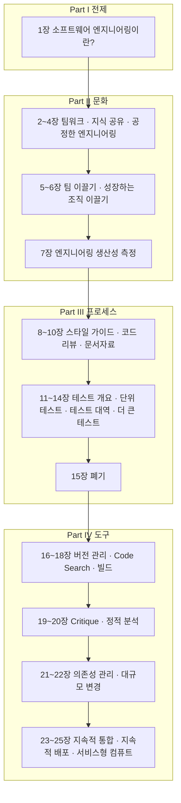
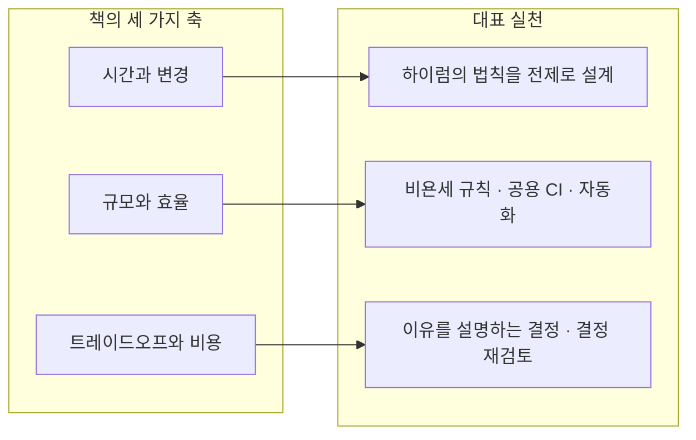
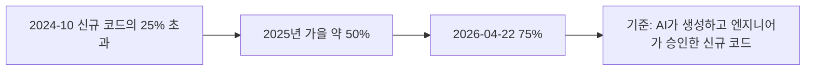
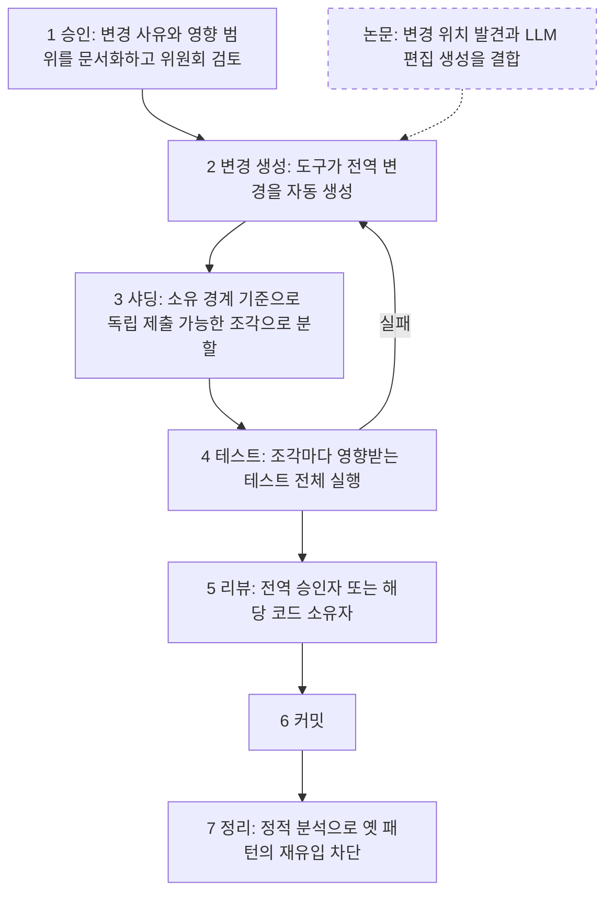
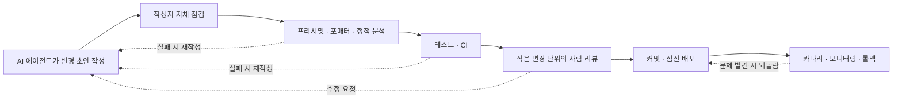

원제 *Software Engineering at Google* 을 2026년의 시점에서 다시 읽는 해설서

- 작성 기준일: 2026-11-05
- 대상 도서: 『구글 엔지니어는 이렇게 일한다』 (한빛미디어), 원서 *Software Engineering at Google: Lessons Learned from Programming Over Time* (O'Reilly)
- 분량 안내: 서술형 해설 중심이며, 장별 해설과 최신 근거 정리, 다이어그램, 참고 자료로 구성했습니다.

---

## 0. 이 문서를 읽는 방법

이 책은 2020년에 나온 원서를 2022년에 번역한 책입니다. 거대 언어 모델(LLM, Large Language Model) 기반 코딩 도구가 일상이 되기 전에 쓰였습니다. 그래서 "AI 시대에 이 책을 어떻게 읽을 것인가"라는 질문에는 서로 다른 성격의 정보가 섞여 들어옵니다. 책에 실제로 적힌 내용, 최근에 공개된 사실과 연구 결과, 그리고 이 둘을 연결하는 필자의 해석입니다. 이 셋이 섞이면 독자가 무엇을 믿어야 할지 알 수 없게 되므로, 이 문서는 근거의 성격을 문장마다 구분해서 표시합니다.

| 표시 | 의미 | 신뢰 방법 |
|---|---|---|
| **[원문]** | 저자들이 온라인에 공개한 원서 HTML 판에서 직접 확인한 내용 | 원서 URL로 대조 가능 |
| **[1차]** | 회사나 연구 기관이 직접 공개한 자료(발표, 보고서, 블로그) | 공개 문서로 대조 가능 |
| **[논문]** | 학회 논문 또는 프리프린트(arXiv) | 초록과 본문으로 대조 가능 |
| **[보도]** | 언론, 해설 블로그, 집계 사이트를 거친 2차 정보 | 원출처 재확인 권장 |
| **[해석]** | 필자가 위 근거들을 바탕으로 이끌어 낸 의견 | 근거와 함께 읽되 동의 여부는 독자가 판단 |

책의 내용은 원서의 공개 HTML 판과 한국어판 목차를 기준으로 정리했습니다. 원서는 변형 금지 조건(CC BY-NC-ND)으로 공개되어 있으므로 원문을 길게 옮기지 않고 요약과 재서술로만 다룹니다. 책에 없는 내용은 책에 있는 것처럼 쓰지 않았습니다.

---

## 1. 책 한눈에 보기

### 1.1 서지 정보

| 항목 | 내용 |
|---|---|
| 한국어판 제목 | 구글 엔지니어는 이렇게 일한다 — 구글러가 전하는 문화, 프로세스, 도구의 모든 것 |
| 원제 | Software Engineering at Google: Lessons Learned from Programming Over Time |
| 출판 | 한빛미디어, 국내 출간 2022-05-10 / 원서 O'Reilly Media, 2020년 3월 |
| 옮긴이 | 개앞맵시 |
| 규격 | 704쪽, 183×235mm, 1338g |
| ISBN | 9791162245620 |
| 원서 온라인 공개 | 저자들이 abseil.io 에서 HTML 판을 무료로 공개 (CC BY-NC-ND 4.0 라이선스) **[원문]** |

원서 전문이 무료로 공개되어 있다는 점은 실용적으로 중요합니다. 한국어판을 읽다가 용어의 원래 표현이 궁금할 때 바로 대조할 수 있고, 이 문서처럼 원문을 확인하면서 읽는 작업도 가능합니다.

### 1.2 누가 만든 책인가

이 책은 구글의 엔지니어 두 명과 테크니컬 라이터(technical writer) 한 명이 큐레이션했습니다. **[원문]** 한국어판 소개에 따르면 이들의 역할은 다음과 같습니다.

한 명은 2010년에 합류한 선임 소프트웨어 엔지니어로, C++ 표준 라이브러리를 설계하는 글로벌 소위원회의 위원장입니다. 매달 약 12,000명의 엔지니어가 수정하는 2억 5천만 라인 규모의 C++ 코드베이스에서 라이브러리 리더를 맡고 있고, 지난 7년간 자동화와 도구로 기본 구성요소를 재구성하고 유지보수하는 팀을 이끌었다고 합니다. 다른 한 명은 2005년부터 소프트웨어 엔지니어링 부문 테크니컬 라이터로 일하며 인프라와 언어에 관한 주요 프로그래밍 가이드를 쓰고 관리했고, 2011년부터 C++ 라이브러리 팀에서 문서와 교육 과정, 오픈 소스 C++ 코드 Abseil의 문서화를 맡았습니다. 나머지 한 명은 구글 C++ 코드베이스의 대규모 유지보수를 맡아 온 엔지니어로, 구글 역사상 코드베이스를 가장 많이 수정한 엔지니어로 꼽힌다고 소개됩니다. **[1차 · 서점 소개]**

또 하나 눈여겨볼 점은 장마다 집필자가 다르다는 사실입니다. 책 전체는 세 사람이 엮었지만, 각 장의 첫머리에는 해당 분야를 직접 맡은 엔지니어가 집필자로, 다른 사람이 편집자로 표기되어 있습니다. **[원문]** 예컨대 9장(코드 리뷰)과 10장(문서자료)은 집필자와 편집자가 서로 다르게 표기되어 있어, 분야별 담당자가 쓰고 별도의 편집자가 다듬는 방식으로 만들어졌음을 알 수 있습니다.

**[해석]** 저자 구성에서 읽을 수 있는 것은 이 책의 관점입니다. 새 기능을 만드는 쪽보다 오래된 코드베이스를 수천 명이 함께 계속 바꿔야 하는 문제를 평생 다뤄 온 사람들이 쓴 책이라는 점이 책 전체의 문제의식(시간, 규모, 변경)과 정확히 맞물립니다. AI가 코드를 쓰는 속도가 빨라진 지금 이 관점이 오히려 더 중요해지는 이유도 여기에 있습니다. 쓰는 일은 싸지고 있지만, 쓴 코드를 오래 유지하는 일은 그대로 비싸기 때문입니다.

### 1.3 책의 구성

책은 네 개의 Part로 이루어져 있습니다. 원서 목차에는 마지막에 결론에 해당하는 Part와 후기(Afterword)도 있습니다. **[원문]**

Part I은 단 한 장으로, 책 전체의 논지를 세웁니다. Part II는 사람과 조직의 문제를 다루고 마지막 7장에서 생산성을 어떻게 측정할지 논의합니다. Part III은 규칙, 리뷰, 문서, 테스트, 폐기처럼 날마다 반복되는 절차를 다룹니다. Part IV는 그 절차를 실제로 떠받치는 도구를 설명하며, 구글 안에서 쓰는 도구의 이름(Critique, Tricorder, Rosie, TAP 등)이 여기서 많이 등장합니다. 전체 장 제목은 부록 A에 한글(영어) 병기로 정리했습니다.

---

## 2. 책의 뼈대: 시간 위에서 이루어지는 프로그래밍

이 책의 모든 장은 1장에서 세운 하나의 구분에서 출발합니다. 그래서 AI 시대의 독서도 1장을 정확히 이해하는 데서 시작해야 합니다.

### 2.1 프로그래밍과 소프트웨어 엔지니어링은 무엇이 다른가

1장은 프로그래밍(programming)과 소프트웨어 엔지니어링(software engineering)의 차이를 세 가지로 말합니다. **시간**(코드가 얼마나 오래 살아남아야 하는가), **규모**(얼마나 많은 사람이 얼마나 오래 같은 코드에 손을 대는가), 그리고 **트레이드오프**(불완전한 추정치를 가지고 더 크고 복잡한 결정을 내려야 한다는 점)입니다. **[원문]** 구글 내부에서는 이를 한 줄로 줄여 소프트웨어 엔지니어링을 "시간에 걸쳐 적분한 프로그래밍"이라고 부른다고 합니다. **[원문]** 한국어판 추천사 가운데에는 바로 이 정의를 읽는 순간 소프트웨어 엔지니어링이라는 말에 대한 막연한 거부감이 사라졌다는 평도 있습니다.

원서는 코드의 기대 수명(expected life span)이 사례에 따라 약 10만 배까지 차이 날 수 있다고 지적합니다. 몇 분 쓰고 버리는 스크립트가 있고, 수십 년 유지되어야 하는 검색 서비스가 있습니다. 수명이 짧은 코드는 시간의 영향을 거의 받지 않으므로 사실상 "그냥 프로그래밍" 문제입니다. 수명이 길어질수록 의존하는 라이브러리, 운영체제, 하드웨어, 언어 버전이 바뀌는 일이 피할 수 없게 되고, 그때부터 같은 규칙이 통하지 않습니다. 이 구분의 핵심은 어느 쪽이 더 낫다는 우열이 아니라, 서로 다른 문제 영역에는 서로 다른 도구가 맞는다는 것입니다. **[원문]**

여기서 책이 정의하는 **지속 가능성**(sustainability)은 기대 수명 동안 가치 있는 변화가 생겼을 때 그에 대응할 수 있는 능력을 뜻합니다. 반드시 모든 변경을 해야 한다는 말이 아니라, 하기로 결정했을 때 할 수 있는 상태여야 한다는 말입니다. 처음 겪는 대규모 업그레이드가 유난히 고통스러운 까닭도 설명합니다. 그 프로젝트에서 한 번도 해 본 적 없는 일이라 숨은 가정이 많고, 담당 엔지니어에게 경험이 없고, 몇 년 치 업그레이드를 한꺼번에 해야 하기 때문입니다. **[원문]**

### 2.2 하이럼의 법칙(Hyrum's Law)

이 책에서 가장 널리 인용되는 개념입니다. 어떤 API를 쓰는 사용자가 충분히 많아지면, 계약서에 무엇을 약속했든 상관없이 시스템이 보여 주는 관측 가능한 모든 동작에 누군가가 의존하게 된다는 법칙입니다. **[원문]** 책은 이를 열역학의 엔트로피에 빗댑니다. 엔트로피가 증가한다고 해서 효율을 포기하지 않는 것처럼, 이 법칙이 작동한다고 해서 대비를 포기하지는 않습니다. 다만 완전히 없앨 수는 없다는 전제를 받아들이라는 뜻입니다.

예로 든 것이 해시 테이블의 순회 순서입니다. 전문가에게 해시 컨테이너의 출력 순서를 가정해도 되느냐고 물으면 "안 된다"고 답하지만, 코드의 수명이 짧고 아무것도 바뀌지 않는다면 그 가정은 문제가 되지 않습니다. 그러나 코드가 얼마나 오래 살지 모른다면 위험한 가정입니다. 심지어 해시 순서를 일부러 무작위로 만드는 언어에서도, 그 무작위성을 난수 생성기 대용으로 쓰는 코드가 있어서 무작위성을 없애면 그 사용자가 깨진다고 책은 소개합니다. **[원문]** 그래서 책은 "영리하다(clever)"가 칭찬이면 프로그래밍이고, 비난이면 소프트웨어 엔지니어링이라는 구분을 덧붙입니다. **[원문]**

### 2.3 규모와 효율: 확장되지 않는 정책과 확장되는 정책

책은 정책이 확장 가능한지 판별하는 간단한 질문을 제시합니다. 조직이 10배, 100배로 커졌을 때, 엔지니어 한 명이 감당해야 하는 일이 같은 비율로 늘어나는가를 묻는 것입니다. 그렇다면 자동화나 최적화 장치가 없는 한 그 정책은 확장되지 않습니다. **[원문]**

대표적인 실패 사례가 전통적인 폐기(deprecation) 방식입니다. "8월 15일에 옛 위젯을 삭제할 테니 그 전에 전환하라"는 공지는 작은 조직에서는 통하지만, 의존 관계가 깊고 넓어질수록 빌드 하나가 깨질 때 영향받는 범위가 커져서 무너집니다. 구글은 2012년에 이를 "이탈 규칙"(Churn Rule)으로 바꿨습니다. 인프라 팀이 직접 사용자를 새 버전으로 옮기거나, 하위 호환을 유지하면서 제자리에서 바꾸라는 규칙입니다. 전문가 집단이 한 번 깊이 배워서 모든 하위 문제에 적용하는 편이, 모든 팀이 각자 배워서 버리는 것보다 확장성이 좋다는 판단입니다. **[원문]**

반대로 확장성이 좋은 정책의 예가 **비욘세 규칙**(Beyoncé Rule)입니다. 인프라 변경으로 제품에 장애가 났는데 지속적 통합(CI, Continuous Integration) 시스템의 테스트가 이를 잡아내지 못했다면, 그것은 인프라 변경 쪽의 잘못이 아니라는 정책입니다. 쉽게 말해 깨지면 안 되는 동작은 공용 CI에 테스트로 걸어 두라는 요구입니다. 이 규칙이 있으면 인프라 팀이 영향받을 수 있는 모든 팀을 일일이 찾아다니며 테스트 방법을 물어볼 필요가 없습니다. **[원문]**

컴파일러 업그레이드 이야기도 이 맥락에서 읽힙니다. 구글의 가장 유명한 컴파일러 업그레이드는 2006년에 있었고, 그때까지 약 5년 동안 컴파일러를 바꾼 적이 없었으며 대부분의 엔지니어가 경험이 없었고 CI도 비욘세 규칙도 없었습니다. 그 결과 하이럼의 법칙이 만들어 낸 숨은 의존성이 곳곳에서 터졌습니다. 구글은 이 고통스러운 경험을 계기로 자동화, 일관성(consolidation), 전문성을 갖추는 방향으로 움직였고, 지금은 일부 언어의 컴파일러를 1~2주마다 올린다고 설명합니다. 업그레이드를 자주 할수록 코드가 구현의 세부가 아니라 언어가 보장하는 추상에 의존하게 되어 다음 업그레이드가 쉬워진다는 것이 책의 관찰입니다. **[원문]**

### 2.4 왼쪽으로 옮기기(Shift Left)

개발 과정을 설계, 구현, 리뷰, 테스트, 커밋, 카나리(canary) 배포, 운영으로 이어지는 시간선으로 놓았을 때, 문제를 더 왼쪽(이른 단계)에서 발견할수록 고치는 비용이 줄어든다는 원리입니다. 보안 결함을 운영 환경에서 발견하는 것보다 배포 전에, 배포 전보다 커밋 전에 잡는 편이 쌀 수밖에 없습니다. 책은 정적 분석과 코드 리뷰로 커밋 전에 잡는 버그가 운영까지 가는 버그보다 훨씬 싸다는 같은 패턴이 책 전체에서 반복된다고 말하며, 어느 한 장치도 완벽할 필요 없이 여러 겹으로 방어(defense in depth)하면 된다고 설명합니다. **[원문]**

### 2.5 트레이드오프와 비용

마지막 축은 의사결정입니다. 책은 "비용"을 돈으로만 보지 않고 금전, 자원, 인력, 거래, 기회, 사회적 비용의 여섯 가지로 나눕니다. **[원문]** 구글 문화는 "내가 그렇게 말했으니까"라는 이유를 몹시 싫어하며, 결정에는 반드시 이유가 있어야 하지만 만장일치가 아니라 합의가 목표라고 설명합니다. 데이터 기반 문화라고 흔히 말하지만 실제로는 데이터가 없을 때 증거, 선례, 논증이 쓰인다는 단서도 붙입니다. 새로운 데이터가 들어오면 결정을 다시 볼 수 있어야 하고, 그러려면 결정권자가 실수를 인정할 권리가 있어야 한다고도 말합니다. **[원문]**

분산 빌드의 사례는 이 장의 가장 뼈 있는 대목입니다. 구글은 로컬 빌드가 느려지자 분산 빌드 시스템을 만들었고 모두의 빌드가 빨라졌지만, 그 후 빌드 그래프에 불필요한 의존성이 마구 늘어났습니다. 빌드가 느릴 때는 개별 엔지니어가 자기 빌드를 빠르게 유지할 동기가 있었는데, 분산 빌드가 그 고통을 가리자 아무도 비대화를 감시하지 않게 된 것입니다. 책은 이를 효율이 좋아질수록 소비가 늘어나는 제번스 역설(Jevons Paradox)에 비유합니다. **[원문]** 이 대목은 뒤에서 AI 코드 생성을 논할 때 다시 돌아옵니다.

---

## 3. 지금 AI는 어떻게 쓰이고 있는가: 2026-11-05 기준 검색 결과

책을 AI 시대에 읽으려면 먼저 AI 시대가 실제로 어떤 모습인지 사실로 확인해야 합니다. 아래는 이번에 검색으로 확인한 내용입니다.

### 3.1 구글 내부의 AI 코드 비중

구글 CEO는 2026년 4월 22일(미국 라스베이거스, Google Cloud Next 2026)에 구글의 신규 코드 가운데 75%가 AI가 생성하고 엔지니어가 승인한(AI-generated and approved by engineers) 코드라고 밝혔습니다. 직전 가을에는 약 50%였다고 말했습니다. **[1차 발언 · 보도 경유]** 여러 매체가 같은 숫자와 같은 표현을 전하고 있고, 2024년 10월에는 신규 코드의 25% 이상이라는 발표가 있었다고 보도되었습니다. **[보도]**

같은 발표에서 구글은 에이전트와 엔지니어가 함께 수행한 복잡한 코드 마이그레이션이 1년 전 엔지니어 단독으로 했을 때보다 6배 빠르게 끝났다고 말했고, 개발 방식이 "진정한 에이전트 워크플로"로 이동하고 있다고 설명했습니다. **[1차 발언 · 보도 경유]** 확인한 자료에서는 이 마이그레이션이 정확히 무엇이었는지, 6배가 어떤 기준으로 측정된 수치인지는 공개되어 있지 않았습니다.

### 3.2 이 숫자를 읽을 때 주의할 점

75%라는 숫자는 회사가 스스로 밝힌 수치입니다. 그리고 정의가 중요합니다. 이것은 **신규 코드**에서 AI가 생성하고 사람이 승인한 비율이므로, 전체 코드베이스 대비 비율이 아닙니다. 코드베이스의 대부분은 AI 이전에 쓰인 코드입니다. 또한 "승인"이라는 말은 사람이 검토 단계를 거쳤다는 뜻이지 사람이 쓰지 않았다는 말과 같지는 않지만, 사람이 얼마나 깊이 검토했는지는 수치만으로 알 수 없습니다. 이 점은 이 문서의 4~7절에서 반복해서 중요해집니다.

외부 설문은 다른 정의로 측정되어 직접 비교할 수 없습니다. 집계 사이트에 따르면 2026년 개발자 생태계 설문(JetBrains)에서는 개발자들이 지난 한 달 업무 코드의 약 47%를 AI 에이전트가 완전히 작성했다고 응답했고, 다른 설문(Sonar, 2025년 10월 조사)에서는 커밋된 코드의 42%가 AI 생성이거나 크게 AI의 도움을 받은 코드였다고 합니다. 둘 다 자기보고(self-report)입니다. **[보도]** 이 숫자들은 방향성을 보여 줄 뿐 하나의 지표로 합칠 수 없습니다.

일부 보도는 구글이 AI 도구 도입 목표를 성과 평가 항목 일부에 반영하고 있다고도 전합니다. **[보도]** 1차 확인이 안 된 내용이므로 사실로 단정하지 않고, 이 문서의 4.5절 측정 논의에서 "만약 그렇다면"의 사례로만 다룹니다.

### 3.3 구글 연구팀이 공개한 AI 활용 연구들

구글이 개발 도구에 ML/LLM을 넣은 사례는 논문으로도 공개되어 있어 수치를 직접 확인할 수 있습니다.

**코드 리뷰 코멘트 자동 해결.** 구글에서는 해마다 수백만 건의 리뷰어 코멘트가 달리고, 변경 작성자는 리뷰를 요청한 뒤 최종 제출까지 평균 약 60분의 적극적인 관여 시간이 필요하다고 합니다. 연구팀은 리뷰어 코멘트로부터 코드 수정안을 예측하는 모델을 만들어 처음에는 리뷰어가 코멘트를 보낸 뒤 비동기로 수정안을 만들어 주는 방식으로 배포했고, 이후 리뷰어가 코멘트를 쓰는 시점에 바로 수정안을 제안하는 상호작용 방식으로 발전시켰습니다. 배포 환경에서 작성자가 ML이 제안한 수정을 적용해 처리한 리뷰 코멘트의 비율은 7.5%였습니다. **[논문 · 연구 블로그]** 7.5%는 크다고도 작다고도 할 수 있는 숫자인데, 연간 수백만 건에 이르는 코멘트 규모 위에서의 7.5%라는 점이 의미를 만듭니다.

**모범 사례 위반 자동 지적(AutoCommenter).** 코드 리뷰 중에 코딩 모범 사례(best practice) 위반을 자동으로 찾아 코멘트로 달아 주는 LLM 기반 시스템입니다. C++, Java, Python, Go를 대상으로 구글 전체에 배포했고, 개발자가 이 코멘트를 보고 실제로 코드를 고쳐 해결한 비율이 약 40%로 추정되었습니다. 명시적인 긍정 피드백 비율보다 훨씬 높다는 점이 논문의 관찰입니다. **[논문]**

**LLM을 이용한 대규모 마이그레이션.** 구글 개발자 세 명이 12개월 동안 수행한 39건의 마이그레이션 사례 연구에서 총 595개의 코드 변경과 93,574건의 편집이 제출되었고, 이 중 변경의 74.45%, 편집의 69.46%를 LLM이 생성했습니다. 개발자들은 이전의 수작업 마이그레이션 대비 전체 소요 시간이 약 50% 줄었다고 추정했습니다. 이 접근은 먼저 바꿀 위치를 찾아내는 단계(change location discovery)와 LLM을 결합한 것이며, 소요 시간 절감은 객관 측정이 아니라 개발자 추정이라는 점을 논문도 밝힙니다. **[논문]**

**명령어 집합 이전(ISA migration).** x86에서 Arm으로 옮기는 수십억 줄 규모의 마이그레이션을 약 4만 건의 커밋으로 분석한 논문의 요약 자료에 따르면, 코드 변환 자체는 수정된 코드 라인의 4% 미만이었고 대부분은 빌드, 설정, 테스트, 배포 관련 작업이었습니다. 이 과정에서 구글은 대규모 변경 도구(Rosie)를 활용하는 한편 부족한 부분을 채우는 AI 에이전트를 개발했다고 합니다. **[논문 · 요약 자료 경유]**

### 3.4 DORA 2025 보고서: AI는 증폭기

구글 클라우드의 DORA 연구팀이 2025년 9월 23일에 낸 보고서 「State of AI-assisted Software Development」는 전 세계 약 5,000명의 기술 전문가 설문과 100시간이 넘는 정성 데이터를 바탕으로 합니다. **[1차]** 핵심 내용은 다음과 같습니다.

AI 도입률은 응답자의 90%로 전년 대비 14%포인트 늘었고, 중앙값 기준 하루 약 두 시간을 AI와 일하는 데 쓴다고 합니다. 응답자의 65%는 AI에 상당히 의존한다고 답했습니다("보통 수준" 37%, "많이" 20%, "매우 많이" 8%). **[1차 · 보도 경유]** 도입이 소프트웨어 배포 처리량(throughput)과 연결된다는 점은 전년도 결과와 달라진 부분입니다. 그러나 보고서는 AI가 소프트웨어 개발을 가속하지만 그 가속이 하류(downstream)의 약점을 드러낸다고 말하며, 느슨하게 결합된 아키텍처와 빠른 피드백 루프를 가진 팀은 이득을 보지만 강하게 결합된 시스템과 느린 프로세스에 묶인 팀은 이득이 거의 없다고 설명합니다. **[1차]** 보고서의 중심 주장은 AI의 가장 큰 역할이 **증폭기**(amplifier)라는 것입니다. 잘하는 조직의 강점도, 어려움을 겪는 조직의 역기능도 함께 키운다는 뜻입니다. **[1차]**

보고서는 AI의 효과를 키우는 일곱 가지 역량으로 구성된 **DORA AI 역량 모델**(DORA AI Capabilities Model)도 제시했습니다. **[1차 · 보도 경유]**

| 번호 | 역량 | 한 줄 설명 |
|---|---|---|
| 1 | AI에 대한 명확하게 공유된 입장 | AI 도구의 허용 범위와 기대를 명시 |
| 2 | 건강한 데이터 생태계 | 품질 좋고 접근 가능한 통합 데이터 |
| 3 | AI가 접근할 수 있는 내부 데이터 | 사내 문서와 코드베이스 같은 맥락을 AI에 연결 |
| 4 | 탄탄한 버전 관리 습관 | 잦은 커밋과 능숙한 롤백 |
| 5 | 작은 배치로 일하기 | 작은 단위의 변경 |
| 6 | 사용자 중심 | 산출량이 아니라 사용자 결과 |
| 7 | 양질의 내부 플랫폼 | 속도를 안전하게 받치는 "포장된 길(paved road)" |

해설 기사에 따르면 이 보고서는 내부 데이터를 AI에 연결하는 방식을 수동 컨텍스트 구성에서 시작해 RAG(검색 증강 생성)나 MCP(Model Context Protocol) 서버를 쓰는 자동화 파일럿으로, 다시 조직 전체로 확장하는 3단계로 설명하며 이를 "프롬프트 엔지니어링에서 컨텍스트 엔지니어링으로의 이동"이라고 부릅니다. **[보도]**

한 가지 더, 일부 해설은 AI가 반복 업무를 가져가면서 신입이 일을 배우는 전통적인 도제(apprenticeship) 경로가 약해질 수 있다는 우려가 보고서에 담겨 있다고 전합니다. **[보도]** 이 부분은 3장(지식 공유)과 9장(코드 리뷰, 가독성 제도)의 해석에서 참고만 합니다.

### 3.5 METR 무작위 대조 실험: 체감과 실측의 차이

비영리 연구 기관 METR가 2025년 7월 10일에 공개한 무작위 대조 시험(RCT, Randomized Controlled Trial)은 AI 도구가 숙련 개발자의 생산성에 미치는 영향을 직접 쟀습니다. 오래 기여해 온 대형 오픈소스 저장소(평균 2만 2천 개 이상의 별, 100만 줄 이상의 코드)에서 16명의 경험 많은 개발자가 246개의 실제 작업을 수행했고, 각 작업마다 AI 사용을 허용할지 무작위로 정했습니다. 결과는 AI를 허용했을 때 작업 완료 시간이 평균 19% 더 **길어졌다**는 것이었습니다. 개발자들은 사전에 AI가 시간을 24% 줄여 줄 것이라고 예측했고, 실험이 끝난 뒤에도 AI가 시간을 20% 줄여 줬다고 믿었습니다. **[1차]**

이 결과는 조건을 함께 읽어야 합니다. 2025년 초 당시의 AI 도구였고, 개발자들이 이미 속속들이 아는 대형 성숙 저장소였고, 표본이 16명이었습니다. METR 자신도 이 결과가 AI 도구가 개발자의 생산성을 높이는 경우가 많지 않다는 뜻은 아니라고 밝힙니다. **[1차 · 보도 경유]** 이 실험이 주는 교훈은 "AI는 느리다"가 아니라 **체감 생산성과 실측 생산성이 크게 어긋날 수 있다**는 것입니다.

### 3.6 이 증거들이 함께 가리키는 것

**[해석]** 위 증거를 함께 놓고 보면 세 가지가 보입니다.

첫째, **규모**는 이미 커졌습니다. 구글은 신규 코드의 대부분을 AI가 쓰고 사람이 승인하는 단계에 들어섰다고 스스로 밝혔고, DORA 설문에서도 사실상 모든 개발자가 AI를 씁니다. 이제 질문은 AI를 쓸지가 아닙니다.

둘째, **효과는 조건부**입니다. DORA는 아키텍처와 피드백 루프에 따라 이득이 갈린다고 하고, METR 실험은 숙련자가 익숙한 대형 코드에서는 이득이 안 나올 수 있다고 보여 줍니다. 두 결과는 모순이 아니라, 효과가 도구 자체보다 그 도구가 놓인 시스템에 달려 있다는 한 가지 이야기로 읽을 수 있습니다.

셋째, **병목이 이동**하는 것으로 보입니다. 구글의 발언과 논문들은 사람의 역할이 쓰기에서 검토와 승인, 오케스트레이션으로 옮겨 가고 있음을 보여 주고, DORA는 가속이 하류의 약점을 드러낸다고 말합니다. 쓰는 일이 싸지면 읽고, 검증하고, 통합하고, 유지하는 일의 비중이 커집니다. 이것이 『구글 엔지니어는 이렇게 일한다』가 다루는 바로 그 영역입니다.

---

## 4. Part II 문화(2~7장)를 AI 시대에 읽기

### 4.1 2장 팀워크 이끌어내기 (How to Work Well on Teams)

**책의 내용.** 장은 "내 코드를 숨기고 싶어요"라는 욕구에서 출발해 천재 신화(The Genius Myth)를 반박하고, 숨기는 것이 해롭다(Hiding Considered Harmful)고 논증합니다. 해로운 이유로 조기 발견(Early Detection), 버스 요인(Bus Factor), 진행 속도(Pace of Progress)를 듭니다. 이어서 사회적 상호작용의 세 기둥인 겸손, 존중, 신뢰(Humility, Respect, Trust)와 비난 없는 사후 분석(Blameless Post-Mortem) 문화를 다룹니다. **[원문, 목차 기준]**

**AI 시대의 읽기. [해석]** 개인이 AI와 단둘이 일하면서 아무에게도 보이지 않는 속도로 큰 변경을 만들 수 있는 환경이 되었습니다. 책이 말하는 숨김의 해악, 즉 문제를 늦게 발견하고, 지식이 한 사람에게 쏠리고, 진행이 불투명해진다는 점은 AI와의 1인 협업에서도 그대로 나타날 수 있습니다. AI가 무엇을 했는지를 팀이 볼 수 있게 남기는 것은 이 장의 원칙을 새 환경에 적용한 결과입니다. 비난 없는 사후 분석 문화는 AI가 만든 결함을 다룰 때도 필요합니다. 누가 프롬프트를 썼느냐가 아니라 어떤 안전망이 왜 놓쳤느냐를 묻는 편이 시스템을 개선하기 때문입니다.

### 4.2 3장 지식 공유 (Knowledge Sharing)

**책의 내용.** 배움을 가로막는 장애물, 심리적 안전(Psychological Safety), 멘토링, 질문하기, 커뮤니티에 묻기(채팅, 메일링 리스트, 사내 질의응답 플랫폼), 누구나 가르칠 것이 있다는 관점, 그리고 조직의 지식을 확장하는 방법으로서 정본(canonical) 정보원 확립을 다룹니다. 마지막 절은 가독성(Readability) 제도, 곧 코드 리뷰를 통한 표준화된 멘토링입니다. **[원문, 목차 기준]** 가독성은 특정 언어에 대해 교육과정을 마친 엔지니어만 부여할 수 있는 승인으로, 코드가 그 언어의 스타일과 모범 사례를 따르는지 확인합니다. **[원문, 9장 기준]**

**AI 시대의 읽기. [해석]** 이 장에는 AI 시대에 두 방향으로 중요해지는 대목이 있습니다. 하나는 정본 정보원입니다. DORA가 AI 역량으로 꼽은 "AI가 접근할 수 있는 내부 데이터"는 결국 어느 문서가 믿을 만한 정본인지가 정리되어 있어야 의미가 있습니다. 정본이 불분명한 조직에서 AI를 사내 문서에 연결하면 낡거나 중복된 문서를 그대로 학습한 답이 나옵니다. 다른 하나는 도제 경로입니다. 가독성 제도와 코드 리뷰는 신입이 코드베이스의 규범을 배우는 대표적인 통로인데, AI가 초안을 대신 쓰는 환경에서도 이 통로가 유지되는지가 질문으로 남습니다. DORA 해설에서 제기된 도제 경로 약화 우려와 같은 지점입니다.

### 4.3 4장 공정 사회를 위한 엔지니어링 (Engineering for Equity)

**책의 내용.** 장 제목들이 흐름을 보여 줍니다. 편견은 피할 수 없다(Bias Is the Default), 다양성이 필요한 이유 이해하기, 다문화 역량 갖추기, 다양성 실천하기, 단일한 접근 방식 거부하기, 확립된 프로세스에 도전하기, 가치 대 결과(Values Versus Outcomes)입니다. **[원문, 목차 기준]** 1장에서 사회적 비용(societal cost)을 비용의 한 종류로 꼽았던 맥락과 이어집니다. **[원문]**

**AI 시대의 읽기. [해석]** 구글이 수십억 사용자 규모에서는 작은 접근성과 공정성의 차이도 증폭된다고 쓴 대목(1장)은 AI 기능이 대규모로 배포되는 현재에 그대로 들어맞습니다. 다만 이 장이 AI 모델의 편향을 직접 다루는 것은 아니므로, 책의 원칙을 AI 출력 점검에 확장하는 것은 독자의 몫입니다.

### 4.4 5장 팀 이끌기, 6장 성장하는 조직 이끌기 (How to Lead a Team, Leading at Scale)

**책의 내용.** 5장은 관리자와 테크 리드의 역할, 개인 기여자에서 리더로 옮겨 가는 법, 안티패턴(약한 사람을 뽑기, 저성과자를 무시하기, 모두의 친구가 되기, 채용 기준을 낮추기, 팀을 아이처럼 대하기 등), 올바른 패턴(자아 버리기, 촉매 되기, 장애물 치우기, 명확한 목표 세우기, 정직하기, 행복 추적하기)을 다룹니다. 6장은 늘 결정하라(Always Be Deciding), 늘 떠나라(Always Be Leaving), 늘 확장하라(Always Be Scaling)입니다. **[원문, 목차 기준]**

**AI 시대의 읽기. [해석]** "늘 결정하라"에서 책은 핵심 트레이드오프를 식별하고, 결정한 뒤 반복하라고 권합니다. AI 도입은 정확히 이런 결정입니다. DORA가 첫 번째 역량으로 꼽은 AI에 대한 명확한 입장은 조직이 어떤 트레이드오프를 어떻게 결정했는지 구성원이 아는 상태라고 해석할 수 있습니다. 모호하게 방치된 AI 정책은 조용한 위험이 됩니다. "늘 떠나라"는 스스로 굴러가는 팀을 만들라는 요구인데, 에이전트에게 일을 위임하는 설계에서도 위임하는 사람이 없어도 안전하게 굴러가는 구조를 먼저 만들라는 요구로 읽을 만합니다.

### 4.5 7장 엔지니어링 생산성 측정하기 (Measuring Engineering Productivity)

이 장은 AI 시대에 가장 직접적으로 쓸모가 큰 장 중 하나이므로 조금 길게 다룹니다.

**책의 내용.** 구글에는 엔지니어링 생산성만 연구하는 전담 팀이 있고, 소프트웨어 공학 연구자뿐 아니라 인지심리학, 행동경제학 같은 사회과학 연구자가 포함됩니다. **[원문]** 이 장은 먼저 선별(triage)의 질문을 던집니다. 측정에는 비용이 들고 측정 자체가 행동을 바꿀 수 있으므로, 결과가 나왔을 때 실제로 어떤 행동을 할 것인지, 결과가 부정적이어도 행동할 것인지, 누가 결정하는지를 먼저 묻습니다. 어떤 결과가 나와도 결정이 바뀌지 않는다면 측정하지 말라는 것이 결론입니다. **[원문]**

측정할 가치가 있다면 **GSM 프레임워크**(Goals, Signals, Metrics)를 씁니다. 목표(goal)는 이루고 싶은 결과를 지표 언급 없이 쓴 것이고, 신호(signal)는 목표를 이뤘는지 알려 주는 단서이며 측정하기 어려울 수도 있습니다. 지표(metric)는 신호의 대리 측정치입니다. 이 순서를 지키면 가로등 효과(streetlight effect), 곧 측정하기 쉬운 것만 재는 오류를 막을 수 있고, 지표가 어떤 신호와 목표에서 나왔는지 추적할 수 있습니다. **[원문]**

목표를 빠뜨리지 않도록 생산성을 다섯 요소로 나눈 **QUANTS**도 제시됩니다. 코드의 품질(Quality of the code), 엔지니어의 주의력(Attention from engineers), 지적 복잡도(Intellectual complexity), 속도(Tempo and velocity), 만족도(Satisfaction)입니다. 이 다섯 요소는 서로 맞교환 관계여서, 속도만 재면 품질이 희생되어도 알 수 없다는 점을 상기시킵니다. 장은 속도를 빠르게 하려면 코드 리뷰를 아예 없애면 된다는 농담 같은 사례로 이를 설명합니다. **[원문]**

정량 지표와 정성 지표는 함께 써야 하며, 둘이 어긋날 때 구글의 경험은 대체로 정량 지표가 의도한 신호를 제대로 잡지 못한 쪽이었다고 합니다(각주). **[원문]** 그리고 생산성 지표를 개인 성과 평가에 쓰면 지표가 조작되어 쓸모가 없어지므로 개인이 아니라 집합 효과를 측정해야 한다고 말합니다(각주). **[원문]**

**AI 시대의 읽기. [해석]** 이 장은 AI 도입 효과 측정에 거의 그대로 쓸 수 있는 틀이지만, 두 가지는 짚어야 합니다.

첫째, METR 실험은 이 장과 미묘하게 어긋나는 사례를 줍니다. 장은 설문과 로그가 어긋날 때 대개 정량 쪽이 틀렸다고 경험적으로 말하지만, METR 실험에서는 **자기보고(설문 성격의 체감)가 틀렸고 실측이 맞았습니다**. 이것이 책의 결론을 뒤집는 것은 아닙니다. 책이 권하는 것은 어느 한쪽을 믿는 것이 아니라 여러 출처를 대조(triangulate)하고 어긋나면 이유를 파헤치는 것입니다. 다만 "개발자들이 빨라졌다고 느낀다"는 설문 결과만으로 도입 효과를 선언하는 것이 위험하다는 점은 분명해 보입니다. 대신 로그 기반 지표와 정성 조사를 함께 쓰는 것이 이 장의 방식에 부합합니다.

둘째, 앞서 3.2절에서 본 대로 일부 보도처럼 AI 도입 목표가 개인 성과 평가에 연결된다면, 이 장의 각주가 경고한 구조와 충돌합니다. 지표가 평가에 연결되면 지표가 오염된다는 것이 책의 경험입니다. 이는 보도가 맞다는 전제 아래서의 이야기이며, 구글 내부 사정을 확인한 것은 아닙니다.

QUANTS를 AI 도입에 적용해 보면 속도(Tempo)만 크게 올라가고 품질(Quality)과 주의력(Attention), 지적 복잡도(Intellectual complexity)가 어떻게 변하는지는 보지 않는 평가가 되기 쉽습니다. 특히 검토해야 할 코드의 양이 늘어나면 사람의 주의력과 인지 부하가 새로운 병목이 될 수 있습니다.

---

## 5. Part III 프로세스(8~15장)를 AI 시대에 읽기

### 5.1 8장 스타일 가이드와 규칙 (Style Guides and Rules)

**책의 내용.** 규칙이 왜 필요한지, 어떻게 만들고 고치는지, 지침(guidance)과 규칙의 구분, 그리고 규칙을 적용하는 방법으로서 오류 검사기(error checkers)와 코드 포매터(code formatters)를 다룹니다. **[원문, 목차 기준]** 22장(대규모 변경)에서는 자동 포매터가 자동 생성 변경이 사람이 쓴 코드와 어울리게 만드는 핵심이며, 포매터가 없었다면 대규모 자동 변경은 받아들여지지 않았을 것이라고 말합니다. **[원문]**

**AI 시대의 읽기. [해석]** AI가 만든 코드가 코드베이스의 기존 스타일에 맞는지는 사람이 눈으로 일일이 볼 일이 아니라 도구가 강제할 일입니다. 책의 입장은 스타일 지적은 사람이 아닌 도구의 몫이라는 것입니다(코드 리뷰 장의 "Automate Where Possible"과 같은 맥락). AI 시대에는 이 원칙이 더 강하게 적용됩니다. 포매터와 린터가 이미 확정한 사항을 리뷰에서 다시 논의하는 것은 사람의 주의력을 가장 비효율적으로 쓰는 방법입니다.

### 5.2 9장 코드 리뷰 (Code Review)

**책의 내용(1): 흐름과 승인.** 구글에서는 거의 모든 변경이 커밋 전에 리뷰되며(precommit review), 리뷰의 목표는 다른 엔지니어의 "LGTM"(looks good to me)을 얻는 것입니다. 승인은 세 가지로 나뉩니다. 첫째, 정확성과 이해 가능성을 확인하는 동료의 LGTM. 둘째, 해당 디렉터리의 코드 소유자(OWNERS) 승인. 셋째, 해당 언어의 가독성 승인입니다. 한 사람이 세 역할을 겸하는 경우가 많아서 보통은 훨씬 간단하게 진행됩니다. **[원문]** 소유권(ownership)은 코드를 소유한다는 뜻보다 청지기(steward)에 가깝다고 책은 설명합니다. **[원문]**

**책의 내용(2): 이점.** 리뷰의 이점을 정확성 확인, 이해 가능성, 일관성, 팀 소유 의식 같은 심리적 효과, 지식 공유, 역사 기록으로 정리합니다. 놀랍게도 정확성 확인은 구글이 얻는 가장 큰 이점이 아니라고 말합니다. 변경이 작동한다는 확인보다 시간이 지나고 코드베이스가 커져도 이해되고 의미가 통하는 코드인지가 더 중요하다는 것입니다. 코드는 한 번 쓰이지만 수십, 수백, 수천 번 읽히므로 독자를 위해 최적화해야 한다는 관점입니다. **[원문]**

**책의 내용(3): 모범 사례.** 작은 변경을 쓰라고 하며, 작은 변경의 기준으로 대략 200줄을 제시합니다. 대부분의 변경은 하루 안에 첫 피드백을 받는 것이 기대 수준이고(리뷰어의 응답은 근무 시간 24시간 이내가 기대), 구글 변경의 약 35%는 한 파일만 건드린다고 합니다. 대부분의 리뷰는 단 한 명의 리뷰어가 하며, 리뷰어를 늘려 얻는 이득은 수확 체감(diminishing returns)이 일어나 비용이 이득을 곧 넘어선다고 설명합니다. 리뷰어가 따로 확인하지 않아도 되도록 프리서밋(presubmit)으로 도구가 기계적으로 확인 가능한 것은 먼저 걸러 냅니다. **[원문]** 코드는 부채(liability)이며, 새로 쓰는 코드는 누군가가 나중에 감당해야 할 유지보수 업무라는 관점도 이 장에 나옵니다. **[원문]**

**책의 내용(4): 자동 생성 변경.** 대규모 변경으로 만들어진 기계 생성 변경도 리뷰를 거칩니다. 위험이 낮으면 코드베이스 전체에 대한 승인 권한을 가진 지정 리뷰어가 검토하고, 위험이 높거나 지역 전문성이 필요하면 해당 엔지니어에게 보냅니다. 리뷰어에게는 범위를 넓히지 말고 자기 코드에 관련된 우려만 표하라고 권합니다. 사람이 수백 개의 변경을 동시에 굴리는 상황에서 일부 변경에 리뷰 코멘트가 붙어도 도구의 확장성이 무너지기 때문입니다. **[원문]**

**AI 시대의 읽기. [해석]** 구글의 "신규 코드 75%가 AI가 생성하고 엔지니어가 승인한 것"이라는 문장에서 승인의 실체는 이 장이 말하는 리뷰 체계라고 보는 것이 자연스럽습니다. 이 장의 원칙을 AI 시대에 비춰 보면 다음과 같은 연결이 보입니다.

- **작은 변경 원칙은 DORA의 "작은 배치"와 같은 말입니다.** AI는 큰 변경을 순식간에 만들어 내므로 리뷰 가능한 크기로 쪼개는 규율이 더 중요해집니다. 큰 AI 생성 변경은 리뷰어가 정확성과 이해 가능성을 제대로 확인할 수 없게 됩니다.
- **코드는 부채라는 관점이 새로운 무게를 얻습니다.** 코드를 쓰는 비용이 내려가면 코드의 양이 늘어나고, 책의 논리대로라면 유지해야 할 부채도 함께 늘어납니다. 새로 쓰기 전에 이미 있는 것을 찾으라는 이 장의 요구(Code Search 활용)는 AI 에이전트가 기존 코드를 재사용하지 않고 새 코드를 쏟아 내는 상황에서 더욱 의미가 큽니다. 이 점은 3.6절에서 본 병목 이동과 맞닿아 있습니다.
- **분산 빌드의 교훈이 여기에 겹칩니다.** 1장에서 본 것처럼 고통이 가려지면 소비가 폭증합니다. 사람이 직접 한 줄씩 쓸 때는 코드량에 자연스러운 제동이 걸렸는데, AI가 그 제동을 풀면 감시의 인센티브가 사라질 수 있습니다. 이는 필자의 해석이며 책이 AI를 두고 한 말은 아닙니다.
- **구글도 리뷰 자체에 AI를 쓰고 있습니다.** 앞서 본 리뷰 코멘트 자동 해결(7.5%)과 AutoCommenter(해결률 약 40%)는 모두 사람 리뷰를 대체하기보다 리뷰 흐름 안에서 도구가 지원하는 형태입니다. **[논문]**

### 5.3 10장 문서자료 (Documentation)

**책의 내용.** 문서는 코드처럼 다뤄야 한다는 것이 핵심입니다. 문서도 소스 관리 아래 두고, 소유자를 정하고, 변경은 리뷰를 거치고, 이슈를 추적하고, 주기적으로 점검합니다. **[원문]** 구글의 위키(GooWiki) 사례가 이를 보여 줍니다. 소유자 없는 문서는 낡았고 중복이 생겼으며, 문서를 고칠 수 있는 사람과 쓰는 사람이 달라서 문서 품질이 개발자 설문의 1위 불만이 되었습니다. 위키를 폐기할 때 문서의 약 90%는 최근 몇 달간 조회도 수정도 없었습니다. 해결은 중요한 문서를 소스 관리로 옮기고(g3doc), 정본 문서에 짧은 사내 링크를 붙여 권위를 갖게 하는 것이었습니다. **[원문]** 독자를 알라는 원칙도 있어서, 탐색자(seekers)에게는 일관성이, 헤매는 사람(stumblers)에게는 명료함이 중요하다고 합니다. 문서 유형은 참조 문서, 설계 문서, 튜토리얼, 개념 문서, 랜딩 페이지로 나누고 하나의 문서에 하나의 목적만 두라고 합니다. 오래된 문서에는 "최종 검토일"을 달아 주기적으로 되짚게 합니다. **[원문]**

**AI 시대의 읽기. [해석]** DORA가 AI의 효과를 키우는 역량으로 "AI가 접근할 수 있는 내부 데이터"를 꼽았다는 점과 이 장은 놀랍도록 맞아떨어집니다. AI에게 사내 맥락을 주려면 정본이 있고, 소유자가 있고, 최신으로 유지되는 문서가 필요한데, 이것이 바로 이 장이 말하는 조건입니다. 반대로 위키가 방치된 조직에서 AI를 연결하면 AI는 낡은 문서를 근거로 자신 있게 틀립니다. 문서를 쓰는 대상 독자가 이제 사람과 AI 둘이 되었다는 점도 새로운 변수이지만, "독자를 알라"는 원칙 자체는 그대로 적용됩니다. 설계 문서가 코드 리뷰 이전의 리뷰 역할을 한다는 이 장의 관점(설계는 코드 리뷰 전에 이미 합의되어 있어야 한다)도 AI가 코드를 빠르게 쓰는 환경에서는 설계 합의의 위치가 더 앞당겨져야 한다는 뜻으로 읽을 수 있습니다.

### 5.4 11~14장 테스트 (Testing)

네 개의 장이 테스트를 다룹니다. AI 시대의 안전망이라는 관점에서 가장 중요한 부분이어서 상세히 봅니다.

**11장 테스트 개요(Testing Overview).** 이 장은 테스트의 목적을 버그를 잡는 것에 한정하지 않고, **변경할 수 있게 하는 능력**으로 설명합니다. 구글 웹 서버(GWS)의 사례가 대표적입니다. 2005년 무렵 이 서비스는 배포의 80% 이상에 사용자에게 영향을 주는 버그가 들어 있어 롤백해야 할 정도였는데, 새 코드에 테스트를 요구하고 지속적으로 실행하는 정책을 도입하자 1년 만에 긴급 배포가 절반으로 줄었습니다. **[원문]** 테스트의 크기(size)와 범위(scope)는 별개의 축이며, 크기는 자원(작은 테스트는 단일 프로세스, 중간은 단일 머신, 큰 테스트는 제한 없음)으로, 범위는 검증하는 코드 경로로 정의합니다. 구글은 대략 단위 테스트 80%, 통합 테스트 15%, 종단 간 테스트 5%의 비율을 권장하며, 이를 책에서 피라미드로 설명합니다. 불안정한 테스트(flaky)의 비율이 1%에 가까워지면 테스트가 가치를 잃기 시작하고, 구글은 이를 약 0.15% 수준에서 유지하려 노력한다고 합니다. **[원문]** 코드 커버리지(code coverage)는 줄이 실행되었는지만 알려 줄 뿐 그 결과가 맞는지를 보증하지 않으며, 목표 수치는 곧 상한선으로 변질된다고 경고합니다. **[원문]** 자동화 테스트의 한계도 인정합니다. 검색 결과의 질이나 복잡한 보안 취약점 탐색 같은 일에는 사람의 판단과 탐색적 테스트가 필요하다고 합니다. **[원문]**

**12장 단위 테스트(Unit Testing).** 유지보수 가능한 테스트의 조건을 다룹니다. 테스트는 한 번 쓰면 요구사항이 바뀌지 않는 한 고칠 필요가 없어야 하며(unchanging tests), 리팩터링, 새 기능, 버그 수정에서는 기존 테스트가 바뀌지 않아야 하고 동작이 바뀔 때만 테스트를 바꾸는 것이 정상이라고 설명합니다. 이를 위해 구현 세부가 아니라 공개 API로 테스트하고, 상호작용이 아니라 상태를 검증하라고 합니다. 명확한 테스트를 위해 완전하고 간결하게, 메서드가 아니라 동작(behavior)별로, 테스트 안에 로직을 넣지 말고, 실패 메시지를 분명히 쓰라고 합니다. 테스트 코드에서는 DRY(Don't Repeat Yourself)보다 DAMP(Descriptive And Meaningful Phrases), 곧 약간의 중복을 감수하더라도 읽기 쉽게 쓰라고 권합니다. **[원문]**

**13장 테스트 대역(Test Doubles)과 14장 더 큰 테스트(Larger Testing).** 13장 목차에는 현실성을 격리보다 우선하라(Prefer Realism Over Isolation)와 상호작용 테스트보다 상태 테스트를 선호하라는 항목이 있습니다. **[원문, 목차 기준]** 11장은 구글이 모의 객체(mock) 남용으로 크게 고생해서 일부 엔지니어가 "더는 목(mock)은 안 된다"고 선언할 정도였다고 설명합니다. **[원문]** 14장은 단위 테스트의 공백을 메우는 더 큰 테스트의 종류(기능, 브라우저와 기기, 성능·부하·스트레스, 배포 설정, 탐색적, A/B 차이 회귀, 사용자 인수, 프로버와 카나리 분석, 재해 복구와 카오스 엔지니어링, 사용자 평가)를 소개합니다. **[원문, 목차 기준]**

**AI 시대의 읽기. [해석]** 여기서 가장 중요한 연결은 DORA의 관찰입니다. AI가 속도를 높이는 만큼 하류의 약점이 드러나고, 해설에 따르면 AI 도입이 불안정성 증가와 연관되어 있다는 분석도 있습니다. **[보도]** 이 환경에서 테스트는 단순한 품질 활동이 아니라 AI가 만든 변경을 받아들일 수 있게 하는 전제 조건입니다. 22장이 말하는 "유령 묘지 없음(No Haunted Graveyards)", 곧 충분히 테스트된 코드는 낡았든 복잡하든 임의로 바꿔도 깨졌는지 알 수 있다는 논리가 같은 이야기입니다. 이 논리는 사람이 바꾸든 AI가 바꾸든 다르지 않습니다.

테스트에 대해서는 AI 시대에 조심할 지점도 이 책이 미리 말해 줍니다. 12장의 원칙은 테스트를 쉽게 쓰는 것이 목적이 아니라 오래 유지되는 것이 목적이라는 것입니다. AI가 테스트를 대량으로 만들 수 있다면, 구현 세부에 결박되고 모의 객체가 가득한 깨지기 쉬운 테스트도 대량으로 만들어질 수 있습니다. 책이 경고한 바로 그 상황(작은 변경에 무관한 테스트가 줄줄이 깨지는 상황)입니다. 이는 필자의 해석이며 AI 생성 테스트가 실제로 그렇다는 근거를 이번에 찾은 것은 아닙니다. 다만 생성된 테스트를 12장의 기준(공개 API로 검증하는가, 동작별로 나뉘어 있는가, 로직이 없는가)으로 점검한다는 방식은 근거가 분명한 책의 기준을 적용하는 것입니다.

또 하나, 커버리지 경고도 그대로 유효합니다. AI에게 커버리지 목표를 맞추라고 시키면 줄만 실행하고 아무것도 검증하지 않는 테스트가 나올 수 있습니다. 책은 사람 사이에서도 목표 수치가 상한선으로 변한다고 말했습니다.

### 5.5 15장 폐기 (Deprecation)

**책의 내용.** 폐기가 왜 어려운지, 권고형과 강제형의 구분, 폐기 경고, 프로세스 책임자와 이정표, 도구를 다룹니다. **[원문, 목차 기준]** 1장의 이탈 규칙과 22장의 대규모 변경이 이 장의 실행 수단입니다. **[원문]**

**AI 시대의 읽기. [해석]** 코드가 빨리 쌓이는 환경에서는 낡은 것을 빨리 제거하는 능력이 상대적으로 더 중요해집니다. 구글의 마이그레이션 논문이 겨냥한 것이 바로 새 프레임워크로 옮기기, 효율을 위한 구현 교체, 의존성 최신화처럼 비용이 크고 보람이 적어 수년씩 걸리던 작업입니다. **[논문 초록]**

---

## 6. Part IV 도구(16~25장)를 AI 시대에 읽기

### 6.1 16~18장 버전 관리, Code Search, 빌드

**책의 내용.** 16장은 구글이 대부분의 코드를 단일 저장소(monorepo)에 두고, 단일 버전 규칙(One-Version Rule)과 거의 없는 장기 브랜치로 운영한다고 설명합니다. 11장에 따르면 책 집필 시점에 저장소에는 20억 줄이 넘는 코드가 있었고 매주 약 2,500만 줄이 변경되며 그 절반은 자동화 시스템이 만든 변경입니다. **[원문]** 17장은 Code Search가 별도의 웹 도구인 이유와 규모가 설계에 미치는 영향을 다루고, 18장은 빌드 시스템의 목적, 작업 기반과 산출물 기반 빌드, 분산 빌드, 1:1:1 규칙(세분화된 모듈) 등을 다룹니다. **[원문, 목차 기준]**

**AI 시대의 읽기. [해석]** 구글의 LLM 마이그레이션 접근이 먼저 바꿀 위치를 찾아내는 단계를 두었다는 점(3.3절)은 22장이 말하는 코드베이스 통찰(Kythe, Code Search 같은 도구로 호출 관계를 파악)과 이어집니다. **[논문, 원문]** 단일 저장소와 단일 버전 규칙은 사람과 도구 모두에게 코드베이스 전체를 일관되게 보여 준다는 점에서, 에이전트가 참조해야 할 맥락을 모으기에도 유리한 구조일 가능성이 있습니다. 다만 이는 가능성에 대한 해석이며, 구글이 그렇게 말한 근거를 확인한 것은 아닙니다. 어느 쪽이든 DORA가 말한 "AI가 접근할 수 있는 내부 데이터"와 "탄탄한 버전 관리"는 이 영역의 문제입니다.

### 6.2 19~20장 Critique와 정적 분석

**책의 내용.** 19장은 구글의 코드 리뷰 도구 Critique를 변경 생성, 리뷰 요청, 변경 이해, 코멘트, 승인(점수 매기기), 커밋의 여섯 단계로 설명하고, 분석 결과가 도구에 밀착 통합되는 점을 강조합니다. **[원문, 목차 기준]**

20장은 효과적인 정적 분석의 조건을 설명합니다. 확장성과 사용성이 중요하고, 개발자의 행복에 집중하고, 정적 분석을 핵심 개발 흐름에 넣고, 사용자가 기여할 수 있게 하라는 세 가지 교훈이 핵심입니다. 구글의 정적 분석 플랫폼 Tricorder는 코드 리뷰 도구와 통합되어 하루에 5만 건이 넘는 변경을 분석하고, 새 검사의 기준으로 이해하기 쉬울 것, 고치기 쉬울 것, 사용자가 체감하는 오탐(effective false positive)이 10% 미만일 것, 코드 품질에 의미 있는 영향이 있을 것을 요구합니다. 실제 전체 체감 오탐률은 5% 안팎이라고 합니다. **[원문]** 체감 오탐이란 도구가 기술적으로 맞더라도 개발자가 이해하지 못해 아무 조치를 하지 않으면 오탐으로 취급한다는 개념입니다. 그래서 구글은 "유용하지 않음" 버튼으로 분석기 작성자에게 직접 피드백이 가게 하고, 오탐률이 높은 분석기는 개선하지 않으면 끈다고 합니다. 가능하면 수정안을 함께 제시하고 스타일 문제는 사람이 아닌 포매터가 처리하게 하며, 컴파일러 경고는 개발자가 무시하므로 오류로 만들거나 아예 보이지 않게 한다는 정책도 있습니다. **[원문]**

**AI 시대의 읽기. [해석]** 이 장은 AI 코드 리뷰 도구를 도입할 때 겪을 문제를 구글이 먼저 풀었던 기록으로 읽을 수 있습니다. AI가 코드 리뷰에서 지적하는 코멘트가 틀리거나 이해하기 어려우면, 개발자들은 정적 분석 초기 때처럼 결과를 무시하게 됩니다. 신뢰가 한번 무너지면 회복이 어렵다는 것이 이 장의 기본 전제입니다. AutoCommenter의 설계 역시 이 계보에 있습니다. 코드 리뷰 도구 안에서 분석 결과로 표시되고, 사용자 피드백으로 개선된다는 점에서 Tricorder의 원칙을 그대로 따릅니다. **[논문, 원문]** AI 기반 도구를 도입한다면 정확도뿐 아니라 개발자가 체감하는 유용성(effective false positive에 해당하는 지표), 피드백 경로, 끄는 기준을 함께 설계해야 한다는 시사점을 얻을 수 있습니다.

### 6.3 21장 의존성 관리 (Dependency Management)

**책의 내용.** 의존성 관리가 어려운 이유(다이아몬드 의존성 등), 의존성 임포트 시 고려할 점, 이론적 모델(변하지 않는 정적 모델, 시맨틱 버저닝(SemVer), 묶음 배포, 헤드에서 살기(Live at Head)), SemVer의 한계, 자원이 무한할 때의 의존성 관리를 다룹니다. **[원문, 목차 기준]**

**AI 시대의 읽기.** 이 장은 이번 검색에서 AI와 직접 연결된 근거를 찾지 못했습니다. 다만 마이그레이션 논문이 업그레이드해야 할 의존성을 마이그레이션의 대표 사례로 든다는 점(3.3절)만 확인되어, 해석을 덧붙이지 않습니다. **[논문 초록]**

### 6.4 22장 대규모 변경 (Large-Scale Changes)

AI 시대에 가장 직접적으로 겹치는 장입니다.

**책의 내용.** 대규모 변경(LSC)은 논리적으로 연관되지만 현실적으로 하나의 원자적 단위로 제출할 수 없는 변경의 묶음입니다. 책은 구글이 대규모 원자적 변경을 오래전에 포기했다고 말합니다. 코드베이스와 엔지니어 수가 늘수록 가능한 가장 큰 원자적 변경의 크기가 오히려 줄어드는데, 영향받는 모든 프리서밋과 테스트를 돌리고 모든 파일이 최신인지 확인하기가 어렵기 때문입니다. **[원문]** 원자적 변경을 가로막는 요인으로 기술적 한계, 병합 충돌, 유령 묘지, 이질성, 테스트, 코드 리뷰를 꼽습니다.

LSC의 실무는 인프라 팀이 중앙에서 맡습니다. 소비 팀에게 마이그레이션을 맡기면 모든 팀이 같은 학습 비용을 따로 치르고, 아무도 원하지 않는 의무 사항이 되며, 옛 코드를 예시로 삼아 새 코드가 계속 쓰이기 때문에 유기적 마이그레이션은 잘 끝나지 않는다고 설명합니다. **[원문]** 변경을 생성하는 도구, 큰 변경을 소유 경계에 따라 쪼개어 독립적인 테스트-메일-제출 파이프라인에 태우는 도구(Rosie), 호출 관계를 알려 주는 코드베이스 통찰 도구(Kythe 등), 변경 생성 후 포매터를 별도 패스로 돌려 사람이 쓴 코드와 어울리게 하는 규율이 함께 필요하다고 합니다. 사례로 `scoped_ptr`에서 `std::unique_ptr`로의 이전은 50만 건이 넘는 참조를 바꾸었고, 최고조에는 하루에 700건이 넘는 독립 변경을 만들어 1만 5천 개가 넘는 파일을 다뤘다고 합니다. **[원문]**

특히 인상적인 개념이 **소떼와 반려동물**(Cattle Versus Pets) 비유입니다. 사람이 며칠씩 공들이는 일반 변경이 반려동물이라면, 대규모로 자동 생성된 변경은 이름 없는 소떼입니다. 개별 변경이 거부되거나 되돌려져도 비용이 낮아야 하며, 도구를 고쳐 새로 만들면 된다는 마음가짐이 필요하다고 합니다. **[원문]** 리뷰도 마찬가지로 하나하나 사람이 보는 대신 전역 승인자가 패턴 기반 도구로 기대에 맞는 변경을 자동 승인하고, 어긋나는 일부만 사람이 직접 검토합니다. **[원문]**

테스트 쪽에는 TAP 열차(TAP train) 방식이 소개됩니다. 3시간마다 새로 출발하는 열차에서 각 변경을 무작위 1,000개 테스트로 먼저 거르고, 통과한 변경들을 하나로 묶어 영향받는 모든 테스트를 돌린 뒤, 실패한 테스트가 있으면 변경별로 다시 돌려 범인을 찾습니다. **[원문]** 한 프로젝트의 변경 중 10~20%가 LSC에서 나올 만큼 일상적이라는 설명도 있습니다. **[원문]**

**AI 시대의 읽기. [해석]** 책이 묘사한 LSC 절차는 구글이 나중에 LLM을 얹은 마이그레이션 논문과 구조적으로 맞아떨어집니다. 논문은 변경 위치를 찾고 LLM이 편집을 생성하며 사람이 검토하는 방식으로, 변경의 74.45%를 LLM이 생성했습니다. **[논문]** 즉 AI는 이 절차의 2단계(변경 생성)를 바꾸었을 뿐, 승인, 샤딩, 테스트, 리뷰, 정리라는 나머지 틀은 이미 책에 있던 것입니다. 구글이 1년 전보다 6배 빠른 마이그레이션을 말할 수 있었던 배경에는 이 틀과 테스트 인프라가 먼저 있었다고 보는 것이 자연스럽습니다. 다만 이는 필자의 추론이며 구글이 그렇게 설명한 것은 아닙니다.

**소떼 비유의 확장도 눈여겨볼 만합니다.** 에이전트가 만드는 개별 변경을 반려동물처럼 아끼지 않고 소떼처럼 다루려면 거부와 롤백의 비용이 낮아야 합니다. 이를 가능하게 하는 것이 작은 변경, 빠른 롤백, 충분한 테스트이고, 이는 DORA의 "탄탄한 버전 관리", "작은 배치"와 같은 처방입니다. 반대로 AI가 만든 변경을 사람이 반려동물처럼 하나하나 정성껏 검토하려고 하면 확장되지 않습니다. 이 책이 제안하는 방식은 패턴 기반 자동 검증과 이상한 것만 사람이 보는 구조입니다.

마지막으로, 논문 요약 자료에 따르면 ISA 마이그레이션에서 코드 변환은 라인 수 기준 4% 미만이었고 대부분이 빌드와 설정, 테스트였습니다. **[논문 · 요약 자료 경유]** 이는 22장이 열거한 이질성, 테스트, 설정 문제가 코드 번역 자체만큼 중요하다는 점과 맞닿아 있습니다. AI가 코드를 잘 옮겨도 병목이 다른 곳에 있다면 전체 속도는 크게 달라지지 않을 수 있습니다.

### 6.5 23~24장 지속적 통합과 지속적 배포 (Continuous Integration, Continuous Delivery)

**책의 내용.** 23장은 CI의 개념(빠른 피드백 루프, 자동화, 지속적 테스트, 밀폐된 테스트(hermetic testing))과 구글의 CI를 설명합니다. 24장은 배포를 관리 가능한 조각으로 나누고, 기능 플래그(feature flag)로 변경을 격리해 평가하고, 릴리스 열차를 운영하고, 사용되는 기능만 배포하고, 데이터에 기반해 더 일찍 결정하며, 배포 규율을 세운다는 항목으로 이어집니다. **[원문, 목차 기준]** 또한 구글은 거의 모든 팀이 브랜칭 없이 헤드에 커밋하고, 빌드도 테스트 인프라가 검증한 가장 최근 커밋을 기준으로 한다고 설명합니다. **[원문, 11장]**

**AI 시대의 읽기. [해석]** DORA의 작은 배치와 탄탄한 버전 관리 역량이 이 두 장과 거의 겹칩니다. 속도가 빨라질수록 되돌리는 능력(롤백, 기능 플래그, 카나리)이 안전을 결정합니다. DORA 해설에서도 AI가 변경 실패율을 높이더라도 작은 배치가 그 영향을 제한한다고 설명합니다. **[보도]** 책의 용어로 말하면 왼쪽으로 옮기기(shift left)가 방어의 한 겹이라면 CD의 점진 배포와 롤백은 오른쪽 끝의 방어 한 겹입니다.

### 6.6 25장 서비스형 컴퓨트 (Compute as a Service)

이 장은 컴퓨트 환경 길들이기, 관리형 컴퓨트에 적합한 소프트웨어 작성, 시간과 규모에 따른 CaaS, 컴퓨트 서비스 선택을 다룹니다. **[원문, 목차 기준]** 이번에 이 문서의 주제와 직접 맞닿는 근거를 찾지 못해 해석을 덧붙이지 않습니다.

---

## 7. 종합: AI가 쓴 코드를 받아들이는 안전망

앞의 해석을 한 장에 모으면 다음과 같은 흐름이 됩니다. 이 흐름도는 책의 각 장에 나온 장치들을 AI 코드 생성이라는 새 입구에 연결해 본 **필자의 해석**이며, 구글이 이렇게 운영한다고 확인한 것이 아닙니다.

각 단계에 대응하는 책의 장과 근거를 표로 정리합니다.

| 단계 | 책의 장 | 책의 핵심 원칙 | 이번에 확인한 관련 근거 |
|---|---|---|---|
| 초안 작성 | 9장 | 코드는 부채이며, 쓰기 전에 이미 있는 것을 찾는다 | 신규 코드의 75%가 AI 생성(구글 발표) |
| 자체 점검, 변경 크기 | 9장 | 작은 변경(약 200줄 기준), 좋은 변경 설명 | DORA의 "작은 배치" 역량 |
| 기계적 검사 | 8장, 20장 | 스타일과 기계적 확인은 도구가 한다, 체감 오탐 10% 미만 | AutoCommenter 해결률 약 40% |
| 테스트와 CI | 1장, 11~14장, 23장 | 비욘세 규칙, 작은 테스트 우선, 불안정 테스트 관리 | DORA: AI는 하류의 약점을 드러냄 |
| 사람 리뷰 | 9장, 19장 | LGTM, 소유자, 가독성의 세 승인, 리뷰어는 한 명 | 리뷰 코멘트 ML 해결 7.5% |
| 대량 변경 | 22장 | 소떼 비유, 샤딩, 전역 승인자, TAP 열차 | LLM 마이그레이션: 변경 74.45% 생성, 시간 약 50% 절감(개발자 추정), 구글 발표 6배 |
| 측정 | 7장 | GSM, QUANTS, 개인 평가에 쓰지 않기 | METR: 체감 +20% 대 실측 −19% |
| 맥락 공급 | 3장, 10장 | 정본 문서, 문서를 코드처럼 | DORA: AI가 접근 가능한 내부 데이터 |
| 되돌림 | 16장, 24장 | 헤드 개발, 기능 플래그, 롤백 | DORA: 버전 관리 역량 |

표에서 반복적으로 눈에 띄는 것은 **책의 어떤 원칙도 AI라는 말이 없이 쓰였는데도 AI가 만든 문제에 그대로 대응한다**는 점입니다. 그 이유를 이 책의 1장이 설명합니다. 책이 다루는 것은 쓰는 속도가 아니라 변경과 규모와 비용이며, AI는 그 가운데 쓰는 속도를 바꿨을 뿐 시간과 규모의 문제는 바꾸지 않았기 때문입니다. DORA가 AI를 증폭기라고 부른 말과 같은 이야기입니다.

---

## 8. 읽을 때 조심할 점

**책의 시대적 한계.** 원서는 2020년 3월에 출간되었고, 책이 말하는 구글의 AI 활용은 정적 분석 같은 전통적 도구에 머물러 있습니다. LLM 에이전트 시대의 개발 방식은 이 책의 범위 밖입니다. 따라서 이 문서의 6.4절과 7절에 나온 연결은 어디까지나 해석이며, 책이 AI 시대를 예견했다고 말하는 것은 아닙니다.

**구글 규모의 전제.** 원서 1장은 구글의 경험이 독자와 다를 가능성이 높다고 먼저 밝힙니다. 코드의 기대 수명, 조직 크기, 컴퓨트 자원이 모두 다르기 때문입니다. 수만 명의 엔지니어와 수십 년 수명을 전제로 한 실천 중에는 작은 조직에서 과한 것도 있고, 책은 그런 대목을 따로 경고로 표시했다고 설명합니다. **[원문]** 단일 저장소와 자체 도구 체계가 대표적이며, 그대로 가져오기보다 원리를 가져오는 것이 맞습니다.

**AI 관련 수치의 성격.** 75%, 6배 같은 구글의 수치는 회사가 스스로 밝힌 것이며 정의와 측정 방법이 충분히 공개되어 있지 않습니다. DORA는 설문에 기반한 연관성이어서 인과를 단정할 수 없고, METR는 표본이 16명이며 2025년 초의 도구를 대상으로 했습니다. 마이그레이션 논문의 시간 절감은 개발자의 추정입니다. 어느 수치도 단독으로 결론을 내릴 근거가 되지는 않으며, 이 문서가 "해석"이라고 표시한 대목은 이런 증거들의 방향을 읽은 것입니다.

**2차 자료의 한계.** [보도]로 표시한 내용은 원출처를 확인하지 못했거나 요약 자료를 거친 것입니다. 인용하거나 의사결정에 쓰기 전에 원출처를 직접 확인하기를 권합니다.

---

## 9. 독자별 읽기 경로 (제안)

**[해석]** 704쪽을 처음부터 읽을 필요는 없습니다. 목적에 따라 다음 순서를 제안합니다.

| 독자 | 먼저 읽을 장 | 이유 |
|---|---|---|
| 조직에 AI 코딩 도구를 도입하는 책임자 | 1장 → 7장 → 9장 → 11장 → 22장 → 23~24장 | 문제 정의, 효과 측정, 검증 체계, 안전망, 대량 변경, 되돌림 순으로 이어짐 |
| 일상적으로 AI와 코드를 쓰는 개발자 | 9장 → 11~12장 → 20장 | 작은 변경, 리뷰 받는 법, 테스트 품질, 도구가 걸러 주는 것 |
| 플랫폼·인프라 담당자 | 16~18장 → 21장 → 22장 → 23장 | 단일 버전, 빌드와 의존성, 대규모 변경, CI |
| 팀 리더와 관리자 | 2장 → 5~6장 → 7장 → 3장 | 팀 문화, 의사결정, 측정, 지식 공유와 도제 경로 |
| 문서와 지식 관리 담당자 | 10장 → 3장 | 정본 문서와 소유 체계. AI에게 맥락을 줄 때의 전제 |

---

## 10. 맺음말

『구글 엔지니어는 이렇게 일한다』는 AI에 대한 책이 아닙니다. 그런데도 지금 다시 읽을 가치가 있는 이유는 책의 중심 질문이 AI 시대에 더 날카로워졌기 때문입니다. 코드를 쓰는 비용이 내려가면 코드를 오래 유지하는 비용, 곧 시간 위의 프로그래밍이라는 문제가 더 눈에 띕니다. 구글 스스로가 신규 코드의 4분의 3을 AI가 쓰고 사람이 승인하는 단계에 들어섰다고 말한다면, 그 승인이 실질을 갖도록 만드는 장치(작은 변경, 테스트, 정적 분석, 리뷰, 롤백, 측정)가 곧 책의 목차이기도 합니다.

DORA가 AI를 증폭기라고 정리한 말은 이 책의 관점으로 다시 쓸 수 있습니다. AI는 조직이 이미 가진 엔지니어링 규율을 증폭합니다. 그러니 AI 도입을 도구 구매의 문제가 아니라 엔지니어링 시스템의 문제로 보라는 것이 가장 짧은 결론입니다. 이 책이 구글의 것을 그대로 따라 하라고 권하는 책이 아니라는 점도 기억할 만합니다. 책이 요구하는 것은 자신의 시간, 규모, 트레이드오프에 맞는 답을 근거를 가지고 정하라는 것입니다.

---

## 부록 A. 한국어판 전체 목차 (한글 · 영문 병기)

장 제목의 영문은 원서 공개 판의 목차를 따랐습니다. **[원문]**

| 장 | 한국어판 제목 | 원서 제목 |
|---|---|---|
| **Part I 전제 (Thesis)** | | |
| 1 | 소프트웨어 엔지니어링이란? | What Is Software Engineering? |
| **Part II 문화 (Culture)** | | |
| 2 | 팀워크 이끌어내기 | How to Work Well on Teams |
| 3 | 지식 공유 | Knowledge Sharing |
| 4 | 공정 사회를 위한 엔지니어링 | Engineering for Equity |
| 5 | 팀 이끌기 | How to Lead a Team |
| 6 | 성장하는 조직 이끌기 | Leading at Scale |
| 7 | 엔지니어링 생산성 측정하기 | Measuring Engineering Productivity |
| **Part III 프로세스 (Processes)** | | |
| 8 | 스타일 가이드와 규칙 | Style Guides and Rules |
| 9 | 코드 리뷰 | Code Review |
| 10 | 문서자료 | Documentation |
| 11 | 테스트 개요 | Testing Overview |
| 12 | 단위 테스트 | Unit Testing |
| 13 | 테스트 대역 | Test Doubles |
| 14 | 더 큰 테스트 | Larger Testing |
| 15 | 폐기 | Deprecation |
| **Part IV 도구 (Tools)** | | |
| 16 | 버전 관리와 브랜치 관리 | Version Control and Branch Management |
| 17 | Code Search | Code Search |
| 18 | 빌드 시스템과 빌드 철학 | Build Systems and Build Philosophy |
| 19 | Critique: 구글의 코드 리뷰 도구 | Critique: Google's Code Review Tool |
| 20 | 정적 분석 | Static Analysis |
| 21 | 의존성 관리 | Dependency Management |
| 22 | 대규모 변경 | Large-Scale Changes |
| 23 | 지속적 통합 | Continuous Integration |
| 24 | 지속적 배포 | Continuous Delivery |
| 25 | 서비스형 컴퓨트 | Compute as a Service |

---

## 부록 B. 참고 자료

### 책 원문과 서지

- **[원문]** 원서 공개 판 안내: https://abseil.io/resources/swe-book
- **[원문]** 원서 목차: https://abseil.io/resources/swe-book/html/toc.html
- **[원문]** 1장: https://abseil.io/resources/swe-book/html/ch01.html
- **[원문]** 7장: https://abseil.io/resources/swe-book/html/ch07.html
- **[원문]** 9장: https://abseil.io/resources/swe-book/html/ch09.html
- **[원문]** 10장: https://abseil.io/resources/swe-book/html/ch10.html
- **[원문]** 11장: https://abseil.io/resources/swe-book/html/ch11.html
- **[원문]** 12장: https://abseil.io/resources/swe-book/html/ch12.html
- **[원문]** 20장: https://abseil.io/resources/swe-book/html/ch20.html
- **[원문]** 22장: https://abseil.io/resources/swe-book/html/ch22.html
- **[1차 · 서점 소개]** 한국어판 상품 정보: https://ebook-product.kyobobook.co.kr/dig/epd/ebook/E000002942639
- **[1차 · 서점 소개]** 원서 상품 정보: https://product.kyobobook.co.kr/detail/S000003305197

### 구글의 AI 활용 현황

- **[보도]** 구글 CEO의 Cloud Next 2026 발언 보도: https://devops.com/google-ceo-says-75-of-new-code-is-ai-generated
- **[보도]** 같은 발언을 다룬 해설: https://codimite.ai/blog/75-of-googles-code-is-ai-generated-key-insights-from-google-ceo-at-cloud-next-2026/
- **[보도]** Cloud Next 2026 행사 종합 보도(마이그레이션 6배 언급): https://capacityglobal.com/news/google-cloud-declares-pilot-era-over/
- **[보도]** 성과 평가 연계 언급 보도(1차 미확인): https://letsdatascience.com/news/google-reports-75-of-new-code-is-ai-generated-4fdef2d2
- **[보도]** 2024년 10월 25% 발표 보도: https://www.notebookcheck.net/Google-s-AI-now-writes-25-percent-of-company-code-as-revenue-soars-to-88-2-billion.911313.0.html
- **[보도]** AI 코드 비중 수치 집계(설문 포함): https://www.finishkit.app/blog/ai-generated-code-2026
- **[보도]** AI 코딩 통계 집계: https://agentscamp.com/guides/concepts/ai-coding-statistics-2026

### 구글의 연구 논문

- **[논문]** 리뷰 코멘트 ML 해결(논문 초록): https://research.google/pubs/resolving-code-review-comments-with-machine-learning/
- **[1차]** 리뷰 코멘트 ML 해결(연구 블로그, 2023-05-23): https://research.google/blog/resolving-code-review-comments-with-ml/
- **[논문]** AutoCommenter: https://arxiv.org/pdf/2405.13565
- **[논문]** LLM 마이그레이션(FSE 2025 산업 트랙): https://arxiv.org/abs/2504.09691v1
- **[논문 · 요약]** 위 논문 요약 페이지: https://getdx.com/research/migrating-code-at-scale-with-llms-at-google/
- **[논문]** 명령어 집합 이전: https://arxiv.org/pdf/2510.14928
- **[보도 · 요약]** 명령어 집합 이전 논문 요약: https://www.themoonlight.io/review/instruction-set-migration-at-warehouse-scale

### DORA 2025와 METR

- **[1차]** DORA 2025 보고서 안내: https://dora.dev/dora-report-2025/
- **[1차]** DORA 2025 발표 글(Google Cloud): https://cloud.google.com/blog/products/ai-machine-learning/announcing-the-2025-dora-report?e=48754805
- **[1차]** DORA 2025 핵심 결과(Google): https://blog.google/technology/developers/dora-report-2025/
- **[1차]** 보고서 초록: https://research.google/pubs/dora-2025-state-of-ai-assisted-software-development-report/
- **[보도]** 도입률과 일일 사용 시간 보도: https://www.i-programmer.info/news/105-artificial-intelligence/18354-dora-report-reveals-widespread-reliance-on-ai.html
- **[보도]** AI 역량 모델 해설: https://techstrong.ai/features/ai-doesnt-fix-whats-already-broken-what-doras-new-model-tells-us-about-getting-ai-right/
- **[보도]** 보고서 리뷰(불안정성, 도제 경로 우려 언급): https://www.splunk.com/en_us/blog/learn/state-of-devops.html
- **[1차]** METR 무작위 대조 시험: https://metr.org/blog/2025-07-10-early-2025-ai-experienced-os-dev-study/

---

작성일: 2026-11-05
