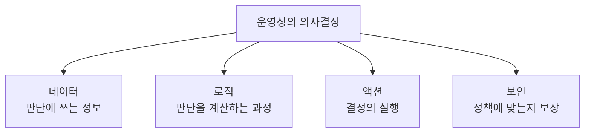
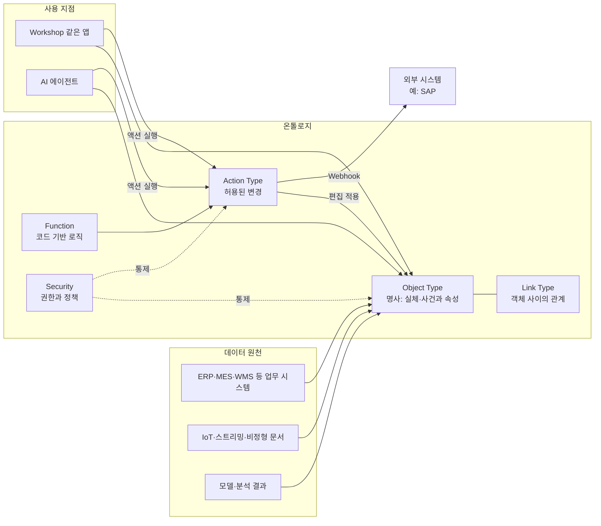
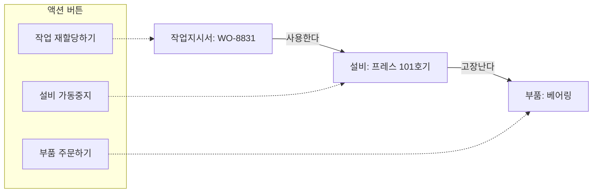
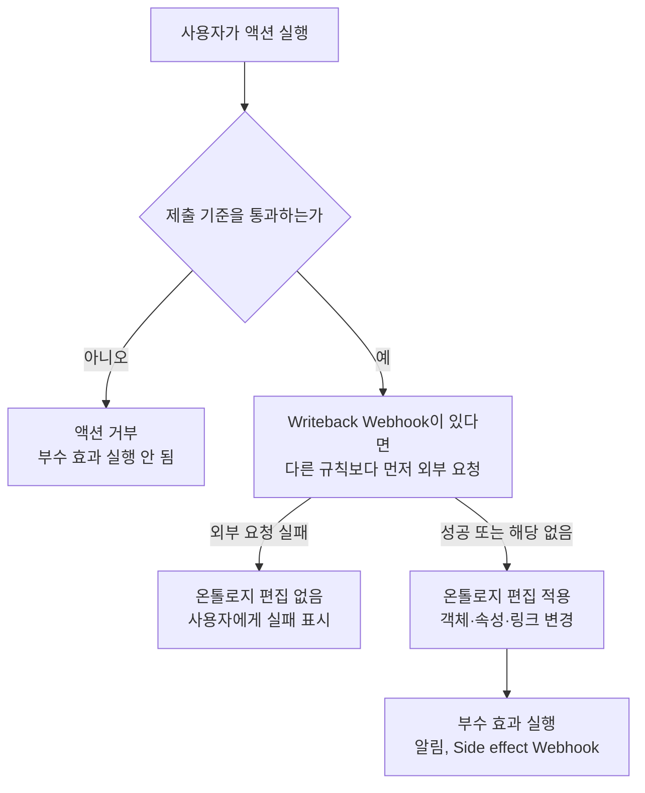
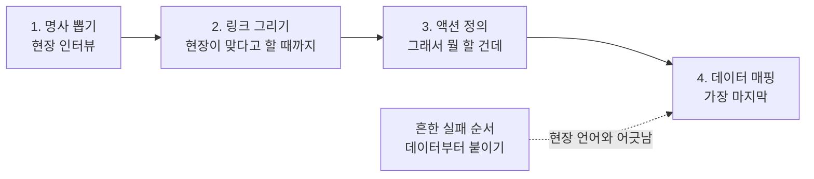

Threads 게시글 「팔란티어에서 온톨로지 얘기할 때 철학책 덮어라」에 담긴 주장을 팔란티어 공식 문서와 대조하며 풀어 쓴 해설

- 작성일: 2026-11-05
- 대상 글: https://www.threads.com/share/BAVbzVICFC (4개 묶음으로 이어지는 게시글)
- 조사 방식: 팔란티어 공식 문서(palantir.com/docs)를 직접 열어 본문을 확인했고, 최신 동향은 제3자 해설과 파트너사 글로 보완했습니다.

## 0. 이 문서를 읽는 법

이 문서에서는 내용의 근거를 세 가지로 구분해 표시합니다. 근거의 강도가 서로 다르기 때문에, 어떤 문장이 어디에서 왔는지 바로 알 수 있어야 한다고 보았습니다.

| 표시 | 의미 |
| --- | --- |
| [공식] | 팔란티어 공식 문서 본문에서 직접 확인한 내용 |
| [제3자] | 파트너사, 해설 블로그, 기사 요약 등 팔란티어 밖에서 정리한 내용 |
| [게시글] | 대상 Threads 게시글 작성자의 설명 또는 주장 |

게시글은 온톨로지를 "회사를 코드로 만든 디지털 쌍둥이"라고 소개합니다. 이 한 문장이 글 전체의 핵심이며, 나머지는 그 문장을 구체화하는 설명입니다. 문서의 흐름은 다음과 같습니다. 먼저 온톨로지가 무엇이고 왜 만드는지를 짚고, 구성요소를 하나씩 살펴본 뒤, 공장 현장 예시를 따라가 봅니다. 그다음 일반 데이터베이스와의 차이, 만드는 순서와 실패 패턴, 2026년 기준 최신 동향을 다루고, 마지막에 게시글의 주장 하나하나를 공식 문서와 대조한 검증표를 붙였습니다.

## 1. 한눈에 보는 요약

게시글의 요지는 온톨로지를 철학적 개념으로 받아들이지 말고, 현장 사람이 쓰는 말로 데이터를 다시 짜는 작업으로 보라는 것입니다. 주문, 설비, 환자, 작업지시서처럼 현장에서 명사로 부르는 것들을 객체로 만들고, 그 사이의 관계를 링크로 이어 주고, "이 화면을 보고 무엇을 할 것인가"에 대한 답을 액션(버튼)으로 정의합니다. 데이터는 가장 마지막에 이 구조에 붙입니다.

팔란티어 공식 문서도 큰 방향에서는 같은 이야기를 합니다. [공식] 온톨로지는 조직을 위한 "운영 계층(operational layer)"이고, 많은 경우 조직의 디지털 트윈 역할을 하며, 객체·속성·링크라는 의미 요소와 액션·함수·동적 보안이라는 운동(kinetic) 요소를 함께 담습니다. 또 공식 문서는 온톨로지가 단순한 데이터가 아니라 기업의 "의사결정"을 표현한다고 설명합니다.

다만 게시글에는 공식 문서와 어긋나거나 확인하지 못한 부분도 있습니다. 가장 중요한 것은 "액션이 유일한 쓰기 경로"라는 표현입니다. 공식 문서에는 액션 외의 편집을 허용하는 설정이 존재하고, 다만 "액션을 통해서만 편집"하는 방식을 권장한다고 되어 있습니다. 자세한 대조는 8장에 정리했습니다.

## 2. 온톨로지란 무엇이고 왜 만드는가

### 2.1 공식 정의: 데이터 위에 올리는 운영 계층

[공식] 팔란티어 문서는 온톨로지를 조직을 위한 운영 계층이라고 정의합니다. 이 계층은 플랫폼에 통합된 디지털 자산, 즉 데이터셋, 가상 테이블, 모델 위에 놓이고, 그것들을 공장·설비·제품 같은 물리적 자산이나 고객 주문·금융 거래 같은 개념 등 실세계의 대응물과 연결합니다. 문서는 많은 환경에서 온톨로지가 조직의 디지털 트윈 역할을 한다고 말하고, 그 안에 의미 요소(객체, 속성, 링크)와 운동 요소(액션, 함수, 동적 보안)가 모두 들어 있다고 설명합니다.

여기서 "디지털 트윈"이라는 표현이 게시글의 첫 문장과 정확히 맞닿습니다. 다만 게시글의 "코드로 만든"이라는 수식은 저자의 표현이고, 공식 문서의 표현은 아닙니다.

### 2.2 왜 만드는가: 데이터가 아니라 결정을 담는다

[공식] "Why create an Ontology?" 문서는 온톨로지가 단순히 데이터가 아니라 기업의 의사결정을 표현한다고 말합니다. 기존 데이터 구조는 의사결정에 들어간 추론과 그 뒤에 이어지는 행동을 담지 못하고, 그래서 학습과 AI 활용에 한계가 있다는 논리입니다.

문서는 하나의 운영상 의사결정을 네 가지 요소로 분해합니다. 정보(데이터), 평가 과정(로직), 결정의 실행(액션), 그리고 결정이 운영 정책에 맞는지를 보장하는 보안입니다. 온톨로지는 이 네 요소를 한곳에 묶어 사람과 AI 에이전트가 함께 쓸 수 있게 합니다.

[공식] 같은 문서는 비유도 하나 제시합니다. 온톨로지의 데이터 요소(실세계 객체와 링크)를 "명사", 액션을 "동사"라고 부르며, 모든 업무 흐름은 명사와 동사가 사람 또는 AI의 추론을 거쳐 문장으로 완성되는 과정이라고 설명합니다. 게시글의 "Object = 명사, Action = 동사 버튼"은 이 비유와 같은 계열입니다.

### 2.3 한 장으로 보는 전체 구조

아래 다이어그램은 공식 문서의 설명을 바탕으로 데이터 원천, 온톨로지, 사용 지점의 관계를 단순화한 것입니다. 실선은 데이터나 호출의 흐름, 점선은 통제 관계를 뜻합니다.

## 3. 구성요소를 하나씩 살펴보기

### 3.1 Object Type(객체 유형): 현장의 명사

[공식] 객체 유형은 "실세계 개체 또는 사건(entity or event)의 스키마 정의"입니다. 객체는 그 유형의 개별 인스턴스이고, 객체 집합(object set)은 여러 객체의 묶음입니다. 문서의 예로 `Employee`라는 객체 유형이 있고, 특정 직원이 객체, "근속 직원 전체"가 객체 집합입니다. 개체뿐 아니라 사건도 객체가 될 수 있다는 점이 눈에 띕니다. 공식 문서는 `Flight`(항공편)를 예로 듭니다.

데이터와의 대응은 공식 문서가 표로 정리해 두었습니다. 이미 표 형태의 데이터에 익숙한 분이라면 이 표가 가장 빠른 이해의 열쇠입니다.

| 데이터셋 | 온톨로지 |
| --- | --- |
| 데이터셋 | 객체 유형 |
| 행(Row) | 객체 |
| 열(Column) | 속성 |
| 셀의 값 | 속성 값 |
| 조인(Join) | 링크 유형 |

[공식] 객체는 두 경로로 생깁니다. 하나는 객체 유형에 백킹 데이터소스를 연결하는 것이고, 다른 하나는 객체를 만드는 액션을 설정하는 것입니다. 모든 객체가 액션으로만 만들어진다면 백킹 데이터소스 없이 객체 유형을 만들 수도 있습니다. 게시글이 말한 "실제 데이터셋이 뒤에 붙어 있다"는 첫 번째 경로를 가리킵니다.

속성(Property)은 [공식] "실세계 개체 또는 사건이 가진 특성의 스키마 정의"입니다. 여러 객체 유형이 공통으로 쓰는 속성은 공유 속성(shared property)으로 관리할 수 있고, 여러 객체 유형이 공통의 모양과 기능을 가질 때는 인터페이스(interface)로 추상화합니다. 게시글은 기본 요소를 "3가지 + 알파"로 단순화했기 때문에 인터페이스는 언급하지 않았지만, 공식 문서에서는 설계가 커질수록 중요해지는 요소입니다.

### 3.2 Link Type(링크 유형): 객체 사이의 관계

[공식] 링크 유형은 두 객체 유형 사이 관계의 스키마 정의이고, 링크는 그 관계의 개별 인스턴스입니다. 데이터 관점에서는 조인에 해당하지만, 의미 관점에서는 "이 직원의 상사", "이 장비를 만든 공장"처럼 현장 언어로 읽히는 관계입니다. 공식 설계 가이드는 링크 이름을 관계가 드러나게 지으라고 권합니다. 예를 들어 막연한 "관련 항목(Related Item)" 대신 `Supervisor`(상사)나 `Manufacturing Facility`(제조 시설) 같은 이름을 쓰라는 식입니다.

게시글은 링크를 "명사들 사이의 동사"로 설명하고 고객-주문한다, 환자-진료받는다-의사 같은 예를 듭니다. 현장 사람이 문장처럼 읽을 수 있게 만들라는 취지로는 매우 좋은 설명입니다. 다만 공식 분류에서는 링크가 객체, 속성과 함께 의미(semantic) 요소에 속하고, 동사에 해당하는 운동 요소는 액션입니다. 8장에서 이 차이를 다시 다룹니다.

### 3.3 Action Type(액션 유형): 세상을 바꾸는 버튼

[공식] 액션 유형은 사용자가 한 번에 수행할 수 있는 객체·속성 값·링크의 변경 묶음에 대한 정의이며, 액션을 제출했을 때 일어나는 부수 효과(side effect)까지 포함합니다. 액션은 "하나의 트랜잭션"으로서, 개별 속성 편집이 아니라 업무 목적 단위로 데이터를 바꾸게 해 줍니다.

공식 문서의 예시가 이해에 도움이 됩니다. `Assign Employee`라는 액션 유형은 `Employee` 객체의 `role` 속성을 바꾸는 방법을 정의하고, 새 역할을 표준화된 형태로 입력받는 파라미터가 있으며, 새 `Manager`와 링크를 자동으로 만드는 규칙을 넣을 수 있습니다. 여기에 이전·새 관리자에게 알림을 보내는 부수 효과를 붙이고, 인사 부서 직원만 실행할 수 있도록 검증을 거는 것도 가능합니다.

이 예시에서 게시글이 말한 세 가지, 즉 파라미터, 검증 규칙, 사이드이펙트가 모두 확인됩니다. 공식 문서의 용어로는 다음과 같이 대응합니다.

| 게시글의 표현 | 공식 문서의 용어 | 하는 일 |
| --- | --- | --- |
| 파라미터 | Parameters | 사용자가 입력하는 값을 표준화된 형태로 받음 |
| 검증 규칙 | Submission criteria(제출 기준) | 누가, 어떤 조건에서 실행할 수 있는지 세밀하게 통제 |
| 변경 내용 | Rules(규칙) | 객체 생성·수정·삭제, 링크 관리, 함수 실행 등 |
| 사이드이펙트 | Side effects | 알림(이메일 포함), Webhook, 빌드 트리거 등 |

공식 문서는 이 밖에도 함수 기반 액션(function-backed action), 테스트 실행(test run), 액션 로그, 모니터링, 되돌리기(undo/revert), 브랜치에서의 액션 같은 운영 기능을 따로 문서화하고 있습니다. 목차에서 확인되는 항목이며, 이 문서에서는 이름만 소개합니다.

실행 권한에 대해서도 공식 문서가 구체적입니다. [공식] 액션을 제출하려면 사용자가 그 액션이 편집하는 객체 유형·링크 유형과 그 데이터소스를 볼 수 있어야 하고, 제출 기준을 통과해야 합니다. 제출 기준을 통과하지 못하면 부수 효과도 실행되지 않습니다.

### 3.4 "알파": Function과 Security

게시글은 알파로 Function과 Security를 꼽습니다. 공식 개요 문서의 구분과 일치합니다. 개요는 운동 요소를 "액션, 함수, 동적 보안"으로 나열합니다.

**Function(함수).** [공식] 입력 파라미터를 받아 결과를 돌려주는 코드 기반 로직입니다. 온톨로지와 기본적으로 통합되어 있어 객체와 객체 집합을 입력으로 받고, 객체의 속성 값을 읽고, 액션 유형과 온톨로지 위에서 만든 애플리케이션 어디서든 쓸 수 있습니다. 공식 개요는 액션이 "조직의 통제를 지키면서 변화를 일으키는" 장치이고, 함수는 "임의의 복잡도를 가진 비즈니스 로직을 작성하고 발전시키는" 수단이라고 말합니다. 함수 기반 액션을 쓰면 객체가 어떻게 바뀌어야 하는지를 코드로 정의하는, 훨씬 복잡한 액션도 만들 수 있습니다.

**Security(보안).** 이 부분은 게시글이 "누가 뭘 볼 수 있고, 어떤 로직을 태울지"라고 짧게 정리한 것에 비해 공식 문서의 층이 깊습니다. 핵심만 짚으면 다음과 같습니다.

- [공식] 역할(Roles)은 온톨로지의 중심 권한 모델이며, 온톨로지 전체 또는 개별 리소스 단위로 부여할 수 있습니다.
- [공식] 온톨로지의 보안 통제는 객체 유형, 링크 유형, 액션 유형과 객체·링크 데이터 자체까지 모두 대상으로 합니다.
- [공식] 객체 보안 정책(object security policy)은 백킹 데이터소스의 권한과 별개로, 객체 유형에 직접 설정해 객체 인스턴스별 조회 권한을 정합니다. 행 단위 보안(row-level security)을 구현하는 수단이며, 공식 문서는 온톨로지 기반 사용 사례 대부분에서 제한된 뷰(restricted view)보다 객체 보안 정책을 권장하고 이전 도구도 제공합니다.
- [공식] 정책은 사용자 그룹 속성(SSO로 들어오는 것 포함), 마킹(markings), 원천 데이터에 적용된 행·열 제한 등을 조합해 상호작용마다 실행 시점에 계산됩니다.
- [공식] 도구 호출도 같은 보안 체계의 통제를 받습니다. 최소한 도구를 호출하려면 그 밑에 있는 객체·속성·링크에 대한 접근 권한이 있어야 합니다.

## 4. 현장 예시 따라가기: 프레스 101호기

이 장은 게시글이 든 예시를 따라가며 구조를 눈으로 익히기 위한 것입니다. 예시는 게시글 작성자가 가정한 상황이며, 팔란티어가 공개한 실제 고객 사례가 아닙니다. 데이터팀이 "ERP 테이블 3개를 조인해 출하 지연 리스트를 뽑아왔다"고 해도 현장에서는 쓸 수 없다는 문제 제기에서 출발합니다. 온톨로지 방식으로 바꾸면 다음과 같이 정리됩니다.

세 개의 객체(설비, 작업지시서, 부품)가 있고, 두 개의 링크(설비가 부품을 고장 낸다, 작업지시서가 설비를 사용한다)가 있으며, 세 개의 액션(부품 주문, 설비 가동중지, 작업 재할당)이 있습니다. 공장 반장이 앱에서 프레스 101호기를 누르면 연결된 고장 이력, 현재 작업, 재고가 한 화면에 모이고, 거기서 버튼을 눌러 부품 주문 액션을 실행하면 SAP에 쓰기가 일어난다는 것이 게시글의 시나리오입니다.

이 시나리오를 가능하게 하는 공식 기능은 실제로 존재합니다. [공식] 객체 보기(Object Views)는 특정 객체와 관련된 정보와 워크플로의 중심 허브로, 핵심 정보, 연결된 객체, 관련 지표, 분석·대시보드·애플리케이션을 한곳에 모읍니다. [공식] Workshop은 온톨로지 위에서 코드 없이 포인트앤클릭으로 애플리케이션을 만드는 도구입니다. 공식 문서는 Workshop과 Slate 같은 도구는 사전에 "빌더"가 구성해야 쓸 수 있다고도 설명합니다. 즉 "현장 앱"은 온톨로지를 만든 뒤에 별도로 구성하는 단계가 필요합니다.

### 4.1 "SAP로 write-back"이 실제로 뜻하는 것

게시글의 "SAP로 Write-back된다"는 문장은 두 가지 서로 다른 쓰기가 섞여 있어서 풀어 둘 필요가 있습니다.

**첫째는 온톨로지 안의 쓰기입니다.** [공식] 액션으로 만들어진 변경은 사용자가 액션을 실행하는 순간 온톨로지에 반영되어 모든 사용자 애플리케이션에 보이고, 사용자 편집이 반영된 최신 객체 데이터는 객체 유형의 "라이트백 데이터셋(writeback dataset)"에 담깁니다.

**둘째는 외부 시스템으로의 쓰기입니다.** [공식] 이는 Webhook으로 구현합니다. Webhook은 Data Connection의 개념으로, Salesforce, SAP, 또는 설정된 임의의 HTTP 서버 같은 외부 시스템에 요청을 보내 그쪽 데이터를 바꾸게 하는 장치입니다. 즉 SAP 예시는 공식 문서에서도 직접 언급되는 연결 대상입니다. 다만 [공식] Webhook 부수 효과는 기본적으로 활성화되어 있지 않고, Data Connection에서 Webhook 플러그인을 구성하려면 추가 권한이 필요합니다.

Webhook에는 두 가지 방식이 있고, 실행 순서와 실패 시 동작이 다릅니다.

| 구분 | Writeback Webhook | Side effect Webhook |
| --- | --- | --- |
| 실행 시점 | 다른 규칙이 평가되기 전에 요청 전송 | 객체 편집이 적용된 뒤에 요청 전송 |
| 외부 요청이 실패하면 | 온톨로지 편집이 적용되지 않고 사용자에게 실패가 표시됨 | 실패가 최종 사용자에게 보이지 않을 수 있음(이미 성공 메시지를 본 뒤일 수 있음) |
| 적합한 상황 | 외부 시스템이 진실의 원천이라 먼저 성공해야 할 때 | 알림이나 후속 동기화처럼 편집 뒤에 해도 되는 일 |

공식 문서는 Writeback Webhook을 쓰면 외부 요청이 실패했을 때 Foundry 변경이 일어나지 않는 "어느 정도의 트랜잭션성"이 생기지만, 외부 요청은 성공했는데 온톨로지 변경이 실패하는 경우는 여전히 가능하다고 분명히 적어 두었습니다. 외부 연동을 설계할 때 꼭 기억할 부분입니다.

### 4.2 안전장치: 시험과 브랜치

공식 문서는 실제 시스템에 잘못 쓰는 사고를 막기 위한 장치도 갖추고 있습니다.

- [공식] 테스트 실행은 현재 온톨로지 브랜치에서 사용자 본인의 권한으로 실행되며, 일반 제출과 같은 객체 보안과 제출 기준을 적용합니다. 액션이 적용된 뒤에 일어날 부수 효과 중 일부는 건너뜁니다. 다만 결과를 알아내는 데 필요한 외부 호출은 실제로 실행될 수 있어서, 외부 호출이 있으면 확인을 거친 뒤 진행합니다.
- [공식] 브랜치에서 액션을 실행할 때 기본값은 Webhook을 실행하지 않는 것입니다. 시험 환경에서 외부 시스템에 실수로 쓰는 것을 막기 위함입니다. 외부 호출이 들어간 함수 기반 액션도 기본적으로 브랜치에서는 실패하도록 되어 있고, 필요하면 액션 유형 설정에서 허용으로 바꿀 수 있습니다.

## 5. 일반 DB·데이터웨어하우스와 무엇이 다른가

게시글은 비교표와 함께 "DB는 과거가 어땠나를 답하고, 온톨로지는 지금 뭘 해야 하나를 답한다"고 요약합니다. 이 비교를 공식 문서의 관점과 나란히 놓으면 다음과 같습니다.

| 관점 | 일반 데이터 모델 | 팔란티어 온톨로지 | 근거 |
| --- | --- | --- | --- |
| 기본 단위 | 행, 외래 키 | 객체, 링크 | [공식] 데이터셋 대응표 |
| 변경의 방식 | 쿼리나 저장 프로시저 | 액션과 함수 | [게시글] 비유이며, 공식 대응표는 아님 |
| 쓰기 | 보통 원천 시스템에서 | 액션을 통한 편집과 외부 시스템 write-back | [공식] 액션, 라이트백 데이터셋, Webhook |
| 이해하는 사람 | 데이터 분석가 | 현장 작업자와 AI 에이전트 | [공식] 설계 가이드는 사용자와 AI 에이전트가 마찰 없이 탐색할 수 있어야 한다고 강조 |
| 질문의 성격 | 과거가 어땠나 | 지금 무엇을 결정하고 실행할 것인가 | [공식] 의사결정 중심이라는 설명과 취지 일치 |

공식 문서가 이 차이를 가장 직접적으로 설명한 문장은 이렇게 요약됩니다. [공식] 의사결정이 실시간으로 이루어질 때 그 실행의 고리를 닫는 것이 운영 시스템과 분석 시스템을 구분 짓는다는 것입니다. 게시글이 "액션이 없으면 그냥 BI"라고 한 것과 같은 말입니다.

주의할 점은 "읽기 전용 DB vs 읽기·쓰기 온톨로지"라는 단순한 구도가 모든 경우에 맞지는 않는다는 것입니다. 일반 데이터 시스템에도 쓰기는 있고, 온톨로지는 쓰기에 승인·검증·로그·권한을 입혔다는 점이 차별점이라고 보는 편이 정확합니다.

## 6. 만드는 순서와 망하는 패턴

### 6.1 게시글이 제안하는 순서

게시글은 네 단계를 제시하고 "이 순서가 아니면 망한다"고 강조합니다.

이 순서는 공식 설계 가이드의 첫 번째 원칙과 맞닿아 있습니다. [공식] 모범 사례의 첫 원칙은 "도메인 주도 설계"로, 온톨로지는 원천 데이터가 아니라 실세계를 모델링해야 한다는 것입니다. 구체적인 실천 항목에는 "원천 스키마를 보기 전에 실세계 개체부터 정의하라", "도메인을 모델링한 다음 데이터를 매핑하라", "사람이 읽는 이름을 붙여라"가 포함됩니다. 공식 문서의 예시도 흥미롭습니다. `order_id`, `customer_name`, `customer_email`, `product_sku`, `quantity` 열이 있는 CSV 한 개는 사실 주문, 고객, 제품이라는 세 개 이상의 실세계 개체를 담고 있으므로 객체 유형을 세 개로 나누고 링크로 연결하라는 것입니다.

한편 게시글의 숫자들은 공식 문서에 근거가 없습니다. "명사 10개만", "100개 뽑으면 망한다", "Palantir FDE들은 2주 안에 Object 5개, Action 2개로 운영부터 돌린다" 같은 표현은 저자의 경험칙으로 읽어야 합니다. 다만 방향성, 즉 작게 시작해 점진적으로 개선하라는 점은 공식 문서와 일치합니다. [공식] 가이드는 "큰 한 방의 리팩터링보다 점진적 개선을 선호하라", "완벽하지만 아직 설계 중인 온톨로지보다 약간 불완전해도 쓰이고 가치를 내는 온톨로지가 낫다"고 말합니다. 또 [공식] 실제 비즈니스 질문을 합격 기준으로 삼아 검증하라는 항목도 있습니다.

### 6.2 게시글이 꼽은 망하는 패턴 3가지와 공식 안티패턴

게시글이 꼽은 세 가지는 공식 안티패턴 문서와 잘 겹칩니다.

| 게시글의 패턴 | 공식 문서에서 대응하는 안티패턴 |
| --- | --- |
| 데이터 사전 만들기: ERD처럼, IT 용어로 만듦 | 원천 시스템 표를 그대로 본뜬 객체 유형, "Kitchen Sink"(불필요한 기술 열을 속성으로 노출), "Misnomer"(`dtLastInspMod` 같은 모호한 이름) |
| Action 없이 Object만: 화려한 대시보드, "그래서 어쩌라고?" | 행동으로 이어지지 않는 모델은 분석 시스템에 머무른다는 공식 설명(2장 참고) |
| 너무 거창하게: 전사 온톨로지 1년짜리 프로젝트 | 직접 대응하는 안티패턴은 없지만, 큰 한 방의 리팩터링보다 점진적 개선을 선호한다는 공식 가이드와 같은 방향. 한 객체 유형이 모든 것을 떠안는 설계는 God Object로 분류 |

공식 안티패턴 문서는 전부 여덟 가지를 다룹니다. 게시글이 다루지 않은 것까지 알아 두면 실무에 도움이 되어 아래에 모았습니다.

| 안티패턴 | 설명 | 해법 |
| --- | --- | --- |
| System Silos | 원천 시스템마다 별도 객체 유형을 만듦 | 파이프라인에서 병합해 하나의 통합 객체 유형으로 |
| The Kitchen Sink | 기술적 열까지 전부 속성으로 노출 | 업무 의미가 있는 속성만 선별 |
| Department Silos | 부서마다 같은 개체의 자기 버전을 만듦 | 공유 객체 유형을 만들고 부서별 정보는 속성·링크로 |
| The God Object | 하나의 객체 유형이 여러 개체를 떠안음 | 개체별로 분리하고 공통점은 인터페이스로 |
| The Golden Hammer | 한 가지 도구(액션, 파이프라인, 함수)만 모든 문제에 사용 | 일에 맞는 도구 선택 |
| Action Sprawl | 속성 하나만 바꾸는 액션을 수없이 만듦 | 업무 단위로 묶인 응집된 액션 |
| The Time Machine | 과거 버전을 별도 객체나 객체 유형으로 만듦 | 개체당 객체 하나, 이력은 연결된 객체나 시계열로 |
| The Misnomer | 모호하거나 오해를 부르는 이름 | 구체적이고 자기 설명적인 이름 |

여기서 특히 짚을 대목은 "Golden Hammer"와 "Action Sprawl"입니다. 게시글은 "액션이 있어야 현장에서 쓸 수 있다"를 강조하는데, 공식 문서는 그 반대편의 실수도 경고합니다. 액션은 [공식] "사람이나 에이전트의 결정, 사용자가 시작하는 소수 객체의 편집"에 적합하고, 일괄 계산, 예약 갱신, 사람 개입이 없는 이벤트 반응에는 파이프라인이나 자동화가 맞다고 정리합니다. 예를 들어 지역별 매출 합계를 계산하라고 사용자가 누르는 액션을 만들기보다 파이프라인으로 미리 계산해 두라는 것입니다. 또 액션 이름이 `Update Employee Phone`처럼 속성 이름으로 끝나면 위험 신호이고, `Transfer Employee to New Department`처럼 업무 동작으로 지으라고 권합니다. 프레스 101호기 예시의 "부품 주문하기", "작업 재할당하기"가 후자의 좋은 이름 짓기에 해당합니다.

### 6.3 이 글을 바탕으로 한 설계 점검 질문

공식 설계 가이드의 여덟 가지 지침을 질문 형태로 바꿔 두었습니다. 처음 모델링할 때 점검표로 쓸 수 있습니다.

1. 객체 유형이 원천 시스템이나 부서가 아니라 실세계 개체를 대표하는가.
2. 모든 속성에 분명한 업무적 가치가 있는가.
3. 여러 부서가 함께 설계에 참여했는가.
4. 하나의 객체 유형이 하나의 뚜렷한 개체만 나타내는가.
5. 사람이나 에이전트의 결정에는 액션을, 자동 변환에는 파이프라인을 쓰고 있는가.
6. 공통 특성은 넓고 성긴 객체 유형이 아니라 인터페이스로 모델링했는가.
7. 객체 유형, 속성, 링크를 Ontology Manager에 문서화했는가.
8. 실제 비즈니스 질문으로 사람과 에이전트가 온톨로지를 탐색할 수 있는지 시험해 보았는가.

## 7. 최신 동향: AI 에이전트와 온톨로지 (2026년)

### 7.1 공식 문서가 말하는 방향

[공식] 최근 공식 문서는 온톨로지를 사람과 AI 에이전트가 함께 일하는 토대로 설명합니다. "Why create an Ontology?" 문서는 에이전트가 사람과 같은 보안 정책 아래에서 움직이고, 각 에이전트를 "새 팀원"처럼 다루며 신뢰가 쌓이면서 권한 범위를 넓혀 간다고 설명합니다. 문서가 든 가상의 제조사 시나리오에서는 AI가 기본적으로 액션을 "준비(stage)"만 하고 사람이 최종 검토하며, 충분히 검증된 AI 프로세스에 한해 검토 없이 액션 루프를 닫는 것도 선택할 수 있다고 합니다. 또 사람과 에이전트의 액션을 온톨로지 시나리오(scenario)로 샌드박스에 먼저 담아 영향을 살펴본 뒤 확정할 수 있다고 설명합니다.

개발자 쪽에서는 [공식] 온톨로지 SDK(OSDK)가 개발 환경에서 온톨로지를 직접 다루게 해 줍니다. 온톨로지에서 생성된 타입 안전한 함수와 타입을 쓰고, 토큰은 앱이 접근하도록 지정한 온톨로지 요소로 범위가 한정되며 사용자 본인의 권한도 함께 적용됩니다. 읽기뿐 아니라 최소한의 코드로 쓰기도 지원합니다.

### 7.2 2026년 주요 일정 (제3자 정리 기준)

아래 일정은 팔란티어 발표를 요약한 제3자 글에서 확인한 것입니다. 이번 조사에서 공식 발표 원문을 직접 열어 보지는 못했으므로, 날짜와 세부 기능은 공식 릴리스 노트로 한 번 더 확인하시기를 권합니다.

| 시기 | 내용 | 근거 |
| --- | --- | --- |
| 2026-03-31 발표, 2026-04-13 주 GA | AIP Analyst: 온톨로지를 검색하고 분석 단계를 보여 주는 분석 에이전트 | [제3자] |
| 2026-05 (18일 주 GA) | Global Branching: 데이터 변환, 파이프라인, 온톨로지, Workshop, AIP Logic 등을 격리된 브랜치에서 수정·테스트한 뒤 검토를 거쳐 병합 | [제3자] |
| 2026-06 | Ontology MCP, Palantir MCP 발표 | [제3자] |
| 2026-07-09 | Claude Agent SDK, OpenAI Agents SDK, Google ADK용 에이전트 SDK 템플릿 발표 | [제3자] |
| 2026-07 | 프로코드 에이전트, Automate 브랜치 지원 | [제3자] |
| 2026-07-21 | 권한 디버그, 제한된 뷰 관련 업데이트 | [제3자] |

[제3자] 같은 요약글에 따르면 Ontology MCP는 온톨로지 SDK를 추가하면 객체 유형, 액션, 쿼리 함수를 모델이 발견할 수 있는 도구로 노출합니다. 또한 게시되는 에이전트는 온톨로지에 묶이고 API 이름을 가지며 비동기 비즈니스 함수처럼 다뤄지고, 권장 트리거는 Automate이지만 Workshop, OSDK, 온톨로지 액션으로도 호출할 수 있다고 합니다. 이 글은 외부 모델이나 MCP 클라이언트가 온톨로지에 연결될 때 데이터가 외부로 노출될 수 있으므로 자원 노출 정책과 감사 요건을 에이전트 구조에 넣어야 한다는 점도 짚습니다. 이는 해설자의 판단이지 공식 문서의 문장은 아니지만, 앞서 본 "에이전트도 같은 보안 체계 아래에서"라는 공식 원칙과 방향이 일치합니다.

[제3자] 파트너사 글은 AIP를 2023년 4월에 출시된 생성형 AI 플랫폼으로 소개하며, Foundry 안에서 AIP Logic(코드 없이 LLM 기반 함수 구축), AIP Chatbot Studio(이전 이름 AIP Agent Studio, 온톨로지 데이터 기반 어시스턴트), AIP Evals, AIP Assist 같은 도구로 나타난다고 정리합니다. 이름은 바뀌는 경우가 있으니 사용 전에 공식 문서의 현재 명칭을 확인하세요.

공식 문서 목차에서 확인되는 상태 표기도 하나 전해 둡니다. 객체 저장소 v1(Phonograph)은 "계획된 폐기(Planned deprecation)"로 표시되어 있고, 구체적인 종료 일자는 제3자 글에서만 보았습니다. 오래된 환경을 운영한다면 공식 마이그레이션 문서를 확인해야 합니다.

## 8. 게시글 내용 검증표

게시글의 주장을 공식 문서와 하나씩 대조한 결과입니다. 판정 기준은 다음과 같습니다. 확인은 공식 문서 본문에서 같은 취지를 확인한 경우, 부분 확인은 취지는 맞지만 표현이나 범위가 다른 경우, 확인 못함은 이번에 열어 본 공식 문서에서 찾지 못한 경우, 수정 필요는 공식 문서와 어긋나는 경우입니다.

| 게시글의 주장 | 판정 | 설명 |
| --- | --- | --- |
| 온톨로지는 회사의 디지털 쌍둥이다 | 확인 | 공식 개요가 "조직의 디지털 트윈 역할"이라고 설명. "코드로 만든"은 저자의 수식 |
| 구성은 Object, Link, Action 세 가지에 Function, Security가 알파 | 확인 | 공식 개요가 의미 요소(객체·속성·링크)와 운동 요소(액션·함수·동적 보안)로 구분. 인터페이스 등 추가 요소도 있음 |
| Object는 현장의 명사, 실존하는 것 | 부분 확인 | 객체 유형은 개체뿐 아니라 사건도 포함(항공편 등) |
| 각 객체에 속성과 실제 데이터셋이 붙는다 | 확인 | 백킹 데이터소스를 연결하거나 액션으로 생성. 액션으로만 생성되면 백킹 데이터소스 없이도 가능 |
| 객체에 Primary Key가 있다 | 확인 못함 | 이번에 읽은 개요·핵심 개념 문서 본문에서는 명시적 설명을 찾지 못함 |
| 링크는 명사 사이의 동사이고 양방향 탐색이 가능하다 | 부분 확인 / 확인 못함 | 링크는 두 객체 유형 사이 관계라는 정의는 확인. 공식 분류상 링크는 의미 요소(명사 쪽)이며 동사는 액션. 양방향 탐색은 이번 문서에서 확인하지 못했고, 제3자 글 중에는 링크를 "방향이 있는" 관계로 설명한 곳도 있음 |
| Action은 읽기만 하는 DB와 가장 큰 차이이며 "허용된 변경"이다 | 확인 | 액션 유형은 사용자가 한 번에 할 수 있는 변경 묶음의 정의 |
| 액션에는 파라미터, 검증규칙, 사이드이펙트가 딸려 있다 | 확인 | 파라미터, 제출 기준, 규칙, 부수 효과(알림, Webhook 등) |
| 액션이 유일한 쓰기 경로다 | 수정 필요 | 공식 권한 문서에 액션 외 편집을 허용하는 설정이 있고, "액션을 통해서만 편집"이 권장 사항으로 적혀 있음. 권장 방식이지 유일한 경로는 아님 |
| 버튼을 누르면 SAP로 write-back 된다 | 부분 확인 | SAP는 Webhook 대상으로 공식 문서에 언급됨. 다만 Webhook 설정과 추가 권한이 필요하고 기본 비활성이며, 외부 요청 성공과 온톨로지 변경 성공이 항상 함께 보장되지는 않음 |
| Workshop 앱에서 객체를 클릭하면 이력, 작업, 재고가 다 보인다 | 가상 예시 | 객체 보기와 Workshop이 이런 화면을 구성하는 기능은 확인. 프레스 101호기 시나리오 자체는 저자의 가정 |
| Foundry 설명에도 "business-aware representation"이라고 한다 | 확인 못함 | 열어 본 공식 문서(개요, 핵심 개념, Why create an Ontology)에서 이 문구를 찾지 못함. 공식 표현은 "운영 계층", "디지털 트윈", "의사결정을 표현" |
| View, Stored Procedure는 Action Type, Function에 대응한다 | 저자의 비유 | 공식 대응표는 데이터셋-객체 유형, 행-객체, 열-속성, 조인-링크 유형 |
| 순서는 명사, 링크, 액션, 데이터 매핑 | 확인 | 공식 모범 사례: "도메인을 모델링한 다음 데이터를 매핑하라" |
| 명사 10개, 2주 안에 Object 5개와 Action 2개 | 확인 못함 | 공식 문서에 수치 기준 없음. 점진적 개선이라는 방향은 일치 |
| 액션이 없으면 그냥 BI다 | 취지 확인 | 실행의 고리를 닫는 것이 운영 시스템과 분석 시스템을 가른다는 공식 설명과 일치. 단, 모든 변경을 액션으로 만들지는 말라는 안티패턴도 함께 공식화되어 있음 |

## 9. 마무리: 어떻게 받아들이면 좋은가

게시글의 장점은 복잡한 개념을 "명사, 관계, 버튼"으로 줄여서 현장 사람에게 말할 수 있는 형태로 만들었다는 데 있습니다. 공식 문서의 큰 줄기, 즉 온톨로지는 데이터를 현장의 언어로 옮기고, 거기에 실행과 보안을 결합해 의사결정을 담는 계층이라는 점과 어긋나지 않습니다.

다만 입문용 요약이다 보니 세부는 단순화되어 있습니다. 링크를 동사로 읽는 것은 이해를 돕는 장치로 좋지만 공식 분류와는 다르고, "액션이 유일한 쓰기 경로"는 권장 사항을 규칙처럼 말한 것이며, 숫자 기준과 일정은 저자의 경험에서 나온 이야기입니다. 이 글을 출발점으로 삼되, 실제로 설계할 때는 공식 문서의 설계 가이드(모범 사례, 구조 가이드, 안티패턴, 검증)를 함께 보시기를 권합니다.

## 10. 참고 자료

모든 링크는 2026-11-05에 확인했습니다. 제3자 자료는 공식 발표 원문이 아니므로 날짜와 세부 사항은 공식 릴리스 노트로 교차 확인이 필요합니다.

### 팔란티어 공식 문서

- Ontology 개요: https://www.palantir.com/docs/foundry/ontology/overview/
- Why create an Ontology?: https://www.palantir.com/docs/foundry/ontology/why-ontology/
- Core concepts: https://www.palantir.com/docs/foundry/ontology/core-concepts/
- Object types 개요: https://www.palantir.com/docs/foundry/object-link-types/object-types-overview/
- Action types 개요: https://www.palantir.com/docs/foundry/action-types/overview/
- Action types 권한: https://palantir.com/docs/foundry/action-types/permissions
- Webhooks: https://www.palantir.com/docs/foundry/action-types/webhooks
- Explore other action types: https://palantir.com/docs/foundry/action-types/explore-action-types/
- Test run: https://palantir.com/docs/foundry/action-types/test-run/
- Branching action types: https://palantir.com/docs/foundry/action-types/branching-action-types/
- Ontology design: Best practices: https://www.palantir.com/docs/foundry/ontology/ontology-best-practices/
- Ontology design: Anti-patterns: https://www.palantir.com/docs/foundry/ontology/ontology-anti-patterns/
- Object and property security policies: https://palantir.com/docs/foundry/object-permissioning/object-security-policies/
- Object permissioning 개요: https://palantir.com/docs/foundry/object-permissioning/overview/
- Ontology-aware applications: https://palantir.com/docs/foundry/ontology/applications/
- Ontology SDK: https://palantir.com/docs/foundry/ontology-sdk/overview/index.html

### 제3자 자료

- BD Emerson (파트너사), Palantir ontology explained: https://www.bdemerson.com/article/palantir-ontology-explained
- BD Emerson (파트너사), What does Palantir do: https://www.bdemerson.com/article/what-does-palantir-do
- DataFun 요약, Palantir 2026 로드맵 정리: https://www.besthub.dev/articles/palantir-s-true-moat-enterprise-ai-agents-ontology-and-decision-layer-engineering-382f60db4c3c
- DataFun 요약, Claude·OpenAI·Google 에이전트를 공유 온톨로지에 통합하는 방식: https://www.besthub.dev/articles/how-palantir-unifies-claude-openai-and-google-agents-on-a-shared-ontology-e3d42d4c3800
- 대상 게시글: https://www.threads.com/share/BAVbzVICFC

작성 일자: 2026-11-05
